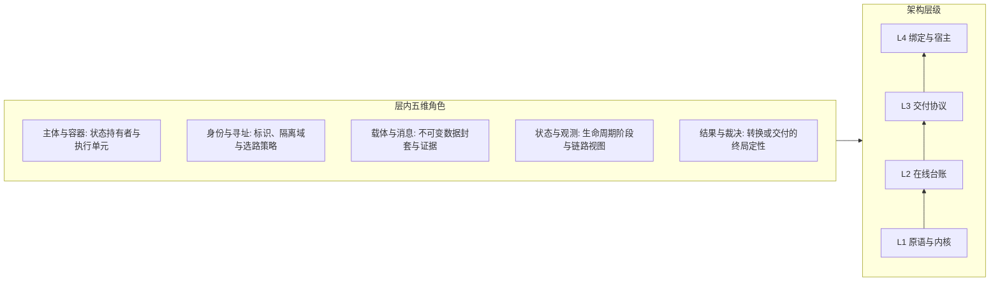

# L0-B: 领域词汇表

- **前置约定**：[00-conventions.md](00-conventions.md)

## 分类标准（架构层级 × 五维角色）

术语先按所属最低层级（`L1`–`L4`）归位，层内按五个正交维度细分（空维度省略）：

---

## L1 原语与内核

### L1 主体与容器

| 术语 | 定义 | 边界 |
| --- | --- | --- |
| `Operation` | 绑定固定 `operation_id`、不可变 `request` 与三态生命周期的单体状态机 | `request` 相同但 `operation_id` 不同视为独立实例；区别于未签发的 `Submission` |

### L1 载体与消息

| 术语 | 定义 | 边界 |
| --- | --- | --- |
| `OpaquePayload` | 含格式标识与原始字节流的不透明业务载荷 | 封装请求与结果，L1–L3 不解析其内容 |
| `Attempt` | 针对指定 `Operation` 的单次不可变执行授权（`attempt_id`, `operation_id`） | 重复传递同一 `Attempt` 不产生新授权 |
| `Report` | 绑定 `operation_id`、`attempt_id` 与 `result` 的不可变结果证据 | 业务级失败只要对应已结束 `Attempt`，仍属合法 `Report` |

### L1 状态与观测

| 术语 | 定义 | 边界 |
| --- | --- | --- |
| `OperationStatus` | `Operation` 三态枚举：`Ready`、`AwaitingReport`、`Closed` | 三态互斥完备 |
| `Ready` | 未关闭且无在途 `Attempt` 的状态 | 属 `OperationStatus`（初态或接受 `Report` 后状态）；区别于 L3 `PresenceState::Ready` |
| `AwaitingReport` | 唯一等待 `pending_attempt_id` 对应 `Report` 的状态 | 单实例同时至多一个在途 `Attempt`，期间禁止新签发或关闭 |
| `Closed` | 显式终结的不可逆终态 | 幂等关闭，不回退；接受 `Report` 不自动进入 `Closed` |

### L1 结果与裁决

| 术语 | 定义 | 边界 |
| --- | --- | --- |
| `KernelRejectionReason` | 单 `Operation` 因状态不符或引用失配拒绝转换的原因枚举 | 拒绝无副作用；区别于 L3 未建操作即返回的 `Outcome::Rejected` |

---

## L2 在线台账

### L2 主体与容器

| 术语 | 定义 | 边界 |
| --- | --- | --- |
| `Ledger` | 索引在线 `Operation` 并记录全局已签发 `attempt_id` 集合的内存台账 | 保证跨重试、跨 `Operation` 的 `attempt_id` 单次签发；不含网络与外部存储 |

### L2 结果与裁决

| 术语 | 定义 | 边界 |
| --- | --- | --- |
| `LedgerErrorReason` | `Ledger` 因身份冲突、目标缺失、`Attempt` 复用或内核拒绝报错的原因枚举 | 失败调用原子无副作用，不污染已用 `attempt_id` 集合 |

---

## L3 交付协议

### L3 主体与容器

| 术语 | 定义 | 边界 |
| --- | --- | --- |
| `Authority` | 持有私有 `Ledger` 与本地 `Registry`、负责选路、签发 `Attempt` 并验收 `Report` 的协调者 | 各 `Authority` 间不共享 `Ledger` 或 `Registry` |
| `Worker` | 发布 `Presence`、执行能力并产出 `Report` 的无台账执行者 | 共用 `Worker` 不共享或接管任何 `Authority` 的 `Operation` |
| `Registry` | `Authority` 按 `(Pool, RoleInstance)` 维护的本地 `Worker` 状态与租约视图 | 纯内存软状态，依赖状态格合流与本地单调时钟判定可用性 |

### L3 身份与寻址

| 术语 | 定义 | 边界 |
| --- | --- | --- |
| `RoleInstance` | 固定 `role_id` 与单次运行 `session_id` 组成的角色会话标识 | 锁定单次运行实例；禁止按 UUID 大小推断新旧 |
| `Pool` | 大小写敏感的路由隔离命名空间 | 限定 `Presence` 可见域与选路范围，不修剪或改写 |
| `CapabilityId` | 按字节精确匹配的带版本能力标识 | 同时约束 `Presence` 声明与 `Call` 准入，无隐式兼容 |
| `Selection` | 目标选定策略：`Any`（同池匹配能力任选其一）或 `Exact`（指定 `RoleInstance`） | 单次提交至多选路一次；`Exact` 不可达时直接拒绝，绝不回退 |

### L3 载体与消息

| 术语 | 定义 | 边界 |
| --- | --- | --- |
| `Presence` | `Worker` 向所属 `Pool` 发布的含 `RoleInstance`、能力集与 `PresenceState` 的完整快照 | 单份快照即可完成登记，无需增量补丁 |
| `Task` | 由 `CapabilityId` 与输入 `OpaquePayload` 组成的不可变任务内容 | 创建 `Operation` 时冻结为原始 `request` |
| `Submission` | 携带 `Pool`、`Selection` 与 `Task` 的外部提交封套 | 仅表提交意图，尚未创建 `Operation` 或 `Attempt` |
| `Call` | `Authority` 发往选定 `Worker`、携带已签发 `Attempt` 与 `Task` 的定向调用 | 仅传递既有授权，`Worker` 不生成新授权 |
| `WorkerResponse` | `Worker` 对 `Call` 的一次性响应：`Report`、准入拒收（`rejected_reason`）或执行异常（`failed_reason`） | 拒收代表未进入处理器；执行异常无法排除副作用，不得伪造为 `Report` |

### L3 状态与观测

| 术语 | 定义 | 边界 |
| --- | --- | --- |
| `PresenceState` | 单 `session_id` 内的单调状态格：`Ready < Draining < Offline` | 按上确界（`join`）合流，阻止乱序旧消息复活会话；重启须换新 `session_id` |
| `Ready` | 允许投递新 `Call` 的会话初态 | 属 `PresenceState`；仅表可路由，不预留并发槽位，区别于 L1 `OperationStatus::Ready` |
| `Draining` | 停止接入新 `Call`、排空在途任务的会话中间态 | 不可再被选路，但在途任务产出的 `Report` 仍有效 |
| `Offline` | 排空完毕退出的会话终态 | 当前 `session_id` 下不可逆 |
| `Connection` | 传输端点暴露的链路布尔连接态与当前 `Epoch` 视图 | 隔离底层重连细节与上层租约判定 |
| `Epoch` | 单条传输链路的本地单调递增连接世代号 | 断线或重连推进 `Epoch` 后，旧世代租约立即失效 |
| `Stale` | 因断线、`Epoch` 失配或本地 TTL 超时派生的租约失效标记 | 观测方本地计算属性；不影响在途合法 `Report` 验收 |

### L3 结果与裁决

| 术语 | 定义 | 边界 |
| --- | --- | --- |
| `Outcome` | `Authority` 对 `Submission` 的三态终局裁决：`Rejected`、`Completed`、`Unresolved` | 三态互斥完备 |
| `Rejected` | 未创建 `Operation` 与 `Attempt` 即拒绝的裁决 | 属 `Outcome`；保证 `Ledger` 无新增对象 |
| `Completed` | 验收匹配 `Report` 并关闭 `Operation` 后的完成裁决 | 属 `Outcome`；唯一携带 `report_id` 与 `result` 的分支 |
| `Unresolved` | 已签发 `Attempt` 但未在期限内获有效 `Report` 的未决裁决 | 属 `Outcome`；`Operation` 保持 `AwaitingReport`，不代表远端已取消或未执行 |

---

## L4 绑定与宿主

### L4 主体与容器

| 术语 | 定义 | 边界 |
| --- | --- | --- |
| `Host` | 启动异步长期任务组、广播停止信号并限时收集排空结果的监督容器 | 不感知领域身份、传输协议或系统信号源 |

### L4 身份与寻址

| 术语 | 定义 | 边界 |
| --- | --- | --- |
| `Subject` | NATS 绑定中按版本、`Pool` 与 `RoleInstance` 构造的路由主题名 | 仅作路由与来源核对，非安全认证凭据 |

### L4 状态与观测

| 术语 | 定义 | 边界 |
| --- | --- | --- |
| `Shutdown` | `Host` 向受管任务广播的单向幂等停止信号 | 首次触发即锁定全组排空截止时间，后续异常不重置倒计时 |
