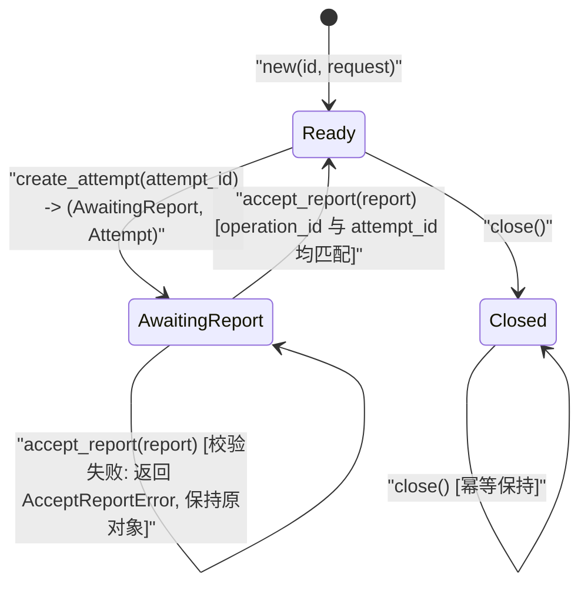
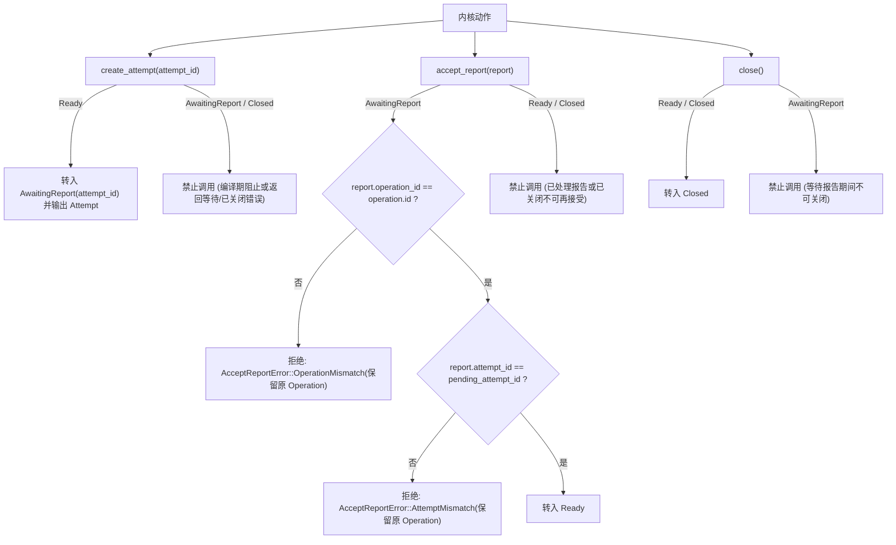

# 原语与 Operation 内核状态机

- **参考实现**：[beamlet-primitives](../crates/core/beamlet-primitives/src/lib.rs)、[beamlet-kernel](../crates/core/beamlet-kernel/src/lib.rs)
- **非目标范围**：不执行任何 I/O 或存储，不管理多 `Operation` 集合，不保存历史已用 `Attempt` 集合，亦不决定重试或关闭策略。

## 三种核心原语

Beamlet 的全部协调建立在三种最小原语之上，其身份与业务数据字段在内核层均保持不透明、由调用方定义：

- **`Operation`**：由不可变身份 `id`、不可变原始 `request` 以及三态生命周期构成。`request` 内容相同而 `id` 不同的实例视为完全独立的 `Operation`。
- **`Attempt`**：针对唯一 `Operation` 签发的单次执行授权，仅绑定自身 `id` 与所属 `operation_id`。重复传递同一份 `Attempt` 数据不得视为签发新授权；结构自身亦不证明授权真实性。
- **`Report`**：一次 `Attempt` 执行结束后的不可变结果证据，同时绑定自身 `id`、所属 `Attempt`（含 `operation_id` 与 `attempt_id`）及业务 `result`。业务语义失败只要对应已结束的 `Attempt`，仍构成合法 `Report`。

## 生命周期状态机

## 状态转换与校验规则

- **校验顺序与无损拒绝**：`accept_report` 必须先检查处于 `AwaitingReport`，再依次校验 `operation_id` 与 `attempt_id`，返回首个失配的 `AcceptReportError` 变体，并无损归还原 `Operation` 供继续等待。
- **单等待与显式关闭**：一个 `Operation` 同时至多等待一个 `Attempt`。`accept_report` 成功仅回到 `Ready` 而非直接 `Closed`；重试或关闭由外层策略决定。
- **外层防重用前提**：内核不保存历史 `Attempt` 集合，外层在 `Ready` 上每次调用 `create_attempt` 时必须提供未曾使用过的新 `attempt_id`。
- **已知状态外部恢复**：
  - `restore_awaiting_report(id, request, attempt)`：校验 `attempt.operation_id == id`，不匹配时返回 `RestoreOperationError` 并归还全部输入；匹配时恢复为 `AwaitingReport(attempt.id)`，不重新签发授权。
  - `restore_closed(id, request)`：直接恢复为 `Closed`，不触发关闭副作用。

## 关键不变量

- **身份与请求不可变**：任何转换均不修改 `Operation` 的 `id` 与原始 `request`；被拒绝的动作不改变生命周期状态。
- **`Closed` 单调不可逆**：进入 `Closed` 后不可回到 `Ready` 或 `AwaitingReport`。
- **双引用绑定**：仅当处于 `AwaitingReport(pending)` 且 `report.operation_id == operation.id` 与 `report.attempt_id == pending` 同时成立时，`accept_report` 才可回到 `Ready`。

## 形式化模型

- Quint 原语与转换模型：[primitives.qnt](quint/kernel/primitives.qnt)、[state_machine.qnt](quint/kernel/state_machine.qnt)
- Quint 模型验证与测试：[kernel.qnt](quint/kernel/kernel.qnt)、[kernel_test.qnt](quint/kernel/kernel_test.qnt)
