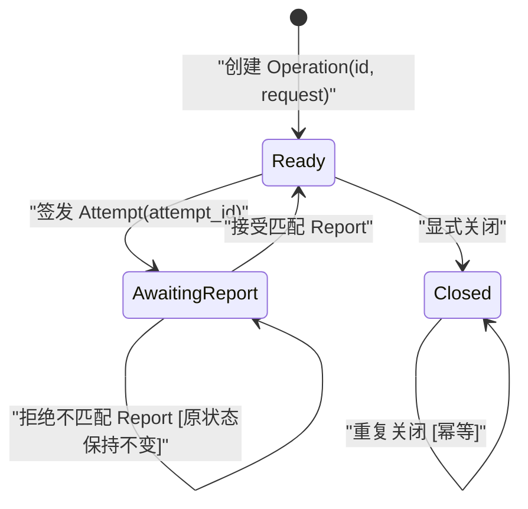
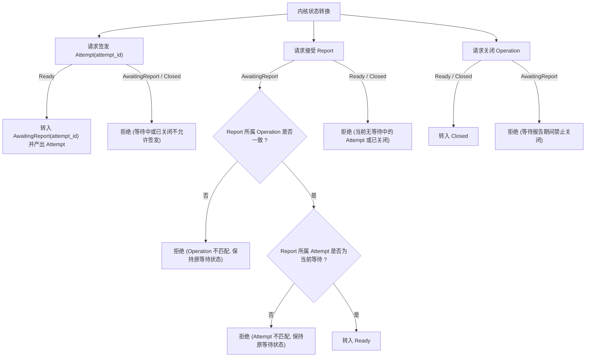

# 原语与内核状态机

- **非目标范围**：不涉及任何存储、并发、多 `Operation` 集合、历史已用 `Attempt` 记录，亦不决定重试或关闭策略。

## 三种核心原语

Beamlet 的所有协调语义建立在三种不可变原语之上，其身份与业务载荷在内核层完全不透明：

- **`Operation`**：由固定身份 `id`、不可变原始 `request` 以及三态生命周期构成。`request` 相同而 `id` 不同的实例视为彼此独立的 `Operation`。
- **`Attempt`**：针对唯一 `Operation` 签发的单次执行授权，绑定自身 `id` 与所属 `operation_id`。重复传递同一份 `Attempt` 数据不产生新授权；数据自身亦不证明授权真实性。
- **`Report`**：一次 `Attempt` 执行结束后的不可变结果证据，同时绑定自身 `id`、所属 `Attempt`（含 `operation_id` 与 `attempt_id`）及业务 `result`。业务执行语义失败只要对应已结束 `Attempt`，仍构成合法 `Report`。

## 生命周期状态机

## 状态转换与恢复规则

- **校验顺序与无副作用拒绝**：接受 `Report` 时必须先校验当前处于 `AwaitingReport`，再依次校验所属 `Operation` 身份与当前等待 `Attempt` 身份；任一条件不满足则拒绝并完整保留原状态及数据不变。
- **单等待与显式关闭**：同一时刻一个 `Operation` 至多等待一个 `Attempt`。接受 `Report` 成功仅回到 `Ready` 而非自动关闭；继续签发新 `Attempt` 或显式关闭由外层决定。
- **外层新身份责任**：内核不保存历史 `Attempt` 集合，外层在每次合法签发前必须提供此前未曾使用过的新 `attempt_id`。
- **外部已知状态恢复**：当外部拥有者已独立确认状态合法时，内核允许无副作用恢复既有状态而不重新签发授权或触发关闭：
  - **恢复 `AwaitingReport`**：校验传入 `Attempt` 的 `operation_id` 与目标 `Operation` 一致；不一致则拒绝并保持无副作用，一致则恢复至对应等待态。
  - **恢复 `Closed`**：直接恢复至终态 `Closed`。

## 关键不变量

- **身份与请求不可变**：任何状态转换均不得修改 `Operation` 的 `id` 与原始 `request`；被拒绝的动作不得改变生命周期状态。
- **`Closed` 单调不可逆**：进入 `Closed` 后不可回到 `Ready` 或 `AwaitingReport`。
- **双引用绑定**：仅当处于 `AwaitingReport` 且 `Report` 同时匹配当前 `Operation` 与当前等待中的 `Attempt` 时，状态才可回到 `Ready`。

## 形式化模型

- Quint 原语与转换模型：[primitives.qnt](quint/kernel/primitives.qnt)、[state_machine.qnt](quint/kernel/state_machine.qnt)
- Quint 模型验证与测试：[kernel.qnt](quint/kernel/kernel.qnt)、[kernel_test.qnt](quint/kernel/kernel_test.qnt)
