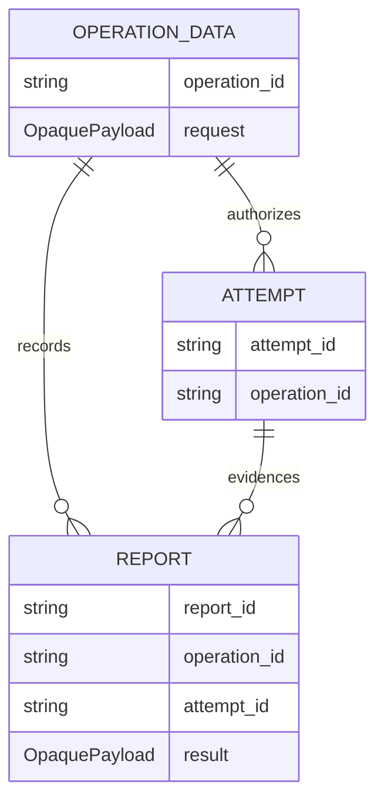

# L1-A: 核心原语

- **实现状态**：`Implemented`
- **下层依赖**：[00-glossary.md](00-glossary.md)
- **非目标范围**：不定义状态机转换、在线集合管理、路由拓扑、网络传输或存储机制。

## 概念模型与结构契约

Beamlet 的所有协调语义建立在三个最小不可变事实载体之上：**`Operation`（不可变头部数据）**、**`Attempt`** 与 **`Report`**。本层只定义它们的跨语言数据结构与引用关系，详见 [primitives.proto](proto/beamlet/l1/v1/primitives.proto)。

### 实体职责分工

1. **`Operation` 不可变数据**：由固定 `operation_id` 与原始 `request`（`OpaquePayload`）组成。两者在创建时冻结，不随生命周期推进而改变。
2. **`Attempt`（执行授权）**：针对某个唯一 `Operation` 的单次执行授权，仅包含自身 `attempt_id` 与所属 `operation_id`。重复传递同一份 `Attempt` 数据**不得**被解释为签发了新的授权。
3. **`Report`（结果证据）**：对应某次已结束 `Attempt` 的结果记录，携带自身 `report_id`、双引用身份（`operation_id` 与 `attempt_id`）以及不透明业务载荷 `result`。

## 不变量与跨字段约束

- **`INV-PRM-01`（不可变性与内容无关相等）**：`Attempt` 与 `Report` 一旦构造完成即**必须**保持字段不可变。拥有相同 `request` 内容但不同 `operation_id` 的两个 `Operation` **必须**视为完全独立的请求，互不干扰。
- **`INV-PRM-02`（双引用绑定与非真实性声明）**：`Report` **必须**同时保留其所属 `operation_id` 与所对应 `attempt_id` 的精确引用。仅凭原始字段从外部反序列化或拼装出 `Attempt` / `Report` 数据结构，本身**不得**被视为证明了该授权确由合法协调者签发，亦不表示该结果已被状态机接受；真实性与状态推进判定由上层负责。
- **`SEM-PRM-01`（业务结果语义中立）**：`Report.result` 承载业务级输出（包括业务失败或异常描述的编码）。`L1` 原语层**不得**检查、解析或以 `result` 内容作为区分 `Report` 结构合法性的依据；即使业务结果代表业务执行失败，只要其属于一次已结束的 `Attempt` 且身份字段非空，仍构成有效的结构化 `Report`。

## 形式化模型索引

- Protobuf IDL：[spec/proto/beamlet/l1/v1/primitives.proto](proto/beamlet/l1/v1/primitives.proto)
- Quint 规范模块：[spec/quint/kernel/primitives.qnt](quint/kernel/primitives.qnt)
