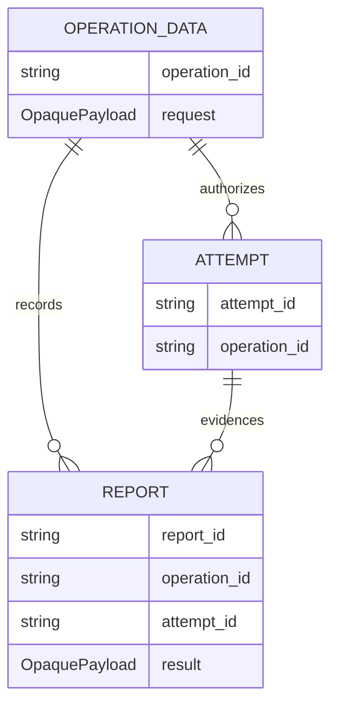

# L1-A: 核心原语

- **实现状态**：`Implemented`
- **下层依赖**：[00-conventions.md](00-conventions.md)、[00-glossary.md](00-glossary.md)
- **非目标范围**：不定义状态转换、在线集合、路由拓扑、网络传输或存储机制。

## 结构契约

逻辑结构见 [primitives.proto](proto/beamlet/l1/v1/primitives.proto)：

## 不变量与语义边界

- **`INV-PRM-01`（不可变与身份独立）**：`Operation` 头部数据、`Attempt` 与 `Report` 构造后字段**必须**不可变；重复传递同一 `Attempt` **不得**视为新签发授权；`request` 相同但 `operation_id` 不同的 `Operation` **必须**视为独立实例。
- **`INV-PRM-02`（双引用与非自证性）**：`Report` **必须**同时绑定 `operation_id` 与 `attempt_id`。仅构造或反序列化出 `Attempt` / `Report` 数据，**不得**视为授权真实性或状态机已接受的证明。
- **`SEM-PRM-01`（结果内容中立）**：`L1` **不得**解析 `Report.result` 或据其判定 `Report` 结构合法性；业务失败只要绑定合法非空身份且对应已结束 `Attempt`，即构成有效 `Report`。

## 形式化模型索引

- Protobuf IDL：[spec/proto/beamlet/l1/v1/primitives.proto](proto/beamlet/l1/v1/primitives.proto)
- Quint 模型：[spec/quint/kernel/primitives.qnt](quint/kernel/primitives.qnt)
