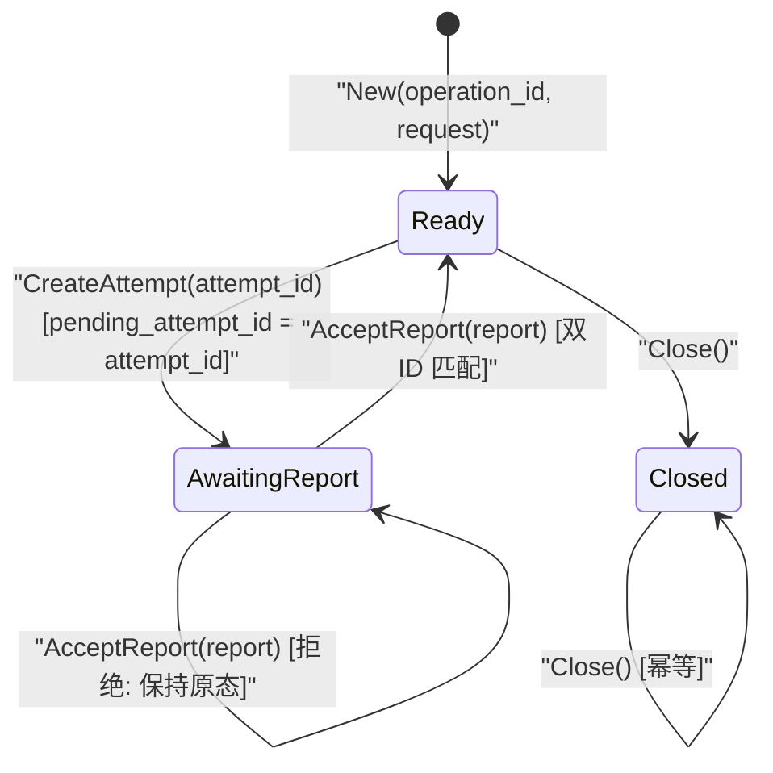
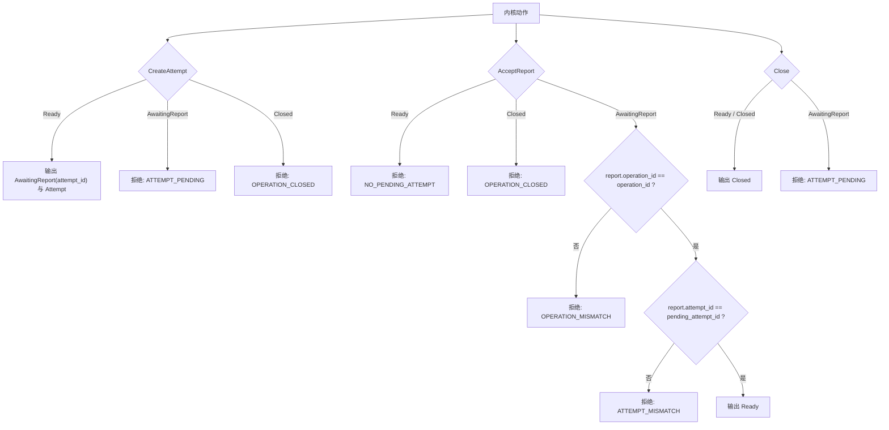

# L1-B: Operation 内核状态机

- **实现状态**：`Implemented`
- **下层依赖**：[00-conventions.md](00-conventions.md)、[00-glossary.md](00-glossary.md)、[01-primitives.md](01-primitives.md)
- **非目标范围**：不涉及 I/O、多实例集合、历史已用 `Attempt` 记录及重试/关闭策略。

## 生命周期状态机

逻辑结构与拒绝枚举见 [kernel.proto](proto/beamlet/l1/v1/kernel.proto)：

## 转换与重建规则

- **校验优先级**：`AcceptReport` **必须**按“状态是否为 `AwaitingReport` -> `operation_id` 匹配 -> `attempt_id` 匹配”顺序校验，返回首个 `KernelRejectionReason`。
- **外部状态重建**：已由外层独立验证的状态可通过无副作用入口直接恢复：
  - `New(operation_id, request)`：构造初始 `Ready`。
  - `ReconstructAwaitingReport(operation_id, request, attempt)`：校验 `attempt.operation_id == operation_id`（失配拒绝 `OPERATION_MISMATCH`），恢复为 `AwaitingReport(attempt.attempt_id)`，**不**签发新 `Attempt`。
  - `ReconstructClosed(operation_id, request)`：直接恢复为 `Closed`。

## 不变量与语义边界

- **`INV-KRN-01`（拒绝无副作用）**：被拒绝的动作**不得**改变当前状态、`operation_id`、`request` 或 `pending_attempt_id`。
- **`INV-KRN-02`（`Closed` 不可逆）**：进入 `Closed` 后，任何动作**不得**使其回到 `Ready` 或 `AwaitingReport`。
- **`INV-KRN-03`（签发一致性）**：`CreateAttempt` **必须**仅在 `Ready` 下成功，输出 `Attempt.operation_id == operation_id` 并转入 `AwaitingReport(attempt_id)`。
- **`INV-KRN-04`（双匹配验收）**：`AcceptReport` **必须**仅在 `AwaitingReport(pending)` 且 `(report.operation_id, report.attempt_id) == (operation_id, pending)` 时成功并转回 `Ready`；重复提交同一 `Report` 拒绝为 `NO_PENDING_ATTEMPT`，旧 `Attempt` 的迟到 `Report` 拒绝为 `ATTEMPT_MISMATCH`。
- **`SEM-KRN-01`（外层职责边界）**：内核不记录历史 `Attempt`，调用方每次 `CreateAttempt` **必须**提供全新 `attempt_id`；`AcceptReport` 仅回到 `Ready`，后续重试或 `Close` 由外层决定。

## 形式化模型索引

- Protobuf IDL：[spec/proto/beamlet/l1/v1/kernel.proto](proto/beamlet/l1/v1/kernel.proto)
- Quint 模型：[spec/quint/kernel/state_machine.qnt](quint/kernel/state_machine.qnt)、[spec/quint/kernel/kernel.qnt](quint/kernel/kernel.qnt)、[spec/quint/kernel/kernel_test.qnt](quint/kernel/kernel_test.qnt)
