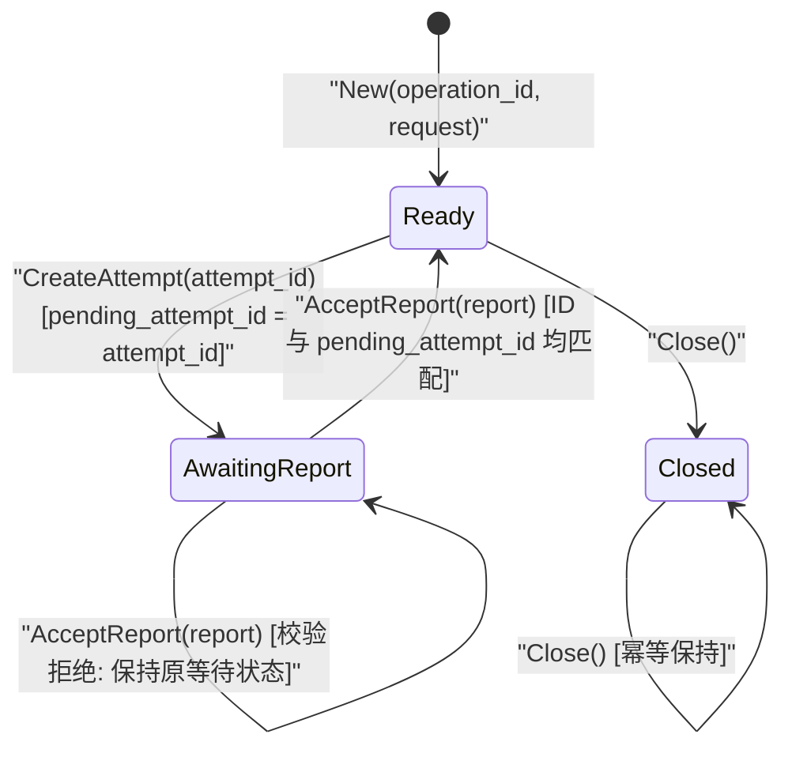
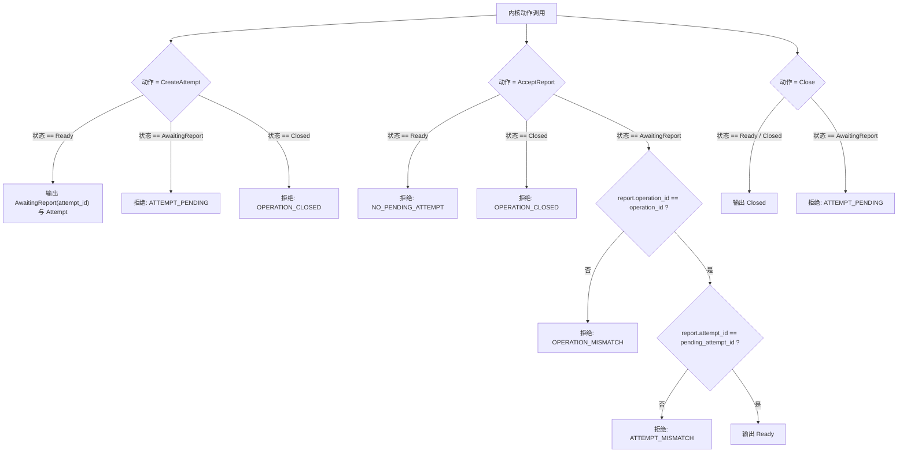

# L1-B: Operation 内核状态机

- **实现状态**：`Implemented`
- **下层依赖**：[00-glossary.md](00-glossary.md)、[01-primitives.md](01-primitives.md)
- **非目标范围**：不执行任何存储或网络 I/O、不维护多 `Operation` 集合、不保存历史已用 `Attempt` 列表，亦不决定重试或关闭策略。

## 概念与生命周期投影

`Operation` 是由固定身份（`operation_id`）、不可变原始请求（`request`）与三态生命周期共同构成的单体状态机。其跨语言逻辑投影与拒绝原因枚举定义于 [kernel.proto](proto/beamlet/l1/v1/kernel.proto)。

一个 `Operation` 在任意时刻**必须**精确处于以下三种状态之一：

1. **`Ready`**：尚未结束，且当前没有正在等待结果证据的 `Attempt`（既可代表初始新建，也可代表上一份 `Report` 已被接受）。
2. **`AwaitingReport(pending_attempt_id)`**：当前正在唯一等待与 `pending_attempt_id` 关联的 `Report`；同一时刻至多等待一个 `Attempt`。
3. **`Closed`**：已显式终止，不允许再次签发 `Attempt` 或接受 `Report`。

## 转换契约与外部状态重建

### 正常转换动作

每个动作以当前 `Operation` 状态与显式输入为前提，输出推进后的新状态或无副作用的拒绝原因：

- **校验优先级**：当 `AcceptReport` 收到无效输入时，实现**必须**先判定生命周期状态是否处于 `AwaitingReport`，再依次校验 `operation_id` 与 `attempt_id`，返回首个不匹配原因（见 `KernelRejectionReason`）。
- **无副作用拒绝**：任一转换返回拒绝时，原 `Operation` 的身份、原始请求及当前等待状态**必须**保持完全不变，以便调用方在收到错误 `Report` 后继续等待正确 `Report`。

### 已知状态外部重建（Reconstruction）

当外部拥有者已独立验证并确认某 `Operation` 的合法状态时，内核提供无副作用重建入口以恢复对应生命周期实例，而不重新签发授权或触发关闭副作用：

- **重建 `Ready`**：直接以 `(operation_id, request)` 构造初始 `Ready` 状态。
- **重建 `AwaitingReport`（`ReconstructAwaitingReport`）**：输入 `(operation_id, request, attempt)`；内核**必须**校验 `attempt.operation_id == operation_id`，不匹配时拒绝（`OPERATION_MISMATCH`），匹配时恢复至 `AwaitingReport(attempt.id)` 且**不**签发新 `Attempt`。
- **重建 `Closed`（`ReconstructClosed`）**：输入 `(operation_id, request)` 直接恢复至 `Closed`。

## 不变量与语义边界

- **`INV-KRN-01`（拒绝保持状态不变）**：任何被拒绝的动作**不得**改变 `Operation` 的当前状态、`operation_id`、`request` 或 `pending_attempt_id`。
- **`INV-KRN-02`（关闭单调不可逆）**：一旦 `Operation` 进入 `Closed` 状态，后续任何动作序列都**不得**使其重新回到 `Ready` 或 `AwaitingReport`。
- **`INV-KRN-03`（授权创建一致性）**：`CreateAttempt` **必须**仅在 `Ready` 状态下成功，且输出的 `Attempt.operation_id` 与当前 `Operation.operation_id` 相同、同时状态精确转变为 `AwaitingReport(attempt.attempt_id)`。
- **`INV-KRN-04`（报告接受双匹配与解除等待）**：`AcceptReport` **必须**仅在 `AwaitingReport(pending)` 状态下且 `report.operation_id == operation_id`、`report.attempt_id == pending` 同时成立时成功，并将状态转回 `Ready`。同一份 `Report` 被接受后因状态已回到 `Ready`，再次提交同一 `Report` **必须**被拒绝（`NO_PENDING_ATTEMPT`）；创建新 `Attempt` 后，旧 `Attempt` 的 `Report` **必须**被拒绝（`ATTEMPT_MISMATCH`）。
- **`SEM-KRN-01`（外层前置责任与显式关闭）**：`L1` 内核不保存历史已用 `Attempt` 集合，调用方**必须**在每次调用 `CreateAttempt` 时提供全局未曾使用过的新 `attempt_id`（该全局唯一性由 `L2` 集合管理层强制保障）。此外，`AcceptReport` 成功只返回 `Ready` 而不自动关闭 `Operation`；是否继续签发新 `Attempt` 或调用 `Close` 完全由外层策略决定。

## 形式化模型索引

- Protobuf IDL：[spec/proto/beamlet/l1/v1/kernel.proto](proto/beamlet/l1/v1/kernel.proto)
- Quint 纯转换模型：[spec/quint/kernel/state_machine.qnt](quint/kernel/state_machine.qnt)
- Quint 探索与测试：[spec/quint/kernel/kernel.qnt](quint/kernel/kernel.qnt)、[spec/quint/kernel/kernel_test.qnt](quint/kernel/kernel_test.qnt)
