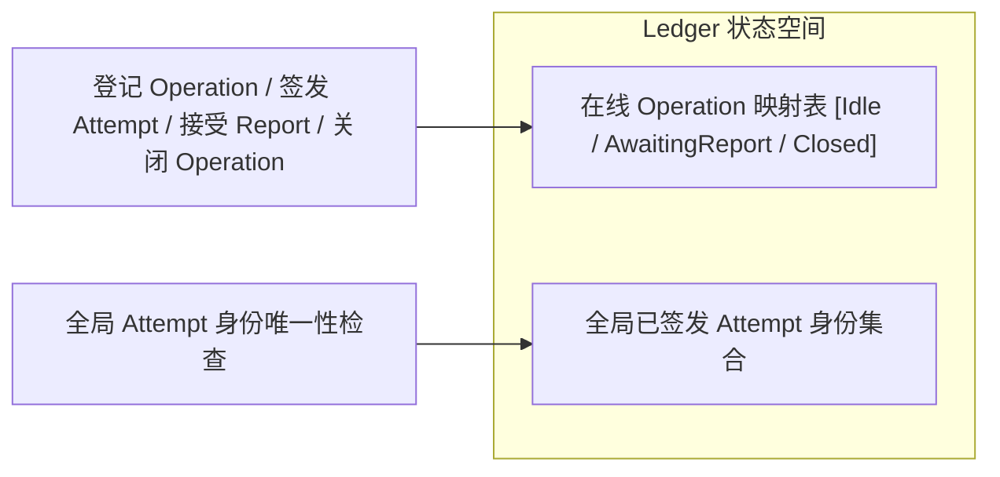
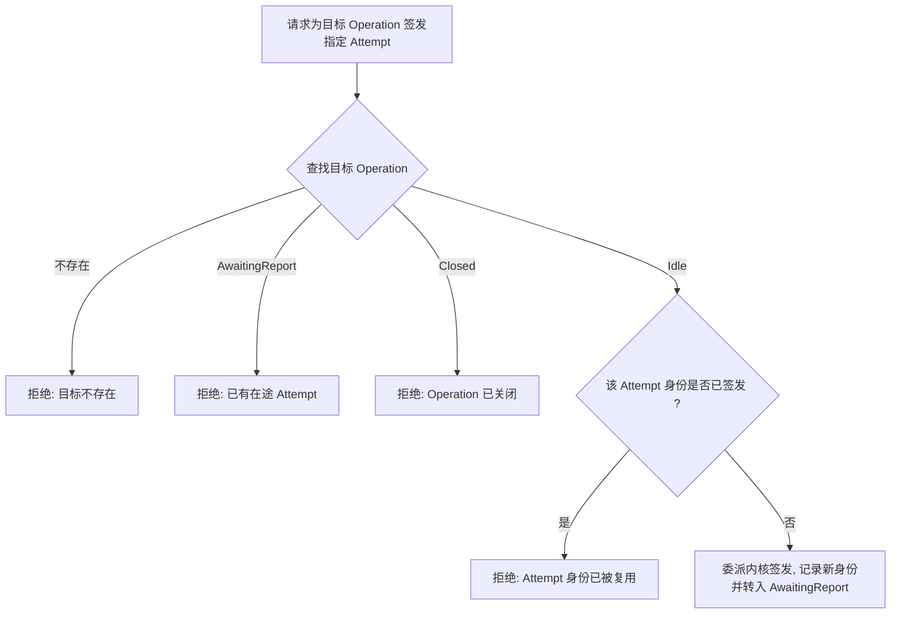

# Ledger 执行台账

- **下层依赖**：[01-kernel.md](01-kernel.md)
- **非目标范围**：不涉及进程外存储、历史事件归档、角色调度、网络通信或超时控制。

## 状态空间

`Ledger` 在内存中串行维护两个核心状态集合：在线 `Operation` 集合与全局已签发 `Attempt` 身份集合：

- **在线保留**：已进入 `Closed` 的 `Operation` 在 `Ledger` 存活期间必须继续保留于台账，以保证只读查询、幂等关闭与禁止重启语义；已签发 `Attempt` 身份集合同样单调保留。

## 转换规则

- **登记新 `Operation`**：仅当目标身份尚不存在时插入初始 `Idle` 条目；若已存在必须拒绝并保留原条目与原请求不变，绝不覆盖。
- **签发 `Attempt`**：仅当目标处于 `Idle` 且待签发身份未出现在已签发集合中时成功；任意原因拒绝均不得修改原条目，亦不得把当前被拒的未使用身份写入已签发集合。
- **接受 `Report`**：按 `Report` 关联的 `Operation` 身份查找条目；目标不存在、处于 `Idle` 或已 `Closed` 均拒绝；处于 `AwaitingReport` 时委托内核校验，失配时保留原等待态不变。
- **关闭 `Operation`**：`Idle` 转为 `Closed`；已 `Closed` 幂等成功；处于 `AwaitingReport` 时拒绝。
- **只读查询**：允许外部按身份读取当前 `Operation` 的只读状态，不暴露可绕过约束的内部可变状态。

## 关键不变量

- **`Closed` 单调保留**：任一 `Operation` 关闭后在线期间永久保持 `Closed`，不被覆盖或重新激活。
- **全局 `Attempt` 身份唯一**：跨同一 `Operation` 重试与跨不同 `Operation` 签发的全部 `Attempt` 身份两两互异。
- **拒绝不污染已用集合**：被拒绝的 `Attempt` 签发尝试不得污染已签发身份集合。
- **在途授权一致**：任意处于 `AwaitingReport` 的条目所等待的 `Attempt` 必然属于已签发身份集合，且任意两个条目同一时刻不得等待同一个 `Attempt`。

## 形式化模型

- Quint 模型与测试：[ledger.qnt](quint/ledger/ledger.qnt)、[ledger_test.qnt](quint/ledger/ledger_test.qnt)
