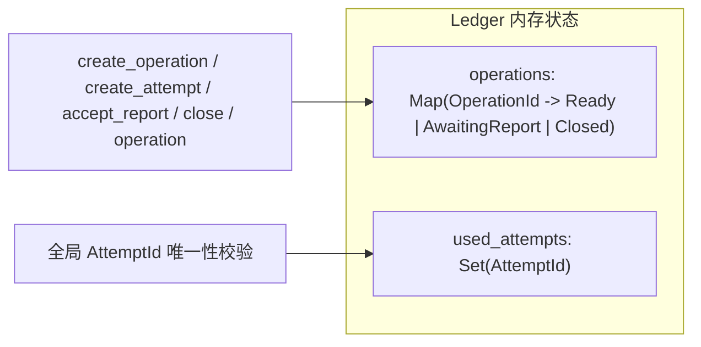
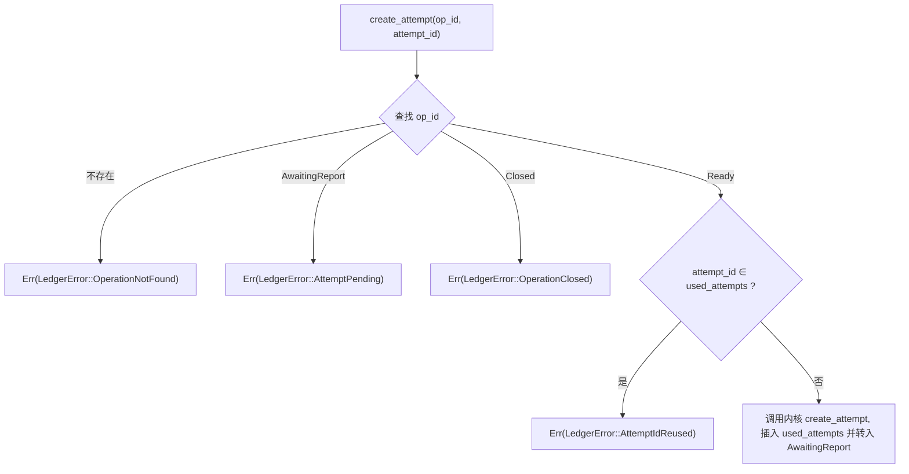

# Ledger 在线执行台账

- **下层依赖**：[01-kernel.md](01-kernel.md)
- **非目标范围**：不涉及进程外存储、事件历史归档、角色调度、网络通信或超时控制。

## 状态结构

`Ledger` 在单个内存容器内串行维护多个在线 `Operation` 及其全局已签发 `Attempt` 身份集合：

- **在线保留**：已进入 `Closed` 的 `Operation` 在 `Ledger` 在线期间必须继续保留于 `operations`，以支持只读查询、幂等 `close` 与防重激活；`used_attempts` 同样单调保留。

## 操作契约

- **`create_operation(id, request)`**：仅当 `id` 不存在时插入 `Ready` 条目；若已存在则返回 `Err(CreateOperationError)` 归还输入，不得覆盖既有条目。
- **`create_attempt(op_id, attempt_id)`**：按上图校验顺序执行；仅在目标为 `Ready` 且 `attempt_id` 未用时成功。
- **`accept_report(report)`**：按 `report.operation_id()` 查找目标；不存在返回 `OperationNotFound`，`Ready` 返回 `NoPendingAttempt`，`Closed` 返回 `OperationClosed`，`AwaitingReport` 下若核对失败则无损归还原等待对象并返回 `ReportMismatch`。
- **`close(op_id)`**：`Ready` 转为 `Closed`；`Closed` 幂等返回 `Ok(())`；`AwaitingReport` 返回 `AttemptPending`；不存在返回 `OperationNotFound`。
- **`operation(id)`**：返回只读视图 `Option<OperationView>`，不暴露内部可变状态对象。

## 关键不变量

- **`Closed` 单调保留**：任一 `Operation` 关闭后在线期间永久保持 `Closed`，不被覆盖或重开。
- **全局 `Attempt` 身份唯一**：同一 `Operation` 的多次重试及不同 `Operation` 之间签发的全部 `Attempt` 身份两两互异。
- **拒绝不污染已用集合**：任意 `create_attempt` 拒绝均保持 `operations` 不变，且不得将本次传入的未使用 `attempt_id` 记入 `used_attempts`。
- **在途授权一致**：任意处于 `AwaitingReport(a)` 的条目必须满足 `a ∈ used_attempts`，且任意两个条目同一时刻不得等待同一 `a`。

## 形式化模型

- Quint 模型与测试：[ledger.qnt](quint/ledger/ledger.qnt)、[ledger_test.qnt](quint/ledger/ledger_test.qnt)
