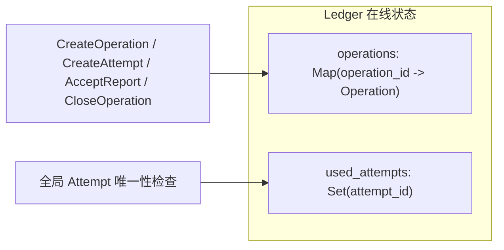
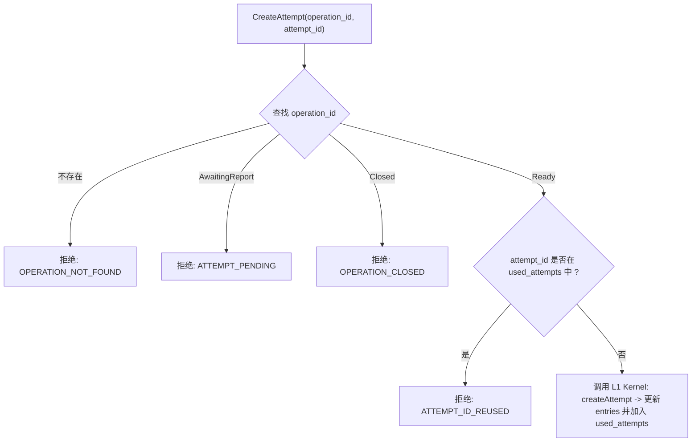

# L2: 在线执行台账（Ledger）

- **实现状态**：`Implemented`
- **下层依赖**：[00-glossary.md](00-glossary.md)、[01-primitives.md](01-primitives.md)、[02-kernel.md](02-kernel.md)
- **非目标范围**：不规定进程外状态保存、事件归档或进程重启后的恢复；不涉及网络通信、并发调度或期限控制。

## 概念与结构契约

单个 `Operation` 在 `L1` 中独立维护自身状态转换，但不掌握历史已用 `Attempt` 集合，也无法阻止跨 `Operation` 重复签发同一 `attempt_id`。`L2` 在其之上引入 **`Ledger`（在线执行台账）**，统一管理多个在线 `Operation` 实例以及全局已签发 `Attempt` 身份集合。

`Ledger` 对外暴露的抽象操作与错误分类定义于 [ledger.proto](proto/beamlet/l2/v1/ledger.proto)（`LedgerService` 与 `LedgerErrorReason`）。

- **内存生命周期边界**：`Ledger` 为单进程或单协调实例的内存执行台账。对已进入 `Closed` 的 `Operation`，`Ledger` 在线期间**必须**继续保留其记录与 `used_attempts` 集合，以保证幂等重复关闭与防重放语义。

## 操作规则与校验管线

- **`CreateOperation(operation_id, request)`**：若 `operation_id` 尚不存在，则插入一个新的 `Ready` `Operation`；若已存在，**必须**返回 `OPERATION_EXISTS`，**不得**覆盖既有 `Operation`（包括其原始请求与状态）。
- **`CreateAttempt(operation_id, attempt_id)`**：仅当目标 `Operation` 处于 `Ready` 且 `attempt_id` 未出现于 `used_attempts` 时，才推进至 `AwaitingReport` 并把 `attempt_id` 登记入 `used_attempts`。
- **`AcceptReport(report)`**：按 `report.operation_id` 查找对应条目并委托 `L1` 内核校验。若目标不存在返回 `OPERATION_NOT_FOUND`；若处于 `Ready` 返回 `NO_PENDING_ATTEMPT`；若处于 `Closed` 返回 `OPERATION_CLOSED`；若在 `AwaitingReport` 下发生引用不匹配，**必须**完整保留原 `AwaitingReport` 条目并返回 `REPORT_MISMATCH`。
- **`CloseOperation(operation_id)`**：若目标处于 `Ready` 则关闭为 `Closed`；若已处于 `Closed` 则幂等保持 `Closed`；若处于 `AwaitingReport` 则拒绝并返回 `ATTEMPT_PENDING`。
- **`GetOperation(operation_id)`**：提供只读视图查询，不暴露内部可变状态对象。

## 不变量与原子语义

- **`INV-LDG-01`（`Closed` 全局单调性）**：台账中任一 `Operation` 一旦进入 `Closed`，在台账生命周期内**必须**始终保持 `Closed` 且不可被 `CreateOperation` 覆盖或重新激活。
- **`INV-LDG-02`（`Attempt` 身份全局唯一性）**：`Ledger` 在其整个存在期间签发的所有 `Attempt` 身份**必须**两两互异——无论是同一 `Operation` 在接受 `Report` 后的重试，还是不同 `Operation` 之间的签发，均**不得**复用任何已签发过的 `attempt_id`。
- **`INV-LDG-03`（拒绝不污染已用集合）**：任何原因导致 `CreateAttempt` 被拒绝时（包括 `OPERATION_NOT_FOUND`、`ATTEMPT_PENDING`、`OPERATION_CLOSED` 或 `ATTEMPT_ID_REUSED`），原 `Operation` 状态**必须**保持不变，且**不得**将当前请求的 `attempt_id` 加入 `used_attempts`（即被拒绝的未使用 `attempt_id` 仍可用于后续合法的 `CreateAttempt` 调用）。
- **`INV-LDG-04`（等待中授权一致性）**：台账中任意处于 `AwaitingReport(a)` 的 `Operation`，其 `a` **必须**已包含于 `used_attempts`，且任意两个不同的 `Operation` 在同一时刻**不得**等待同一个 `a`。

## 形式化模型索引

- Protobuf IDL：[spec/proto/beamlet/l2/v1/ledger.proto](proto/beamlet/l2/v1/ledger.proto)
- Quint 形式化模型：[spec/quint/ledger/ledger.qnt](quint/ledger/ledger.qnt)
- Quint 场景测试：[spec/quint/ledger/ledger_test.qnt](quint/ledger/ledger_test.qnt)
