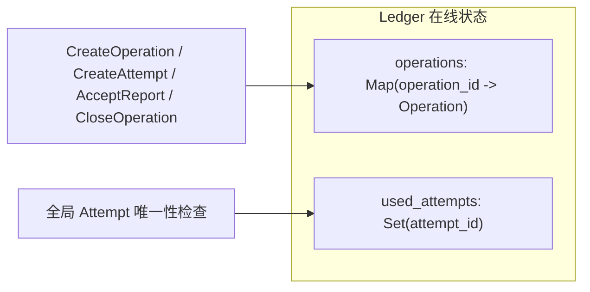
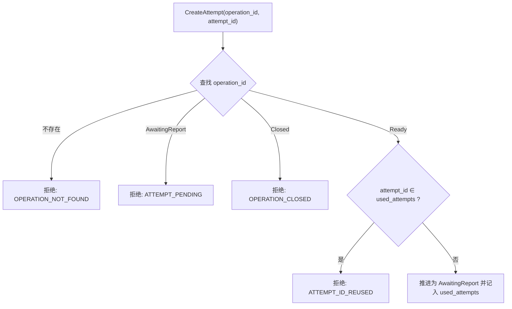

# L2: 在线执行台账（Ledger）

- **实现状态**：`Implemented`
- **下层依赖**：[00-conventions.md](00-conventions.md)、[00-glossary.md](00-glossary.md)、[01-primitives.md](01-primitives.md)、[02-kernel.md](02-kernel.md)
- **非目标范围**：不涉及进程外存储、重启恢复、网络通信、并发调度与期限控制。

## 状态结构

接口与错误枚举见 [ledger.proto](proto/beamlet/l2/v1/ledger.proto)：

- **在线保留**：`Operation` 进入 `Closed` 后，`Ledger` 在线期间**必须**保留其条目及 `used_attempts`，以维持幂等关闭与防重用语义。

## 操作规则

- **`CreateOperation(operation_id, request)`**：不存在时插入 `Ready` 实例；已存在时返回 `OPERATION_EXISTS`，**不得**覆盖既有条目。
- **`CreateAttempt(operation_id, attempt_id)`**：见上图；仅在目标处于 `Ready` 且 `attempt_id` 未使用时成功。
- **`AcceptReport(report)`**：目标缺失返回 `OPERATION_NOT_FOUND`；其余委托 `L1` 校验（`Ready` -> `NO_PENDING_ATTEMPT`、`Closed` -> `OPERATION_CLOSED`、引用失配 -> 保留原等待态并返回 `REPORT_MISMATCH`）。
- **`CloseOperation(operation_id)`**：`Ready` 转 `Closed`；`Closed` 幂等成功；`AwaitingReport` 返回 `ATTEMPT_PENDING`。
- **`GetOperation(operation_id)`**：返回只读视图。

## 不变量

- **`INV-LDG-01`（`Closed` 单调保留）**：已 `Closed` 的 `Operation` 在线期间**必须**保持 `Closed`，**不得**被覆盖或重新激活。
- **`INV-LDG-02`（`Attempt` 全局唯一）**：跨同一 `Operation` 重试与跨不同 `Operation` 签发的全部 `attempt_id` **必须**两两互异，**不得**复用。
- **`INV-LDG-03`（失败原子无污染）**：`CreateAttempt` 被拒绝时，原条目状态不变，且**不得**将被拒的未使用 `attempt_id` 记入 `used_attempts`。
- **`INV-LDG-04`（在途授权一致）**：任意处于 `AwaitingReport(a)` 的 `Operation` **必须**满足 `a ∈ used_attempts`，且不同 `Operation` **不得**同时等待同一 `a`。

## 形式化模型索引

- Protobuf IDL：[spec/proto/beamlet/l2/v1/ledger.proto](proto/beamlet/l2/v1/ledger.proto)
- Quint 模型：[spec/quint/ledger/ledger.qnt](quint/ledger/ledger.qnt)、[spec/quint/ledger/ledger_test.qnt](quint/ledger/ledger_test.qnt)
