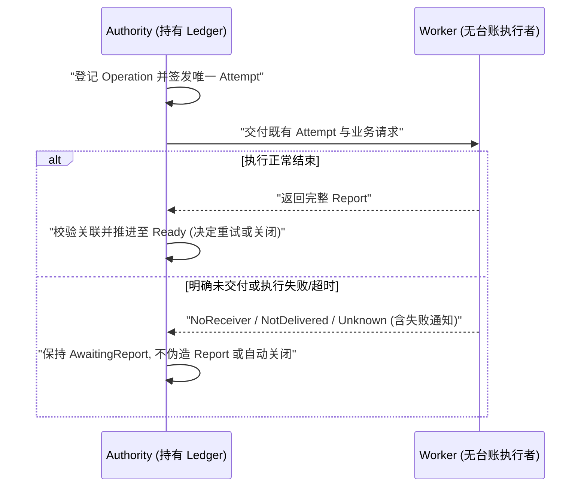
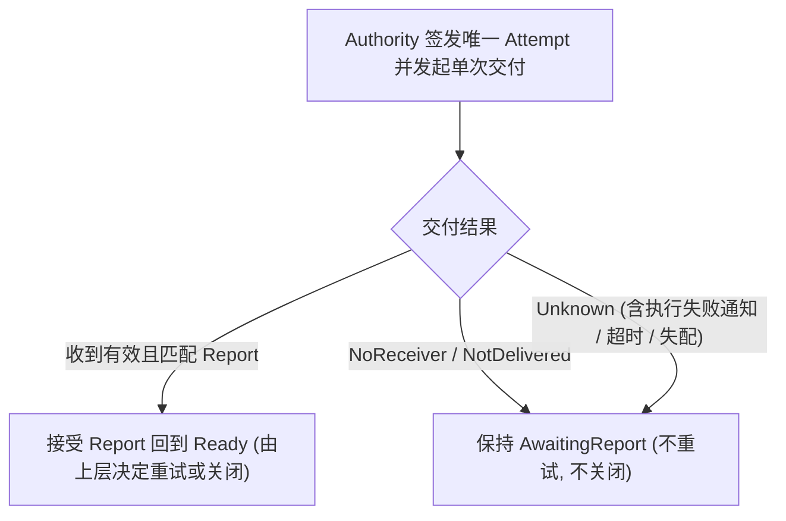

# Authority 与 Worker 协作基础

- **下层依赖**：[01-kernel.md](01-kernel.md)、[02-ledger.md](02-ledger.md)
- **非目标范围**：不涉及多实例寻址分组、成员公告、会话租约、外部接入协议或具体传输机制。

## 职责分离与最简交互

- **`Authority`**：持有私有 `Ledger`，唯一负责登记 `Operation`、签发新 `Attempt`、向目标发起单次交付、校验并接受 `Report` 以及决定重试或关闭。不同 `Authority` 之间不共享 `Ledger`。
- **`Worker`**：无台账执行者；接收既有 `Attempt` 与业务请求并执行处理，正常结束时产出绑定原 `Operation` 与 `Attempt` 的 `Report`，执行异常未完成时返回失败通知而不构造伪造 `Report`。`Worker` 不持有或修改 `Ledger`，亦不得擅自再签发新 `Attempt`。共用同一个 `Worker` 不代表共享或接管任何 `Authority` 的 `Operation`。

## 单次交付语义与故障分类

- **交付故障三分**：
  - **`NoReceiver`**：目标不存在或当前无可用接收者。
  - **`NotDelivered`**：有明确证据证明调用在进入业务执行前即未交付（如参数非法或准入校验拒收）。
  - **`Unknown`**：无法排除远端已收到或已产生副作用（如网络超时、链路中断、错配回复或执行期异常通知），禁止自动重发同一次尝试。
- **一次性响应相关性**：每次调用至多关联一份响应；局部发送成功仅表示底层接收了回复数据，不代表接收端已推进状态机。
- **超时非取消与验收解耦**：等待期限耗尽或取消等待仅结束本地等待，不取消或回滚 `Worker` 侧已开始的执行。收到迟到 `Report` 时仅核对其非空身份与原 `Attempt` 及锁定目标匹配，不要求目标在验收瞬间仍在线。

## 关键不变量

- **未获真实证据不解除等待**：遭遇 `NoReceiver`、`NotDelivered`、`Unknown` 或错配 `Report` 时，原 `Operation` 必须保持 `AwaitingReport`，不得自动重试或无证关闭。
- **合法验收必有真实来源**：能够解除 `AwaitingReport` 的 `Report` 必须匹配当初签发并投递给目标 `Worker` 的 `(Operation, Attempt)`。
- **授权唯一不重发**：每次交付前签发的 `Attempt` 全局唯一；交付返回失败或超时后不得换目标重发同一次尝试。

## 形式化模型

- Quint 交互模型与测试：[roles.qnt](quint/roles/roles.qnt)、[roles_test.qnt](quint/roles/roles_test.qnt)
