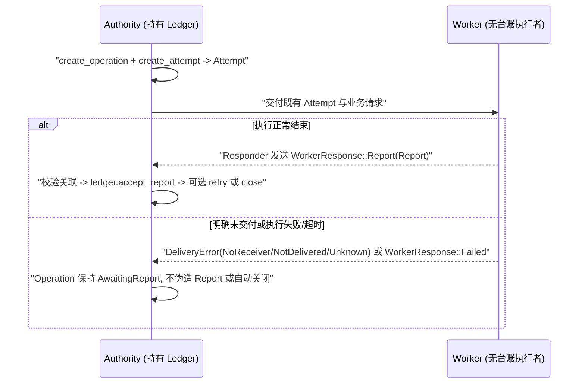
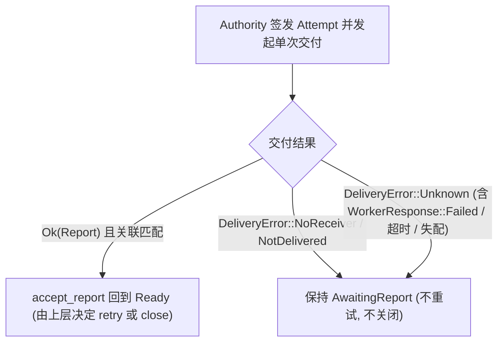

# Authority 与 Worker 协作基础

- **下层依赖**：[01-kernel.md](01-kernel.md)、[02-ledger.md](02-ledger.md)
- **非目标范围**：不涉及多实例寻址分组、成员公告、会话租约、外部接入协议或特定传输实现。

## 职责分离与最简交互

- **`Authority`**：持有私有 `Ledger`，唯一负责创建 `Operation`、签发新 `Attempt`、向外发起单次交付、通过 `accept_report` 验收结果并决定重签发或 `close`。不同 `Authority` 不共享 `Ledger`。
- **`Worker`**：无台账执行者；接收既有 `Attempt` 与请求并执行业务处理器，正常结束时构造绑定原 `Operation`/`Attempt` 的 `Report` 通过一次性 `Responder` 回复，异常未完成时返回 `WorkerResponse::Failed`。`Worker` 不持有或修改 `Ledger`，亦不得擅自签发新 `Attempt`。共用同一个 `Worker` 不意味着共享或接管任何 `Authority` 的 `Operation`。

## 单次交付语义与回复契约

- **`DeliveryError` 三态区分**：
  - `NoReceiver`：目标不存在或无可用接收者。
  - `NotDelivered`：有明确证据证明调用在进入业务执行前即未交付（如参数非法或准入前拒收）。
  - `Unknown`：无法排除远端已收到或已产生副作用（如网络超时、断线、错配回复或执行期 `WorkerResponse::Failed`），禁止自动重发。
- **`WorkerResponse` 与不伪造原则**：`Worker` 仅可返回完整 `Report` 或 `WorkerResponse::Failed`。业务执行期失败绝不伪造为 `Report` 或 `NotDelivered`。
- **一次性 `Responder` 语义**：每次交付绑定唯一回复入口，发送至多一次；`Responder::send` 成功或发生 `ReplyError` 仅反映局部发送动作结果，本身不推进也不回滚 `Ledger`。
- **超时非取消与验收解耦**：等待超时或取消等待仅结束本地等待，不取消或回滚 `Worker` 侧已开始的执行。收到迟到 `Report` 时仅核对其非空身份与原 `Attempt` 及锁定的目标匹配，不要求目标在验收瞬间仍在线。

## 关键不变量

- **未获真实证据不解除等待**：遭遇 `NoReceiver`、`NotDelivered`、`Unknown` 或错配 `Report` 时，原 `Operation` 必须保持 `AwaitingReport`，不得自动重试或无证 `close`。
- **合法验收必有真实来源**：能够解除 `AwaitingReport` 的 `Report` 必须匹配当初签发并投递给目标 `Worker` 的 `(Operation, Attempt)`。
- **授权唯一不重发**：每次交付前签发的 `Attempt` 全局唯一；交付返回失败或超时后不得换目标重发同一次尝试。

## 形式化模型

- Quint 交互模型与测试：[roles.qnt](quint/roles/roles.qnt)、[roles_test.qnt](quint/roles/roles_test.qnt)
