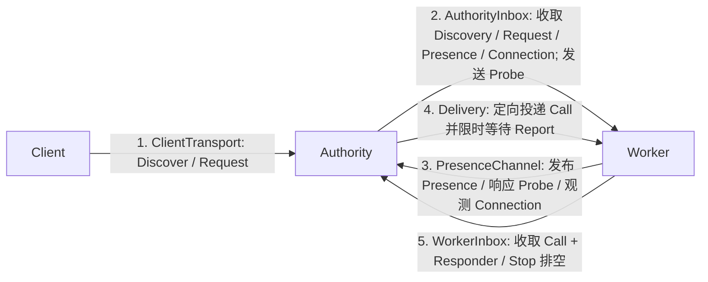
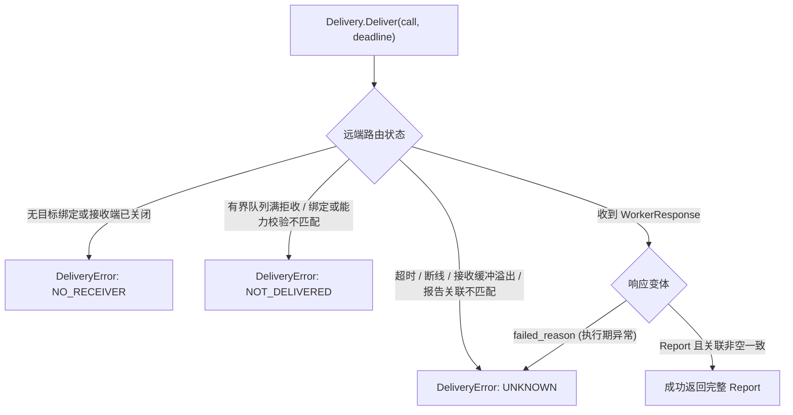

# L3-A: 抽象交互模型与通道契约

- **实现状态**：`Implemented`
- **下层依赖**：[00-glossary.md](00-glossary.md)、[01-primitives.md](01-primitives.md)、[02-kernel.md](02-kernel.md)
- **非目标范围**：不绑定具体消息中间件、序列化格式、进程宿主或特定语言异步运行时原语。

## 概念与标识校验规范

`L3` 在 `L1` 原语与 `L2` 生命周期之上，定义跨角色通信的逻辑实体与通道语义。所有实体、枚举与交互消息的权威结构见 [interaction.proto](proto/beamlet/l3/v1/interaction.proto)。

### 身份、分组与能力标识约束

| 概念 | 格式与校验规则 | 比较与生命周期语义 |
| --- | --- | --- |
| `RoleInstance` | `role_id` 与 `session_id` 均**必须**为非全零 UUID | 共同锁定一次具体角色运行；**不得**按 UUID 字典序比较新旧 |
| `Pool` | 长度 **必须** 为 `1..=64` 字节的 ASCII 字母、数字、`-` 或 `_` | 大小写敏感精确匹配；**不得**自动修剪空白或改写大小写 |
| `CapabilityId` | 长度 **必须** 为 `1..=256` 字节的非空字符串 | 按原始字节精确匹配；不提供隐式版本协商、修剪或别名展开 |
| `Connection` | 单调非负 `epoch` 与布尔状态 `connected` | `epoch` 由观测方本地递增；断线或新 `epoch` 使旧世代观测失效 |
| `Presence` | 包含 `pool`、`instance`、`capabilities`（非空）、`sequence`（`> 0`）与 `PresenceState` | 完整自报状态快照，首份有效公告即可用于登记 |
| `Selection` | `Any` 或 `Exact(RoleInstance)` | 一次调用最多选定一次目标；`Exact` 失效时**不得**回退到其他实例 |

## 抽象交互通道与角色拓扑

`L3` 拒绝将所有底层通信强行抽象为“通用字符串主题总线”，而是按实际交互语义划分为五个最小专用通道与一次性回复句柄 `Responder`：

1. **`AuthorityInbox`**：向 `Authority` 提交四类统一事件——本地链路状态变更（`Connection`）、带连接 `epoch` 标记的 `Presence` 快照、携带 `Responder` 的发现询问（`Discovery`），以及带有实际路由 `pool` 标签与 `Responder` 的 `Command` 请求（`Request`）；另支持向其关联的 `Pool` 发送主动探测信号（`Probe`）。
2. **`PresenceChannel`**：供 `Worker` 读取当前 `Connection` 快照、等待 `Probe` 或连接变更事件、发布 `Presence` 并刷新发送缓冲。缓冲刷新成功仅表明本地传输接受发送，**不**证明远端角色已接收或完成登记。
3. **`WorkerInbox`**：逐条向 `Worker` 交付绑定的调用输入及其一次性 `Responder`。支持显式 `Stop` 语义：关闭新调用接入，同时保留已接收队列供排空执行。
4. **`Delivery`**：向**唯一选定**的 `Worker` 实例交付携带既已签发 `Attempt` 的 `Call`，并在给定 `deadline` 内等待关联 `Report`。`Delivery` **不得**自行选人或跨目标重试。
5. **`ClientTransport` 与 `DiscoveryInbox`**：支持在多个 `Pool` 范围内发起多回复流式发现（`Discover`），以及向唯一目标 `Authority` 会话发送单个 `Command` 并等待单份 `Reply`（`Request`）。

## 交付失败分类与最终结果契约

Beamlet 严格区分“创建前拒绝”、“已确认未执行”与“远端执行结果未知”，绝不以伪造 `Report` 掩盖不确定性：

- **`OutcomeRejected`（`Rejected`）**：创建 `Operation` 或签发 `Attempt` 前的拒绝（如选人失败、输入队列满、协议参数非法）。此分支**不得**产生新的 `Operation` 或 `Attempt`。
- **`OutcomeUnresolved`（`Unresolved`）**：`Operation` 与 `Attempt` **已签发**，但 `Delivery` 返回了任意 `DeliveryError`（包括 `NO_RECEIVER`、`NOT_DELIVERED`、`UNKNOWN`）或报告与台账不匹配。原 `Operation` 保持 `AwaitingReport`，`Unresolved` 诊断信息仅用于上报，**不得**伪装为 `Report`。
- **`OutcomeCompleted`（`Completed`）**：仅当有效 `Report` 被成功接受且 `Operation` 关闭后返回，携带完整的 `operation_id`、`attempt_id`、`report_id`、实际执行 `worker` 与 `result`。

## 交互语义约束

- **`SEM-INT-01`（`Responder` 一次性与非可重入性）**：每个 `Responder` 仅允许发送一次回复并消费自身所有权；回复发送失败不触发自动重试。丢弃未使用的 `Responder` 只释放本地回复通道，**不得**被解释为自动取消了已进行的任务。
- **`SEM-INT-02`（期限与本地取消的非传递性）**：`ClientTransport.Request` 与 `Delivery.Deliver` 接收的均为相对时长 `deadline`。期限耗尽或调用方取消本地等待，**仅**终止本地等待动作，**不得**宣称远端正在执行的任务已被取消或回滚。
- **`SEM-INT-03`（`Worker` 接收准入校验）**：接收端与 `Worker` 绑定校验（`accepts`）**必须**核对 `Call` 中的 `pool` 与目标 `worker`（`RoleInstance`）精确匹配自身绑定、`authority` 两个 UUID 非空、`attempt` 的 `operation_id` 与 `attempt_id` 非空，且 `task.capability` 在本次启用的能力集合内。
- **`SEM-INT-04`（`request_id` 的纯关联语义）**：`Command.request_id` 与 `DiscoveryRequest.request_id` 仅用于将响应与本次查询关联；**不得**把 `request_id` 当作 `Operation` 身份或重复提交的幂等凭据。

## 形式化模型索引

- Protobuf IDL：[spec/proto/beamlet/l3/v1/interaction.proto](proto/beamlet/l3/v1/interaction.proto)
