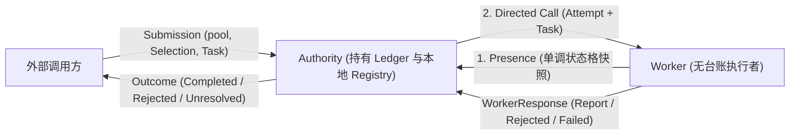
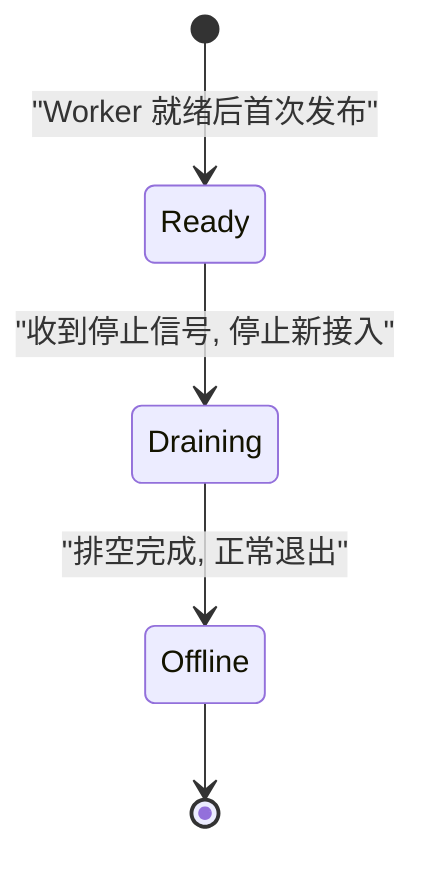
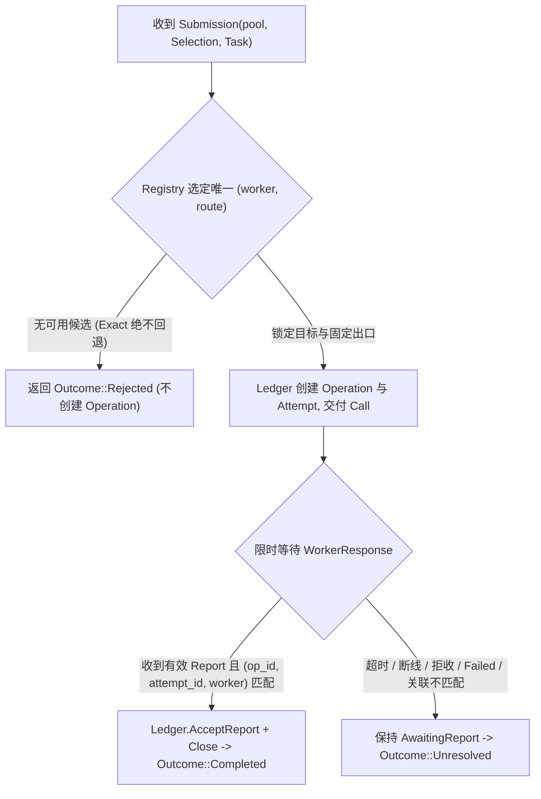
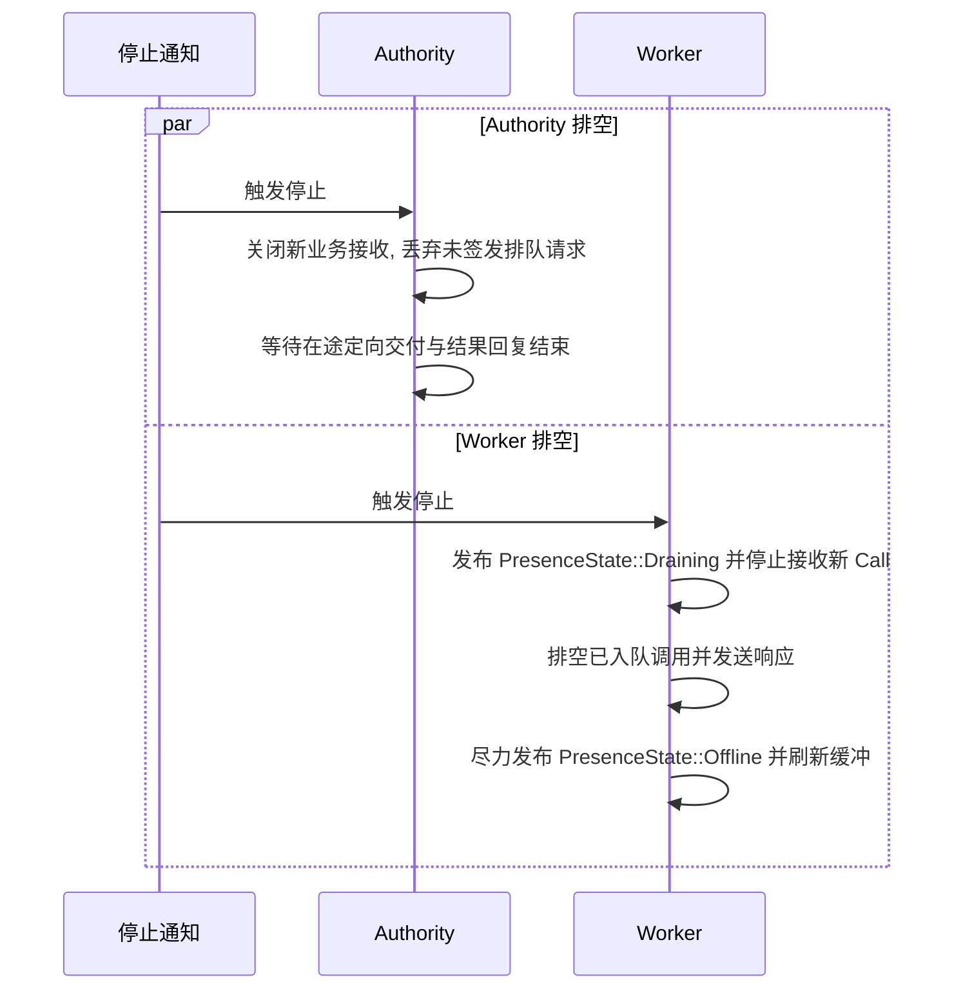

# L3: 分布式交付协议

- **实现状态**：`Draft (Target Spec)`
- **下层依赖**：[00-glossary.md](00-glossary.md)、[01-primitives.md](01-primitives.md)、[02-kernel.md](02-kernel.md)、[03-ledger.md](03-ledger.md)
- **非目标范围**：不规定外部接入协议（如 HTTP / CLI / 发现网关）、不绑定具体消息中间件或编码格式，亦不硬编码具体队列长度与超时秒数等工程调优参数。

## 最小交互模型

`L3` 聚焦于解决唯一的核心分布式问题：**`Authority` 如何安全地将 `Ledger` 中签发的 `Attempt` 定向交付给可用 `Worker`，并在不可靠网络下诚实地回收 `Report`。** 跨语言消息结构定义于 [protocol.proto](proto/beamlet/l3/v1/protocol.proto)。

协议仅由两类正交交互构成：

1. **成员状态公告（`Presence`）**：`Worker` 向所属 `Pool` 发布自身状态与已启用能力集合；`Authority` 按传输来源的本地连接世代 `Epoch` 与本地单调时钟维护独立内存视图（`Registry`）。共享 `Worker` **不**意味着共享或接管彼此的 `Ledger`。
2. **定向调用（`Directed Call`）**：`Authority` 先选定唯一目标 `Worker` 实例与固定传输出口，再签发 `Operation`/`Attempt` 并发起单次限时调用，接收一次性 `WorkerResponse`。

### 标识校验约定

- **`RoleInstance`**：`role_id` 与 `session_id` 均**必须**为非全零 UUID；**不得**按 UUID 大小判断新旧。
- **`Pool`**：长度 `1..=64` 字节的 ASCII 字母、数字、`-` 或 `_`，大小写敏感精确匹配，**不得**修剪或改写。
- **`CapabilityId`**：长度 `1..=256` 字节的非空字符串，按原始字节精确匹配，无隐式版本兼容。

## 单调租约格与连接世代协议

每个 `Authority` 以 `(pool, role_id, session_id)` 为键维护本地 `Registry`。为消除乱序旧心跳导致的“已下线会话复活”问题，协议采用**单调状态格（Monotonic State Lattice）**而非额外维护序号与墓碑保留窗口：

1. **单会话不可逆单调演进**：同一个 `session_id` 的 `PresenceState` 仅允许按 `Ready < Draining < Offline` 方向单调推进，永不回退；`Worker` 重启**必须**分配全新的 `session_id`。`Authority` 合并同一会话的公告时取状态格上确界（`join`），因此延迟或乱序到达的旧 `Ready` 永远无法覆盖已收到的 `Draining` 或 `Offline`。
2. **多来源独立租约与 `Epoch` 隔离**：同一 `Worker` 若经多条传输接入同一 `Authority`，各传输来源独立记录 `Lease { epoch, received_at }`。仅当链路处于 `connected == true`、公告携带的 `epoch == link.epoch` 且合并后状态仍为 `Ready` 时，才刷新该来源的 `received_at`。
3. **即时 TTL 判定**：选人与查询时基于 `Authority` 本地单调时钟即时判定 `now - lease.received_at < worker_timeout`，**不**依赖后台清理时机。

### 租约安全不变量

- **`INV-REG-01`（连接与世代隔离）**：任何被判定为可路由或被选中的 `(worker, source)`，在判定瞬间**必须**满足链路在线、租约 `epoch` 与链路当前 `epoch` 一致、未超过本地租约期限且状态为 `Ready`。断线或重连推进 `epoch` 后，旧世代租约**必须**立即失效，直至在新 `epoch` 上收到新心跳。
- **`INV-REG-02`（单调状态不可复活）**：同一 `session_id` 一旦被观测到 `Draining` 或 `Offline`，后续任何乱序或重放的 `Ready` 公告都**不得**使其重新变为可路由状态。
- **`INV-REG-03`（多来源故障隔离）**：同一 `Worker` 的多个传输来源互不影响；任一来源断线或推进 `epoch`，**不得**破坏另一条保持在线且租约新鲜的来源之可路由性。

## 定向交付与统一三态失败语义

- **先选定，后签发**：选人失败直接返回 `Outcome::Rejected`，**不得**在 `Ledger` 中创建 `Operation` 或 `Attempt`。选定 `(worker, route)` 后即锁定，交付失败**不得**换出口或换 `Worker` 重试。
- **报告验收与当前租约解耦**：收到 `Report` 时仅校验 `report_id` 非空以及 `(operation_id, attempt_id, worker)` 与签发记录匹配，**不得**因执行期间该 `Worker` 租约过期或已 `Offline` 而拒绝其合法 `Report`。
- **执行准入与非伪造原则**：`Worker` 接收 `Call` 时**必须**校验 `pool`、目标 `worker`、非空 `authority` 与 `attempt` 及已启用能力；不匹配返回 `rejected_reason`，处理器执行期异常返回 `failed_reason`，**不得**在未完成执行时伪造 `Report`。
- **背压与非阻塞原则（`SEM-DLV-01`）**：控制面（`Presence` 观测与连接状态更新）**不得**被业务并发满载或回复发送背压阻塞；所有接收队列与并发名额**应当**有界，具体容量与超时数值由具体实现配置，不属于本层协议约束。
- **本地超时非取消原则（`SEM-DLV-02`）**：等待期限耗尽或调用方取消等待仅终止本地等待，**不得**宣称远端执行已被取消或回滚。

### 交付安全不变量

- **`INV-DLV-01`（`Exact` 零回退）**：以 `Selection::Exact(w)` 提交时，若目标不可用则直接返回 `Outcome::Rejected` 且不创建 `Operation`；若已创建，其 `Call`、`Unresolved` 与 `Completed` 均严格锁定 `w`。
- **`INV-DLV-02`（未解决不关闭）**：因超时、断线、拒收或执行失败返回 `Outcome::Unresolved` 时，对应 `Operation` **必须**保持 `AwaitingReport`，**不得**在无真实 `Report` 时关闭或自动签发新 `Attempt`。
- **`INV-DLV-03`（完成必有真实证据）**：任何 `Operation` 因完成而 `Closed` 及返回 `Outcome::Completed`，都**必须**对应一条由锁定 `Worker` 产出的匹配 `Report`。
- **`INV-DLV-04`（错配报告不推进）**：任何身份或授权不匹配的 `Report` 都**不得**将 `AwaitingReport` 推进为 `Closed`。

## 优雅停止与分级排空

## 形式化模型索引

- Protobuf IDL：[spec/proto/beamlet/l3/v1/protocol.proto](proto/beamlet/l3/v1/protocol.proto)
- 租约与单调状态格模型：[spec/quint/protocol/registry_lease.qnt](quint/protocol/registry_lease.qnt)、[spec/quint/protocol/registry_lease_test.qnt](quint/protocol/registry_lease_test.qnt)
- 定向交付与失败语义模型：[spec/quint/protocol/delivery.qnt](quint/protocol/delivery.qnt)、[spec/quint/protocol/delivery_test.qnt](quint/protocol/delivery_test.qnt)
