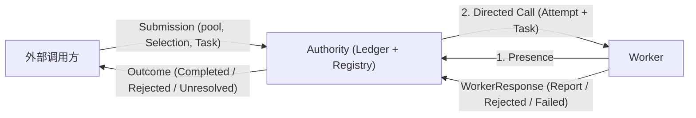
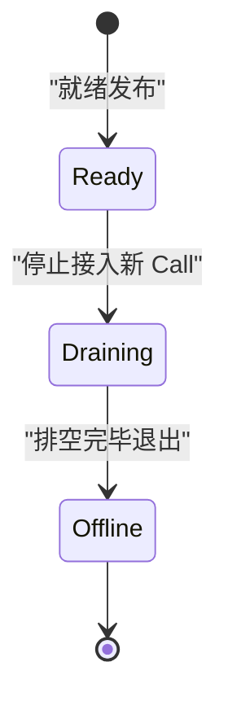
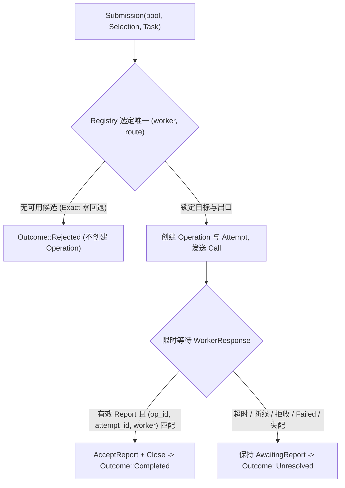
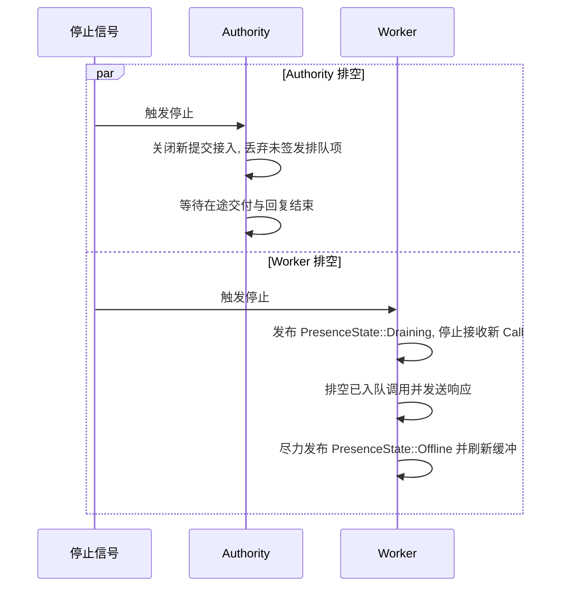

# L3: 分布式交付协议

- **实现状态**：`Draft (Target Spec)`
- **下层依赖**：[00-conventions.md](00-conventions.md)、[00-glossary.md](00-glossary.md)、[01-primitives.md](01-primitives.md)、[02-kernel.md](02-kernel.md)、[03-ledger.md](03-ledger.md)
- **非目标范围**：不规定外部接入网关/CLI、具体消息中间件与线编码格式，不硬编码队列容量与超时数值。

## 交互模型

消息契约见 [protocol.proto](proto/beamlet/l3/v1/protocol.proto)：

1. **`Presence`**：`Worker` 按 `Pool` 发布状态快照与能力集；各 `Authority` 独立维护本地 `Registry`，共用 `Worker` 不共享 `Ledger`。
2. **`Directed Call`**：`Authority` 选定唯一 `(Worker, 传输出口)` 后签发 `Operation`/`Attempt`，发起单次限时调用并接收 `WorkerResponse`。

### 标识约束

- **`RoleInstance`**：`role_id`、`session_id` **必须**为非零 UUID，**不得**按字典序或大小判定新旧。
- **`Pool`**：`1..=64` 字节 ASCII 字母、数字、`-`、`_`，大小写敏感精确匹配。
- **`CapabilityId`**：`1..=256` 字节非空字符串，按字节精确匹配。

## 单调租约格与连接世代

`Authority` 以 `(pool, role_id, session_id)` 为键维护本地 `Registry`：

1. **单调状态格**：单 `session_id` 状态仅按 `Ready < Draining < Offline` 单调推进，按上确界（`join`）合流；`Worker` 重启**必须**更换新 `session_id`。
2. **多源 `Epoch` 租约**：各传输来源独立维护 `Lease { epoch, received_at }`；仅当 `connected == true`、`epoch == link.epoch` 且合流后状态为 `Ready` 时刷新 `received_at`。
3. **即时 TTL 判定**：选路与查询时按本地单调时钟即时判定 `now - received_at < worker_timeout`。

### 租约不变量

- **`INV-REG-01`（世代与鲜活度门控）**：可路由候选在判定瞬间**必须**满足链路在线、`lease.epoch == link.epoch`、未超时且状态为 `Ready`；链路推进 `epoch` 后旧世代租约立即失效。
- **`INV-REG-02`（状态不可复活）**：同一 `session_id` 观测到 `Draining` 或 `Offline` 后，乱序或重放的 `Ready` **不得**使其恢复可路由。
- **`INV-REG-03`（多源故障隔离）**：单一传输来源断线或推进 `epoch`，**不得**影响同一 `Worker` 其他在线鲜活来源的可路由性。

## 定向交付与三态裁决

- **先选路后签发**：选路失败直接返回 `Outcome::Rejected`，**不得**创建 `Operation` 或 `Attempt`；选定 `(worker, route)` 后锁定，失败**不得**换路或换人重试。
- **验收与租约解耦**：`Report` 验收仅核对非空 `report_id` 及 `(operation_id, attempt_id, worker)` 匹配，**不得**因 `Worker` 随后过期或 `Offline` 而拒收。
- **准入与非伪造**：`Worker` **必须**校验 `pool`、目标 `worker`、非空 `authority`/`attempt` 及已启用能力；准入失败返回 `rejected_reason`，处理器异常返回 `failed_reason`，未完成执行**不得**伪造 `Report`。
- **`SEM-DLV-01`（控制面非阻塞与有界缓冲）**：`Presence` 与连接事件处理**不得**被业务并发或回复背压阻塞；接收队列与并发度**应当**有界。
- **`SEM-DLV-02`（超时非取消）**：本地超时或放弃等待仅结束本地等待，**不得**视为远端执行已取消或回滚。

### 交付不变量

- **`INV-DLV-01`（`Exact` 零回退）**：`Selection::Exact(w)` 不可达时返回 `Outcome::Rejected` 且不建操作；已建操作时 `Call` 与终局结果均严格锁定 `w`。
- **`INV-DLV-02`（未决不关闭）**：返回 `Outcome::Unresolved` 时，`Operation` **必须**保持 `AwaitingReport`，**不得**无证关闭或自动重试。
- **`INV-DLV-03`（完成必有真凭）**：任何因完成而 `Closed` 的 `Operation` 及 `Outcome::Completed` **必须**对应锁定 `Worker` 产出的匹配 `Report`。
- **`INV-DLV-04`（错配不推进）**：身份或授权失配的 `Report` **不得**推进 `AwaitingReport`。

## 优雅排空

## 形式化模型索引

- Protobuf IDL：[spec/proto/beamlet/l3/v1/protocol.proto](proto/beamlet/l3/v1/protocol.proto)
- 租约格模型：[spec/quint/protocol/registry_lease.qnt](quint/protocol/registry_lease.qnt)、[spec/quint/protocol/registry_lease_test.qnt](quint/protocol/registry_lease_test.qnt)
- 交付模型：[spec/quint/protocol/delivery.qnt](quint/protocol/delivery.qnt)、[spec/quint/protocol/delivery_test.qnt](quint/protocol/delivery_test.qnt)
