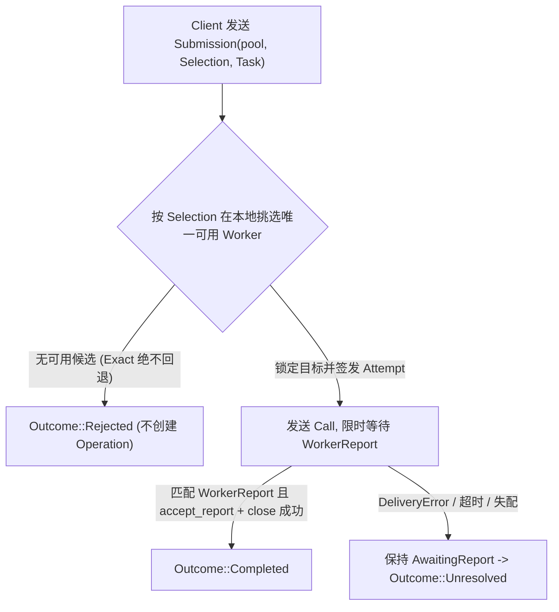
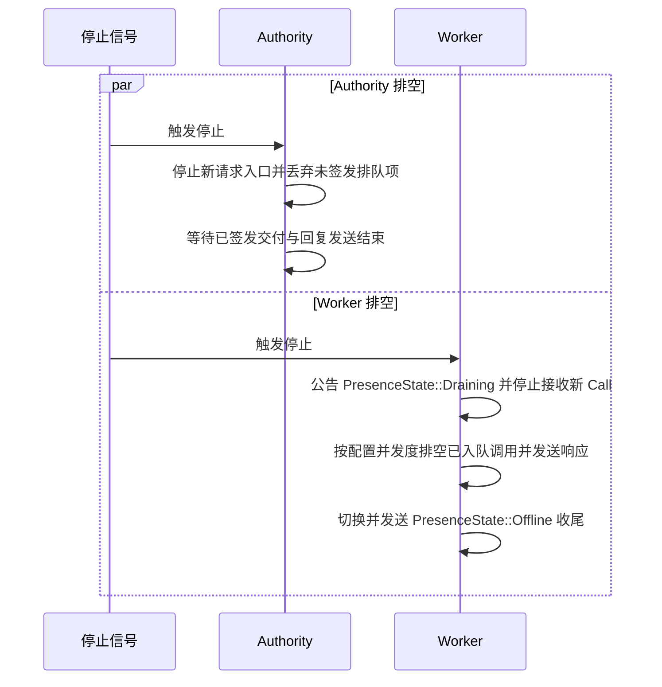

# 会话身份、Presence 租约、路由与 Client 编排

- **下层依赖**：[03-roles.md](03-roles.md)
- **逻辑消息结构**：[messages.proto](proto/beamlet/v1/messages.proto)
- **非目标范围**：不绑定具体消息中间件、序列化线格式、进程运行容器或编程语言实现。

## 实例身份、Pool 与能力约束

- **`RoleInstance`**：由持久 `role_id` 与每次运行生成的 `session_id` 组成；两者均不得为全零 nil UUID，且不得通过比较 UUID 大小或字典序判断会话新旧。
- **`Pool`**：`1..=64` 字节 ASCII 字母、数字、`-` 或 `_`，大小写敏感精确匹配，不修剪空白。`Worker` 归属单个 `Pool`，`Authority` 加入非空 `pools` 集合。
- **`CapabilityId`**：`1..=256` 字节非空字符串，按原始字节精确匹配。`WorkerBinding` 冻结 `(pool, RoleInstance, enabled_capabilities)`，同时用于 `Presence` 公告与接收 `Call` 时的准入检查。

## Presence 公告、Sequence 与 Connection.epoch 租约

每个 `Authority` 在本地内存中按 `(Pool, RoleInstance)` 独立维护 `Worker` 登记视图，不同 `Authority` 允许存在短暂视图差异：

1. **完整快照与 `sequence` 校验**：`Worker` 周期发布与状态变更触发的 `Presence` 必须携带会话内严格递增的非零 `sequence`（`>= 1`）与 `PresenceState`（`Ready` / `Draining` / `Offline`）。首份有效公告即可登记。同一会话收到更小 `sequence`、或同一 `sequence` 内容不一致时必须拒绝；同一 `sequence` 经另一来源重复到达仅登记该来源租约，**不得**刷新首次到达时间（不延长 TTL）。
2. **`Connection.epoch` 隔离与即时过期**：每个观测来源独立记录收到公告时的链路 `epoch` 与本地单调时钟时间。仅有连接处于 `connected == true`、当前 `link.epoch == lease.epoch` 且 `now - received < worker_timeout` 时该来源租约方可视为新鲜；链路断线或重连推进 `epoch` 后，旧 `epoch` 租约立即失效。
3. **`WorkerView` 查询视图**：查询 `workers(pool, capability)` 返回 `WorkerView { presence, last_seen_ms, stale }`，按查询瞬间本地单调时钟即时计算 `last_seen_ms` 与 `stale`，允许包含 `Draining`、`Offline` 或已过期条目。

## 选人策略、`Client` 与外部 `Outcome`

- **`Selection` 零回退**：创建 `Operation` 前必须先完成一次候选判定：`Any` 从同池匹配能力、`PresenceState::Ready` 且存在有效鲜活来源的候选中选出其一（不承诺公平或负载均衡）；`Exact(RoleInstance)` 仅校验该指定实例，不可路由时直接返回 `Outcome::Rejected`，绝不回退到其他实例。
- **`Call` 准入校验**：`Worker` 接收 `Incoming { call, reply }` 时必须校验 `call.pool == self.pool`、`call.worker == self.instance`、`authority` 双 UUID 非零、`attempt` 双 ID 非空以及能力已启用。不满足则拒收，有效执行产出 `WorkerReport` 后经原 `reply` 发回；`Authority` 验收 `WorkerReport` 仅核对 `pool`、`worker`、非空 `report_id` 及 `(operation_id, attempt_id)` 一致，不依赖当前租约是否仍新鲜。
- **`Client` 发现与请求相关性**：`Client::discover` 在 `discovery_window` 窗口内按 `RoleInstance` 去重聚合有效 `AuthorityInfo`（忽略与请求 `pools` 无交集或非法实例回复）。`Command` 携带的 `request_id` 仅用于关联 `Reply`，不提供创建幂等；`Client::request` 校验 `reply.request_id` 与 `reply.authority` 及预期 `Outcome` 分支后消费回复，不自动重试。

## 优雅停止与排空

## 形式化模型

- Quint 路由与租约模型：[routing.qnt](quint/routing/routing.qnt)、[routing_test.qnt](quint/routing/routing_test.qnt)
