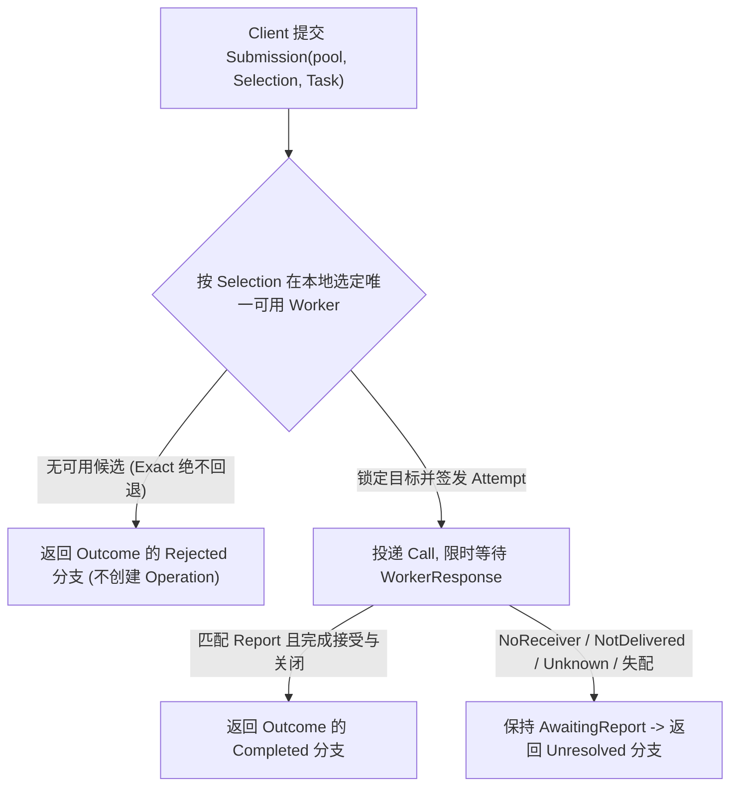
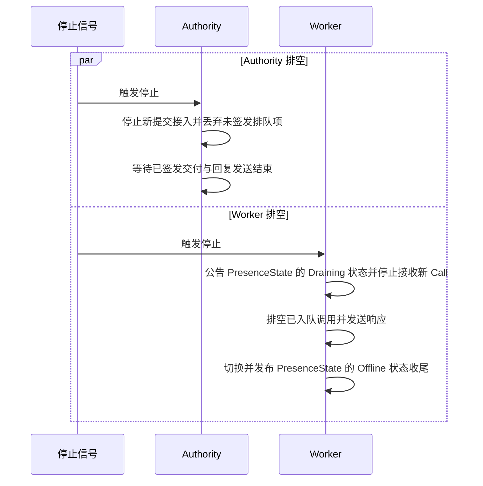

# 会话身份、Presence 租约、路由与编排

- **下层依赖**：[03-roles.md](03-roles.md)
- **逻辑消息结构**：[messages.proto](proto/beamlet/v1/messages.proto)
- **非目标范围**：不绑定具体消息中间件、序列化格式、并发运行时或特定编程语言实现。

## 实例身份、Pool 与能力准入

- **`RoleInstance`**：由持久 `role_id` 与单次运行生成的 `session_id` 构成；两者均必须非空，且不得通过比较标识大小或字典序判断会话新旧。
- **`Pool`**：大小写敏感的逻辑隔离命名空间；每个 `Worker` 归属单个 `Pool`，每个 `Authority` 加入一个或多个 `Pool`。
- **能力精确匹配**：能力标识非空且按原始字面值精确匹配，同时决定 `Worker` 对外公告的能力集合以及接收 `Call` 时的执行准入许可。

## Presence 公告、Sequence 与 Connection 租约

每个 `Authority` 在本地内存中按 `(Pool, RoleInstance)` 独立维护 `Worker` 状态视图，不同 `Authority` 允许存在短暂视图差异：

1. **完整快照与 `sequence` 校验**：`Worker` 周期发布与状态变更触发的 `Presence` 必须携带会话内严格递增的正整数 `sequence`（`>= 1`）与 `PresenceState`（`Ready`、`Draining`、`Offline`）。首份有效快照即可完成登记。同一会话收到更小 `sequence`、或同一 `sequence` 内容不一致时必须拒绝；同一 `sequence` 经另一通信路径重复到达仅增加该路径的路由可用性，**不得**刷新首次到达时间（不延长本地租约期限）。
2. **`Connection` 世代隔离与即时过期**：每个通信路径独立记录收到公告时的连接 `epoch` 与观测方本地单调时钟时间。仅当链路处于 `connected == true`、当前路径 `epoch` 与租约 `epoch` 一致且未超出本地租约期限时，该路径方可视为新鲜可用；链路断线或重连推进 `epoch` 后，旧 `epoch` 租约立即失效。
3. **`WorkerView` 查询视图**：查询 `Pool` 内成员列表返回 `WorkerView { presence, stale }`，`stale` 按查询瞬间本地单调时钟与连接状态即时计算，允许包含 `Draining`、`Offline` 或已过期条目。

## 选路策略、`Client` 与外部 `Outcome`

- **`Selection` 零回退**：创建 `Operation` 前必须先完成一次候选选定：`Any` 从同池匹配能力、`PresenceState` 为 `Ready` 且存在有效新鲜路径的候选中任选其一（不承诺公平或均衡）；`Exact` 仅检查指定 `RoleInstance`，不可路由时直接返回 `Rejected`，绝不回退到其他实例，亦不在台账中创建 `Operation`。
- **`Call` 准入与结果验收**：`Worker` 接收 `Call` 时必须校验 `pool`、目标 `worker`、`authority` 与 `attempt` 身份非空以及能力已启用；不满足则拒收（对应 `NotDelivered`），有效执行则经 `WorkerResponse` 返回 `Report` 或执行失败通知 `failed`。`Authority` 验收回复时仅核对 `pool`、`worker`、非空 `report_id` 及 `(operation_id, attempt_id)` 与签发记录一致，不依赖目标当前租约是否仍然新鲜。
- **`Client` 发现与请求关联**：`Client` 在发现时间窗内按 `RoleInstance` 去重聚合有效 `AuthorityInfo`（忽略与关注 `Pool` 集合无交集或非法的回复）。`Command` 携带的 `request_id` 仅用于关联 `Reply`，不提供创建幂等；`Client` 核对 `Reply` 中的 `request_id`、`authority` 与预期 `Outcome` 分支后消费结果，不自动重试。

## 优雅停止与排空

## 形式化模型

- Quint 路由与租约模型：[routing.qnt](quint/routing/routing.qnt)、[routing_test.qnt](quint/routing/routing_test.qnt)
