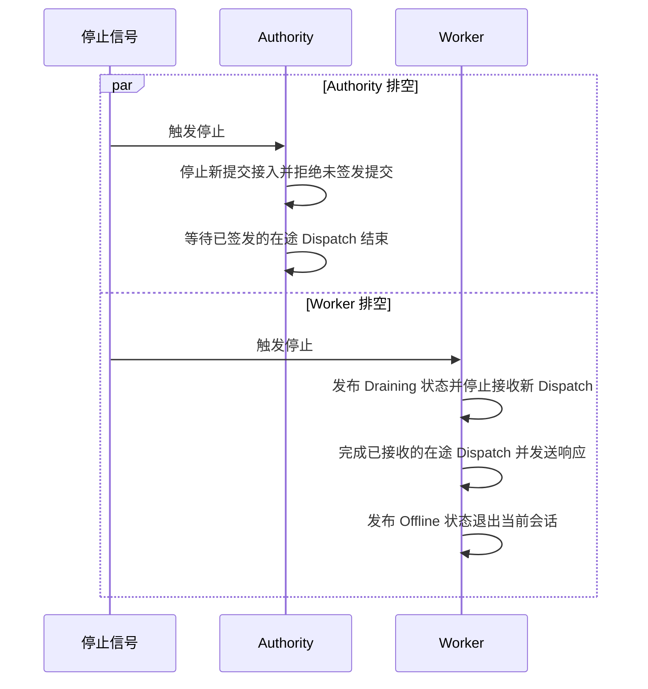

# 会话身份与存活观测

- **下层依赖**：[03-roles.md](03-roles.md)
- **逻辑消息结构**：[messages.proto](proto/beamlet/v1/messages.proto)
- **非目标范围**：不涉及具体选路策略、派发投递、消息中间件或序列化格式。

## 身份与逻辑隔离

- **`RoleSession`**：由持久角色标识与单次运行会话标识组成；两者均必须非空，且不得通过比较标识大小或字典序推断会话新旧。重启实例必须分配全新的会话标识。
- **`Pool`**：大小写敏感的逻辑隔离分组。每个 `Worker` 归属唯一 `Pool`，每个 `Authority` 加入一个或多个 `Pool`；不同 `Pool` 之间的成员与公告完全隔离。

## Presence 快照与本地租约

每个 `Authority` 在本地按分组和 `RoleSession` 独立维护 `Worker` 存活视图，不同 `Authority` 允许存在短暂视图差异：

1. **会话序号与状态快照**：`Worker` 发布的 `Presence` 必须携带所属 `Pool`、自身 `RoleSession`、实际启用的精确能力列表、会话内严格递增的正整数序号 `sequence` 以及当前 `PresenceState`（`Accepting`、`Draining` 或 `Offline`）。首份有效快照即可完成登记；收到序号回退或同序号内容矛盾的公告必须拒绝。
2. **本地租约与重放不续期**：每个 `Authority` 按自身本地单调时钟记录首次收到当前最新 `sequence` 的时间。同一份 `sequence` 快照重复到达**不得**刷新首次到达时间，防止重复投递无端延长本地租约期限。
3. **可路由判定**：仅当该会话当前处于 `Accepting` 且距最新有效 `sequence` 首次到达时间未超出本地租约期限时，该 `Worker` 会话方可视为**可路由**；收到 `Draining` 或 `Offline`、或本地租约到期后，立即退出可路由集合。

## 优雅停止与会话排空

## 形式化模型

- Quint 会话与租约模型：[session.qnt](quint/session/session.qnt)、[session_test.qnt](quint/session/session_test.qnt)
