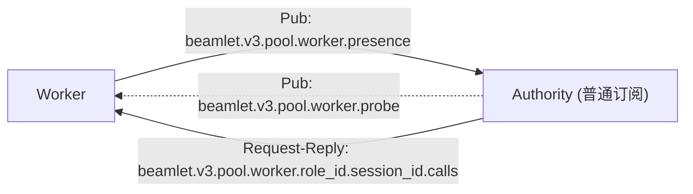

# L4-A: NATS 传输与 v3 JSON 绑定

- **实现状态**：`Implemented`
- **下层依赖**：[00-conventions.md](00-conventions.md) 至 [04-protocol.md](04-protocol.md)
- **参考实现**：[beamlet-protocol](../crates/transports/beamlet-protocol/src/lib.rs)、[beamlet-transport-nats](../crates/transports/beamlet-transport-nats/src/lib.rs)
- **非目标范围**：不修改 L1–L3 语义，不兼容旧纯文本线格式，不提供恰好一次（exactly-once）保证。

## Subject 路由空间

按 `pool` 隔离于 `beamlet.v3.<pool>` 命名空间（见 [subject.rs](../crates/transports/beamlet-transport-nats/src/subject.rs)）：



| Subject | 订阅方式 | 用途 |
| --- | --- | --- |
| `beamlet.v3.<pool>.worker.presence` | 普通广播订阅 | `Worker` 发布完整 `Presence` 快照 |
| `beamlet.v3.<pool>.worker.probe` | 普通广播订阅 | `Authority` 请求同池 `Worker` 立即广播当前状态 |
| `beamlet.v3.<pool>.worker.<role_id>.<session_id>.calls` | 普通订阅（Request-Reply） | 定向投递 `Call` 并接收单份 `WorkerReply` |
| `beamlet.v3.<pool>.authority.discover` | 普通订阅 | 可选外部发现入口 |
| `beamlet.v3.<pool>.authority.<role_id>.<session_id>.requests` | 队列组 `beamlet-authority-<role_id>-<session_id>` | 可选外部提交入口；同会话多连接共享队列组去重 |

## v3 JSON 线格式

消息**必须**封装于 `version = 3` 的 JSON 信封，拒绝未知字段、版本失配或语法错误报文：

```json
{
  "version": 3,
  "body": { ... }
}
```

- **`SEM-BND-01`（UTF-8 载荷特化）**：`OpaquePayload` 映射为保留原始空白的 UTF-8 字符串（`Task.text`、`ReportData.result`）。
- **`WorkerResponse` 映射**：`WorkerReply::Report` 核对 `pool`、`worker`、非空 `report_id` 及 `(operation_id, attempt_id)` 后转为 `Report`；`Rejected` 映射为明确未交付；`Failed` 映射为结果未知。
- **传输错误归类**：`NoResponders` 为无接收者；`InvalidSubject` / `MaxPayloadExceeded` 为明确未交付；超时、断线、解码错误与缓冲溢出均为结果未知（上层裁决为 `Outcome::Unresolved`）。

## 连接世代与缓冲

- **`SEM-BND-02`（世代推进与积压清空）**：初始连接为 `(epoch = 1, connected = true)`，每次断线或重连递增 `epoch`；`Authority` 端点派发连接变更前**必须**清空订阅缓冲中重连前积压的控制消息。
- **就绪刷新与认证边界**：端点订阅并 `flush` 后方可视为就绪；`Subject` 与 `RoleInstance` 仅作路由核对，访问控制由 NATS 账户策略保障。
