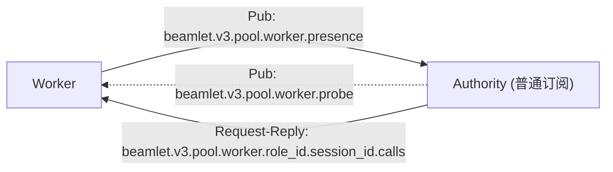

# L4-A: NATS 传输与 v3 JSON 协议绑定

- **实现状态**：`Implemented`
- **下层依赖**：[00-glossary.md](00-glossary.md) 至 [04-protocol.md](04-protocol.md)
- **参考实现**：[beamlet-protocol](../crates/transports/beamlet-protocol/src/lib.rs)、[beamlet-transport-nats](../crates/transports/beamlet-transport-nats/src/lib.rs)
- **非目标范围**：不改变 L1–L3 抽象语义，不提供旧版本纯文本兼容分支，亦不将 NATS 队列组或刷盘解释为恰好一次（exactly-once）执行保证。

## Subject 路由空间

NATS 传输绑定以 `pool` 为第一级隔离边界，将 L3 协议映射至 `beamlet.v3.<pool>` 下的路由主题（见 [subject.rs](../crates/transports/beamlet-transport-nats/src/subject.rs)）：



| Subject 模式 | 订阅方式 | 用途 |
| --- | --- | --- |
| `beamlet.v3.<pool>.worker.presence` | 普通广播订阅 | `Worker` 发布完整 `Presence` 快照，同池内各 `Authority` 独立接收 |
| `beamlet.v3.<pool>.worker.probe` | 普通广播订阅 | `Authority` 启动或重同步时通知同池 `Worker` 立即广播最新状态快照 |
| `beamlet.v3.<pool>.worker.<role_id>.<session_id>.calls` | 普通订阅（Request-Reply） | `Authority` 向唯一选定的 `Worker` 会话交付 `Call` 并等待单份 `WorkerReply` |
| `beamlet.v3.<pool>.authority.discover` | 普通订阅 | 可选的外部发现入口（供外部接入方查询同池 `Authority`） |
| `beamlet.v3.<pool>.authority.<role_id>.<session_id>.requests` | 队列组 `beamlet-authority-<role_id>-<session_id>` | 可选的外部请求入口；同一 `Authority` 会话多连接共享队列组防止重复执行 |

## v3 JSON 线格式映射

所有跨越 NATS 的消息**必须**封装于固定版本 JSON 信封（`VERSION = 3`），并启用严格的 `deny_unknown_fields` 语义；版本不匹配、JSON 语法错误或含未知字段的报文**必须**直接拒绝或忽略：

```json
{
  "version": 3,
  "body": { ... }
}
```

- **业务载荷特化（`SEM-BND-01`）**：当前 v3 文本 Profile 将 `L3` 的不透明 `OpaquePayload` 映射为 UTF-8 字符串（`Task.text` 与 `ReportData.result`），保留原始空白不做修剪。
- **`WorkerResponse` 线格式映射**：
  - `WorkerReply::Report`：校验 `pool`、`worker`、`report_id` 非空及 `(operation_id, attempt_id)` 一致后返回完整 `Report`。
  - `WorkerReply::Rejected`：执行前绑定/能力校验不通过时返回，对应明确未交付（`NotDelivered`）。
  - `WorkerReply::Failed`：处理器执行期异常且未生成 `Report` 时返回，无法排除副作用，对应结果未知（`Unknown`）。
- **底层传输错误分类**：`NoResponders` 归类为无接收者；`InvalidSubject` / `MaxPayloadExceeded` 归类为明确未交付；超时、断线、反序列化失败或订阅缓冲溢出统一归类为结果未知，最终在 `Authority` 侧体现为 `Outcome::Unresolved`。

## 连接世代与缓冲语义

- **`SEM-BND-02`（重连世代推进与旧缓冲丢弃）**：每个 `Nats` 连接实例监听底层连接事件，初始连接为 `(epoch = 1, connected = true)`，每次断线或重连均单调递增 `epoch`。当 `Authority` 端点观测到连接状态变化时，**必须**在派发连接事件前立即丢弃本地订阅通道中所有重连前积压的旧控制消息，防止旧世代心跳在重连后误续租约。
- **订阅刷新与认证边界**：`bind_authority` 与 `bind_worker` 在完成订阅并向服务端执行 `flush` 后才返回就绪。Subject 与 `RoleInstance` 仅作路由关联而非安全认证，权限隔离由 NATS 服务端账户策略保障。
