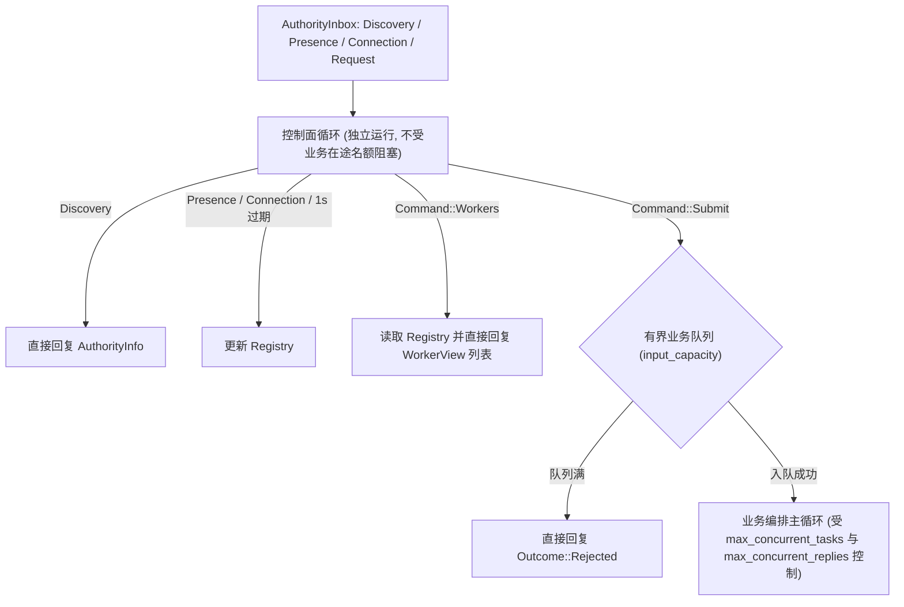
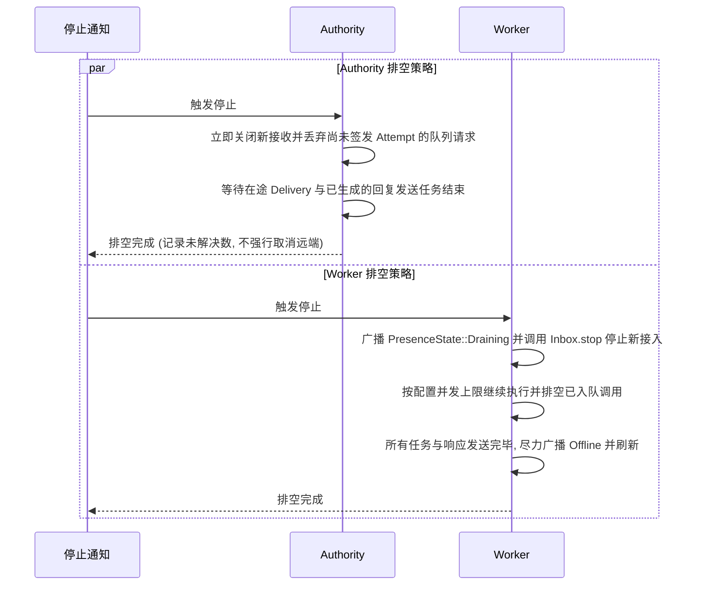

# L3-B: 分布式角色编排协议

- **实现状态**：`Implemented`
- **下层依赖**：[00-glossary.md](00-glossary.md)、[01-primitives.md](01-primitives.md)、[02-kernel.md](02-kernel.md)、[03-ledger.md](03-ledger.md)、[04-interaction.md](04-interaction.md)
- **非目标范围**：不规定具体网络中间件地址或路由主题字符串、线格式编码字节布局、文件配置格式或宿主进程监督循环。

## Registry 租约与连接世代协议

每个 `Authority` 独立持有内存态的 `Worker` 登记表（`Registry`），**不**跨 `Authority` 共享登记状态，亦**不**因共享同一个 `Worker` 而共享或接管彼此的 `Ledger` 与 `Operation`。

### 登记表键值与多来源租约结构

1. **去重主键**：`Registry` 以 `(pool, role_id, session_id)` 为唯一键维护条目；同一 `RoleInstance` 若经由多个并发传输来源接入同一 `Authority`，对外仅聚合展示一条快照记录，同时在条目内部按传输来源分别记录独立的 `Lease { epoch, received_at, sequence }`。
2. **准入过滤**：当 `Authority` 从来源 `source` 在观测世代 `epoch` 与本地单调时刻 `now` 收到 `Presence` 时，若满足以下任一条件，**必须**直接忽略且返回无效：`source` 当前 `connected == false`、`source` 当前世代 `!= epoch`、`presence.pool` 不在 `Authority` 加入的 `pools` 中、身份含全零 UUID、`presence.sequence == 0`、`capabilities` 为空或包含非法 `CapabilityId`。
3. **序号单调与防复用延寿**：
   - 若 `presence.sequence < entry.max_sequence`，**必须**拒绝（防旧包倒序覆盖）。
   - 若 `presence.sequence == entry.max_sequence` 但快照内容与已记录快照不一致，**必须**拒绝。
   - 若同一个 `source` 上已存在 `lease.sequence >= presence.sequence`，**必须**拒绝。
   - 仅当 `presence.sequence > entry.max_sequence` 时才将本地接收时间 `entry.received` 更新为 `now`；若同一序号经由另一个 `source` 重复抵达，**必须**复用原 `entry.received` 而**不得**延长租约有效期。

### 存活判定与四倍保留窗口

- **即时过期计算**：给定本地租约期限 `worker_timeout`（参考默认值 `15s`，应覆盖约三个默认 `5s` 心跳周期），来源租约新鲜当且仅当同时满足：`link.connected == true`、`lease.epoch == link.epoch` 且 `now - lease.received < worker_timeout`。查询（`WorkersQuery`）与选人（`Select`）**必须**在访问时刻即时计算 `stale` 状态，**不得**依赖后台清理定时器的触发精度。
- **Tombstone 保留期**：后台周期清理（参考每秒一次）仅从视图中驱逐 `now - lease.received >= 4 * worker_timeout` 的老化租约；当某条目的全部来源租约均被清理后才彻底删除条目。保留窗口期间继续记住已下线或 `Offline` 时的 `max_sequence`，防止网络延迟的旧 `Ready` 公告立即复活已下线会话。

### 租约安全不变量

- **`INV-REG-01`（连接与世代隔离）**：任何被判定为可路由或被 `Select` 选中的 `(worker, source)`，在判定瞬间**必须**满足链路在线、租约 `epoch` 与链路当前 `epoch` 一致、未超过 `worker_timeout` 且 `PresenceState` 为 `Ready`。连接断开或重连推进 `epoch` 后，旧世代租约**必须**立即失效，直至在新 `epoch` 上收到新的有效心跳。
- **`INV-REG-02`（序号单调防复活）**：在条目未超过 `4 * worker_timeout` 保留期之前，已记录的最高 `sequence` **必须**单调不降；任何状态为 `Offline` 或 `Draining` 的记录**不得**接受新任务，且无法通过相同或更小 `sequence` 的 `Ready` 心跳恢复可选状态。
- **`INV-REG-03`（多来源故障隔离）**：同一 `Worker` 的多个传输来源各自独立计算有效性；任一来源断线或推进 `epoch`，**不得**破坏另一条保持在线且租约新鲜的来源之可路由性。

## Authority 编排与控制数据隔离

### 控制面与业务面隔离

- **`SEM-ROL-01`（控制面非阻塞保证）**：`Discovery` 应答、`Presence` 登记、`WorkersQuery` 查询以及业务队列满载时的 `Rejected` 拒绝回复，**必须**在独立于业务在途并发上限的控制循环中处理；当 `Authority` 业务队列或并发槽位完全占满时，控制面仍**必须**保持响应。
- **回复背压与输入准入**：业务主循环同时受两类资源上限约束——在途并发任务上限（`max_concurrent_tasks`，支持正整数限额或 `Unlimited`）和待发送结果回复上限（`max_concurrent_replies`）。当在途待发送回复达到 `max_concurrent_replies` 时，主循环**必须**暂停从业务队列取出新提交并暂停收割已完成的 `Delivery` 结果，防止回复无限积压；回复发送失败仅记录诊断告警，不终止 `Authority` 运行。

### 定向选人、签发与报告回收规则

1. **先选定，后签发**：主循环取出 `Submission` 后，先在 `Registry` 上按 `(pool, worker, capability)` 执行一次 `Select`。若为 `Any`，挑选一个当前具备新鲜 `Ready` 租约且已启用该能力的 `Worker` 会话并固定其首个有效交付出口；若为 `Exact(instance)`，**必须**精确校验该实例当前可路由，失效时**不得**回退到同 `role_id` 的其他会话或同池其他实例。
2. **选人失败不触碰台账**：无匹配候选时，直接回复 `Outcome::Rejected`，**不得**在 `Ledger` 中创建 `Operation` 或签发 `Attempt`。
3. **一次性定向交付**：选定 `(worker, route)` 后，`Authority` 在 `Ledger` 上依次 `CreateOperation` 与 `CreateAttempt`，随后通过锁定的 `route` 在 `report_timeout` 期限内发起单次 `Delivery.Deliver`。交付失败时**不得**切换 `route` 或向其他 `Worker` 重试。
4. **报告回收与租约解耦**：当 `Delivery` 在期限内返回完整 `Report` 时，`Authority` 仅核对 `report_id` 非空、以及 `(operation_id, attempt_id, worker_instance)` 与签发记录完全匹配，**不得**因为执行期间该 `Worker` 的心跳租约过期或发出了 `Draining`/`Offline` 而拒绝其合法 `Report`。接受成功后立即调用 `Ledger.AcceptReport` 与 `Ledger.CloseOperation`，向调用方回复 `Outcome::Completed`。
5. **失败与超时保持等待**：若 `Delivery` 返回任何 `DeliveryError`（含 `report_timeout` 超时）或关联检验失败，`Authority` 释放并发任务槽位并向调用方回复 `Outcome::Unresolved`，但台账中的 `Operation` **必须**继续保持 `AwaitingReport`，**不得**伪造 `Report` 或强制关闭。

### 交付安全不变量

- **`INV-DLV-01`（`Exact` 零回退保证）**：以 `Selection::Exact(w)` 提交的任务，若失败拒绝则绝不生成 `Operation`；若已生成 `Operation`，其 `Call`、`Unresolved` 与 `Completed` 结果中锁定的执行者**必须**严格等于 `w`。
- **`INV-DLV-02`（未解决不关闭）**：返回 `Outcome::Unresolved` 后，对应 `Operation` **不得**在没有真实匹配 `Report` 的情况下转入 `Closed`，且单次提交**不得**自动签发第二个 `Attempt`。
- **`INV-DLV-03`（完成必有真实证据）**：任何 `Operation` 进入 `Closed`（因报告完成）以及向外返回 `Outcome::Completed`，都**必须**对应一条由目标 `Worker` 为该 `(operation_id, attempt_id)` 真实产出的非空 `Report`。
- **`INV-DLV-04`（不匹配报告绝不解除等待）**：任何 `operation_id`、`attempt_id` 或来源身份不匹配的 `Report` 都**不得**将 `AwaitingReport` 推进为 `Closed`。

## Worker 与 Client 协议行为

### Worker 执行循环与独立心跳驱动

1. **绑定刷新先行**：`Worker` **必须**在任务接收入口（`WorkerInbox`）与探测入口绑定并完成首次发送缓冲刷新后，才能发布 `sequence = 1` 的 `PresenceState::Ready` 公告。
2. **独立心跳与重连行为**：`Presence` 循环独立于业务执行槽位运行，响应周期心跳（`heartbeat_interval`）、`Probe` 立即重发、`Connection` 恢复（先刷新通道再发布递增 `sequence` 的当前状态快照）以及状态变更；断线期间跳过定时心跳周期，**不**在重连后补发积压的历史心跳。所有公告发送与刷新操作受 `announcement_timeout` 约束，避免发送阻塞导致角色无法退出。
3. **有限并发与乱序完成**：`Worker` 在构造时冻结能力处理器表与启用集合（未指定启用集时默认启用全部已注册能力；空集合、重复注册或未知能力均拒绝构造）。执行循环的并发名额（`Limited(n)` 或 `Unlimited`）从取出 `Incoming` 起占用，直到执行完成且通过 `Responder` 发送响应结束（或失败）后释放。`report_id` 按接收顺序生成，`Report` 按实际完成顺序异步回传。
4. **执行失败语义（`SEM-ROL-02`）**：能力处理器返回业务执行失败时，`Worker` 发送 `WorkerResponse::Failed(reason)`，**不得**构造虚假的成功或完成 `Report`；对于调用方目标或能力不匹配的非法 `Call`，记录告警后按通道约定拒收或丢弃。

### Client 发现窗口与响应校验

1. **发现窗口与去重（`SEM-ROL-03`）**：`Client` 构造时校验 `discovery_window < request_timeout`（均须正数）。`Discover` 拒绝空 `pools` 集合，在 `discovery_window` 窗口内持续读取回复，忽略 `request_id` 不匹配、全零 UUID 或与查询 `pools` 无交集的无效回复；按 `RoleInstance` 去重并将同一实例来自多个 `Pool` 的声明合并至同一条 `AuthorityInfo`。总体等待（含创建发现入口与收集）受 `request_timeout` 封顶。
2. **单次提交与关联验证**：`Client` 的 `Workers` 与 `Submit` 均基于显式快照构造 `Command` 并仅交付传输一次，不维护内部自动重发队列；收到 `Reply` 后核对 `request_id`、`authority`、预期 `Outcome` 变体（含非空领域身份与 `Exact` 选择下的执行 `worker` 一致性），不匹配时返回明确关联错误。

## 优雅停止与分级排空序列

当 `Authority` 与 `Worker` 收到停止通知时，两者遵循截然不同的分级排空策略以保护已授权工作的完整性：

## 形式化模型索引

- 租约与连接世代模型：[spec/quint/protocol/registry_lease.qnt](quint/protocol/registry_lease.qnt)、[spec/quint/protocol/registry_lease_test.qnt](quint/protocol/registry_lease_test.qnt)
- 定向交付与失败语义模型：[spec/quint/protocol/delivery.qnt](quint/protocol/delivery.qnt)、[spec/quint/protocol/delivery_test.qnt](quint/protocol/delivery_test.qnt)
