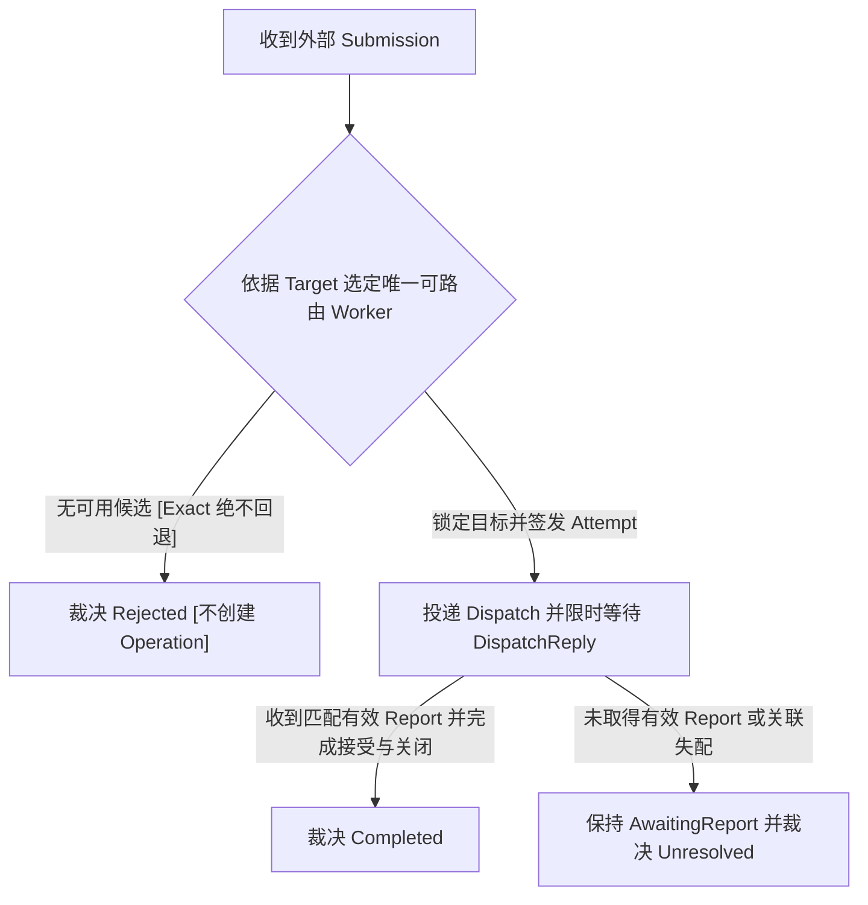

# 目标选定、派发与提交裁决

- **下层依赖**：[04-session.md](04-session.md)
- **逻辑消息结构**：[messages.proto](proto/beamlet/v1/messages.proto)
- **非目标范围**：不绑定外部发现接口、用户界面查询协议、具体传输中间件或运行时并发框架。

## 提交流程与三态裁决

## 选路、准入与验收规则

- **`Target` 零回退**：提交执行创建 `Operation` 前必须先完成唯一候选选定。`Any` 从同 `Pool` 中匹配能力且当前可路由的 `Worker` 里任选其一（不承诺公平或均衡）；`Exact` 仅检查指定的唯一 `RoleSession`。若无满足条件的候选，直接裁决为 `Rejected`，**不得**在 `Ledger` 中创建 `Operation` 或 `Attempt`，且 `Exact` 不可路由时绝不回退到其他会话。
- **定向 `Dispatch` 准入校验**：`Dispatch` 携带目标 `Pool`、双方 `RoleSession`、既有 `Attempt` 与原始 `Task`。`Worker` 接收时必须核对所属 `Pool`、目标 `Worker` 会话、`Authority` 会话与 `Attempt` 身份非空以及 `Task` 能力已在本次会话启用；不满足则直接拒收，有效执行后经 `DispatchReply` 返回完整 `Report` 或执行期失败通知。
- **验收与当前存活解耦**：`Authority` 验收回复时仅校验返回来源的 `Pool`、锁定 `Worker`、非空报告身份以及 `Attempt` 与 `Operation` 关联一致，**不得**因执行期间该 `Worker` 租约过期、`Draining` 或 `Offline` 而拒绝合法迟到的 `Report`。
- **三态 `Outcome` 唯一语义**：
  - `Rejected`：创建 `Operation` 前即拒绝，保证台账中无新增对象。
  - `Completed`：收到真实匹配的 `Report`、台账接受且 `Operation` 已关闭。
  - `Unresolved`：已签发 `Attempt` 但未在期限内获得有效 `Report`，原 `Operation` 保持 `AwaitingReport`，不代表远端未执行或已取消。

## 形式化模型

- Quint 选路与裁决模型：[routing.qnt](quint/routing/routing.qnt)、[routing_test.qnt](quint/routing/routing_test.qnt)
