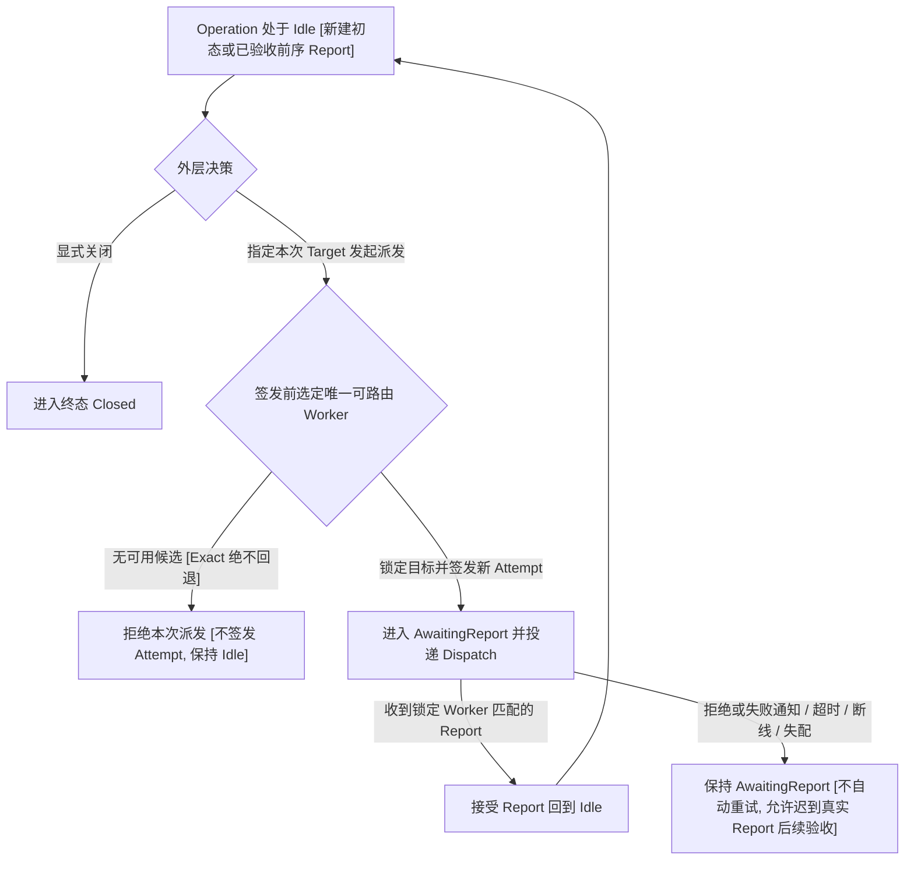

# 目标选定与定向派发

- **下层依赖**：[04-session.md](04-session.md)
- **逻辑消息结构**：[messages.proto](proto/beamlet/v1/messages.proto)
- **非目标范围**：不决定重试次数或关闭时机，不规定外部调用方接入 `Authority` 的接口形态，亦不绑定具体传输中间件。

## 单次派发与多 Attempt 闭环

## 选路、准入与验收规则

- **`Target` 签发前选路与零回退**：对处于 `Idle` 的 `Operation` 发起派发时，必须在签发新 `Attempt` 前依据本次 `Target` 锁定唯一候选。`Any` 从启用对应 `Task` 能力且当前可路由的 `Worker` 会话中任选其一（不承诺公平或均衡）；`Exact` 仅核对指定的唯一 `RoleSession`。若无满足条件的候选，直接拒绝本次派发，**不得**签发 `Attempt`，`Operation` 保持 `Idle`（若采用创建与首派合并入口则连 `Operation` 亦不创建），且 `Exact` 不可路由时绝不回退到其他会话。
- **定向 `Dispatch` 与准入校验**：锁定唯一 `Worker` 并签发新 `Attempt` 后，`Authority` 发送携带双方 `RoleSession`、既有 `Attempt` 与原始 `Task` 的 `Dispatch`。`Worker` 接收时必须核对双方 `RoleSession` 与 `Attempt` 身份非空、目标会话与自身一致、当前处于 `Accepting` 且 `Task` 能力已在本次会话启用；准入不满足或执行期异常时，均通过 `DispatchReply`（携带自身 `RoleSession` 与原因说明）返回拒绝/失败通知，**不得**伪造 `Report`。
- **锁定来源验收与存活解耦**：`Authority` 仅当收到 `DispatchReply` 携带完整 `Report`、回复方 `RoleSession` 与本次 `Attempt` 锁定的 `Worker` 一致、报告身份非空且关联当前 `Operation` 与 `Attempt` 时，才接受 `Report` 将 `Operation` 推进回 `Idle`；**不得**因验收瞬间该 `Worker` 已租约到期、`Draining` 或 `Offline` 而拒绝合法迟到的 `Report`。
- **多 `Attempt` 演进与未决保持**：每次接受 `Report` 回到 `Idle` 后，上层均可根据业务结果继续指定新 `Target`（允许与前序尝试相同或不同）签发下一次 `Attempt`，或显式关闭进入 `Closed`。凡未取得匹配有效 `Report`（含准入拒收、执行异常、未达、超时、断线或来源/关联失配），原 `Operation` 必须保持 `AwaitingReport`，不得自动签发重试或无证关闭。

## 形式化模型

- Quint 选路与多尝试派发模型：[routing.qnt](quint/routing/routing.qnt)、[routing_test.qnt](quint/routing/routing_test.qnt)
