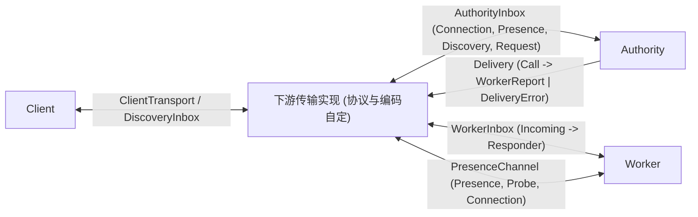

# 抽象传输契约

- **下层依赖**：[04-routing.md](04-routing.md)
- **逻辑消息结构**：[messages.proto](proto/beamlet/v1/messages.proto)
- **非目标范围**：不规定具体消息中间件、网络协议、序列化格式或身份认证机制；具体传输方案由下游按语言与基础设施自行提供。

## 传输端点拓扑

下游传输层仅需向上层角色提供以下五类抽象端口契约，不得侵入协调状态机：

- **职责红线**：传输层仅负责路由投递、请求/回复相关性维持与连接状态观测；**不得**持有 `Operation` 或 `Worker` 租约表，**不得**代做 `Selection` 选路、不自动重试 `Call` 或 `Command`。

## 五类端点契约

1. **`Delivery`（定向交付）**：按 `Call` 指定的 `(pool, worker)` 与本地有限 `deadline` 交付一次。收到回复时必须核对 `pool`、`worker`、非空 `report_id` 及 `(operation_id, attempt_id)` 与原始 `Call` 一致，通过则返回完整 `WorkerReport`；失败按证据严格归类为 `DeliveryError`：
   - `NoReceiver`：目标不存在或当前无对应接收者。
   - `NotDelivered`：有明确证据证明未交付或未进入执行（如输入校验失败、有界接收队列满拒收、`Call` 目标与 `WorkerBinding` 不符拒收）。
   - `Unknown`：超时、连接中断、回复无法解码、身份关联失配或收到 `WorkerResponse::Failed` 等无法排除远端已执行或产生副作用的情形。
2. **`WorkerInbox`（调用接入与排空）**：绑定唯一 `WorkerBinding`（同一路由域内重复绑定同一 `(pool, RoleInstance)` 必须立即拒绝），产出携带专属一次性 `Responder<WorkerResponse>` 的 `Incoming`，支持并发执行与乱序回复。调用 `stop` 必须停止新接入，但**必须**保留已入队尚未取走的消息直至读取完毕返回空信号。
3. **`PresenceChannel`（公告与探测）**：向 `Worker` 暴露当前 `Connection`、接收 `PresenceEvent`（`Probe` 请求或 `Connection` 变更）、向所属 `pool` 发布完整 `Presence`（不修改 `sequence` 与 `state`）及提供 `flush`（`flush` 成功不代表远端已收到或已登记）。
4. **`AuthorityInbox`（控制输入）**：独立于业务并发槽位向 `Authority` 暴露 `ConnectionView`、产出 `AuthorityEvent`（`Connection`、`Presence { presence, epoch }`、`Discovery`、`Request`）与触发 `probe`。同一 `Authority` 会话若通过多个传输连接接入，同一份 `Request` 至多交由一条连接处理，而 `Presence` 与 `Discovery` 允许各连接独立观测。
5. **`ClientTransport` 与 `DiscoveryInbox`（发现与请求）**：`discover(pools, request_id)` 发起查询并返回逐条读取 `DiscoveryReply` 的 `DiscoveryInbox`（允许丢失或乱序，由 `Client` 按窗口收集去重）；`request(command, deadline)` 向唯一 `Authority` 会话发送一次 `Command` 并等待单份 `Reply`（超期或取消等待不取消远端执行）。

## 连接世代与边界约定

- **连接 `epoch` 递增与旧缓冲清理**：连接就绪初态为正整数 `epoch` 与 `connected = true`；每次断线、关闭或重连必须单调递增 `epoch`。`AuthorityInbox` 在向上层派发连接变更事件前，**必须**立即丢弃本地接收缓冲中重连前积压的控制报文，防止旧世代 `Presence` 误续租约。
- **路由与安全分离**：`Pool`、`RoleInstance` 与传输路由地址仅作寻址与关联核对，不承担安全身份认证职责；接入鉴权与访问隔离由下游传输实现与部署基础设施自行保障。
