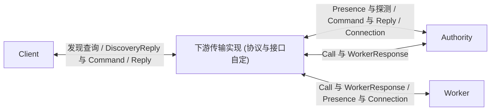

# 抽象传输契约

- **下层依赖**：[04-routing.md](04-routing.md)
- **逻辑消息结构**：[messages.proto](proto/beamlet/v1/messages.proto)
- **非目标范围**：不规定具体消息中间件、网络协议、接口形态、序列化格式或身份认证机制；具体传输方案由下游自行实现。

## 跨边界消息流

下游传输实现只需承载角色之间的消息交换与底层连接观测，不得侵入协调状态机：

## 下游传输必须满足的保证

1. **无状态透明边界**：传输层不得持有 `Operation` 或 `Worker` 租约状态，不得代做 `Selection` 选路，亦不得在失败或超时后自动重发 `Call` 或 `Command`。
2. **定向单次投递与响应独立关联**：按 `Call` 锁定的 `(pool, worker)` 精确投递一次，允许多个在途调用并发执行与乱序回复，每次调用至多关联一份响应。仅当回复核对 `pool`、`worker`、非空 `report_id` 及 `(operation_id, attempt_id)` 均一致时方可交付有效 `Report` 给协调层；任何未达、队列满或绑定不符拒收、执行期 `failed`、超时、断线、解码错误或关联失配，均**不得**伪造 `Report`，亦不得自动重发。
3. **连接世代单调性与旧缓冲清空**：连接建立时初始化正整数 `epoch` 与 `connected = true`，每次断线、关闭或重连均须单调递增 `epoch`。在向 `Authority` 传递连接变更前，传输层**必须**丢弃本地接收缓冲中重连前积压的控制消息，防止旧 `epoch` 的 `Presence` 在重连后误续租约。
4. **控制与业务隔离及同会话分流**：`Presence`、探测与发现的传递不得被业务处理背压阻塞。同一路由域内不得允许同一 `(pool, RoleInstance)` 重复注册为活跃 `Worker` 接收端；若同一 `Authority` 会话经多条连接接入，同一份 `Command` 至多交由其中一条连接处理，而 `Presence` 与发现查询按连接独立传递。
5. **排空保留与安全解耦**：当 `Worker` 停止接收新调用时，传输层须允许已接收进局部队列的在途 `Call` 继续被消费并完成回复发送；发现回复与公告允许丢失，通过后续探测或周期公告恢复。`Pool` 与 `RoleInstance` 仅用于路由关联核对，身份认证与访问控制由下游传输与基础设施保障。
