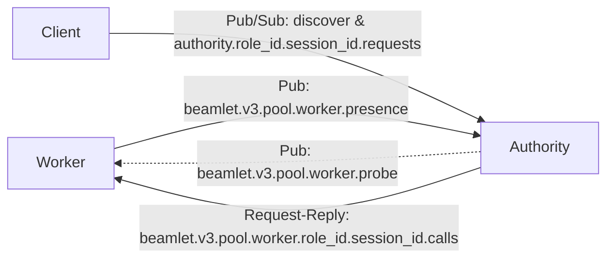

# v3 线协议与 NATS 传输绑定

- **下层依赖**：[04-routing.md](04-routing.md)
- **跨语言 IDL**：[protocol.proto](proto/beamlet/protocol/v3/protocol.proto)
- **参考实现**：[beamlet-protocol](../crates/transports/beamlet-protocol/src/lib.rs)、[beamlet-transport-nats](../crates/transports/beamlet-transport-nats/src/lib.rs)
- **非目标范围**：不改变核心原语与角色语义，不兼容旧纯文本协议，亦不以 NATS 队列组或刷盘承诺恰好一次执行。

## v3 JSON 线格式（`beamlet-protocol`）

所有跨进程控制与调用报文必须包裹于 `VERSION = 3` 的 JSON `Envelope`，编码与解码均启用严格未知字段拒绝（`deny_unknown_fields`）：

```json
{
  "version": 3,
  "body": { ... }
}
```

- **消息结构映射**：`Discovery`、`DiscoveryReply`、`Presence`、`Command`、`Outcome`、`Reply`、`WorkerCall`、`ReportData`、`WorkerReply` 的逻辑字段契约定义见 [protocol.proto](proto/beamlet/protocol/v3/protocol.proto)。
- **文本载荷特化**：v3 线协议将抽象请求/结果载荷特化为保留原始空白的 UTF-8 字符串（`Task.text` 与 `ReportData.result`），并通过显式转换在 `api::Call` / `api::WorkerReport` 与线结构 `WorkerCall` / `ReportData` 之间互转。
- **`WorkerReply` 到下层契约映射**：
  - `WorkerReply::Report`：校验 `pool`、`worker`、非空 `report_id` 及 `(operation_id, attempt_id)` 后映射为完整 `WorkerReport`。
  - `WorkerReply::Rejected`：校对四项绑定身份一致后映射为 `DeliveryError::NotDelivered`（表示执行前明确拒收）。
  - `WorkerReply::Failed`：校对四项绑定身份一致后映射为 `DeliveryError::Unknown`（表示执行期异常，无法排除副作用）。

## NATS Subject 路由与连接世代（`beamlet-transport-nats`）

按 `pool` 隔离于 `beamlet.v3.<pool>` 路由空间（见 [subject.rs](../crates/transports/beamlet-transport-nats/src/subject.rs)）：



| 主题模式 | 订阅模式 | 用途 |
| --- | --- | --- |
| `beamlet.v3.<pool>.authority.discover` | 普通广播订阅 | 发现同 `pool` 在线 `Authority` |
| `beamlet.v3.<pool>.authority.<role_id>.<session_id>.requests` | 队列组 `beamlet-authority-<role_id>-<session_id>` | 向指定 `Authority` 发送 `Command`；同会话多连接共享队列组去重 |
| `beamlet.v3.<pool>.worker.presence` | 普通广播订阅 | `Worker` 发布完整 `Presence` 快照 |
| `beamlet.v3.<pool>.worker.probe` | 普通广播订阅 | `Authority` 请求同池 `Worker` 立即广播状态快照 |
| `beamlet.v3.<pool>.worker.<role_id>.<session_id>.calls` | 普通订阅（Request-Reply） | 向唯一选定 `Worker` 会话投递 `WorkerCall` 并等待单份 `WorkerReply` |

- **传输错误归类**：NATS `NoResponders` 映射为 `DeliveryError::NoReceiver`；`InvalidSubject` / `MaxPayloadExceeded` 映射为 `NotDelivered`；请求超时、报文解码失败或关联字段失配均映射为 `Unknown`。
- **连接 `epoch` 与旧缓冲丢弃**：`Nats::connect` 初始连接为 `(epoch = 1, connected = true)`，每次 `Disconnected` / `Closed` / `Connected` 变更单调递增 `epoch`。`AuthorityEndpoint` 在向上层通知连接变更前，必须丢弃订阅缓冲中重连前积压的控制报文。
- **就绪刷新与认证边界**：`bind_authority` 与 `bind_worker` 订阅完成并向服务端 `flush` 后方返回就绪。主题与实例标识仅用于路由关联，权限隔离由 NATS 服务端账户配置保障。
