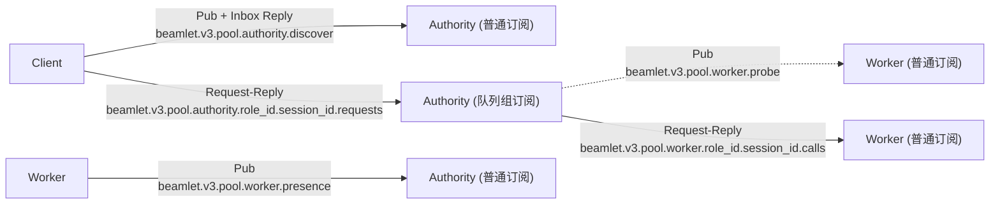

# L4-A: NATS 传输与 v3 JSON 协议绑定

- **实现状态**：`Implemented`
- **下层依赖**：[00-glossary.md](00-glossary.md) 至 [05-roles.md](05-roles.md)
- **参考实现**：[beamlet-protocol](../crates/transports/beamlet-protocol/src/lib.rs)、[beamlet-transport-nats](../crates/transports/beamlet-transport-nats/src/lib.rs)
- **非目标范围**：不改变 L1–L3 抽象语义；不提供旧版本纯文本协议兼容分支，亦不将 NATS 队列组或确认机制解释为恰好一次（exactly-once）执行保证。

## Subject 路由拓扑

NATS 传输绑定以 `pool` 为第一级隔离边界，将 L3 抽象通道映射至统一版本前缀 `beamlet.v3.<pool>` 下的五类 Subject（见 [subject.rs](../crates/transports/beamlet-transport-nats/src/subject.rs)）：



| Subject 模式 | 订阅模式 | 用途与多连接语义 |
| --- | --- | --- |
| `beamlet.v3.<pool>.authority.discover` | 普通订阅 | `Client` 向目标 `pool` 广播发现请求，所有加入该 `pool` 的 `Authority` 分别向 `reply` inbox 回复 `DiscoveryReply` |
| `beamlet.v3.<pool>.authority.<role_id>.<session_id>.requests` | 队列组 `beamlet-authority-<role_id>-<session_id>` | 定向投递 `Workers` 查询或 `Submit` 命令；同一 `Authority` 会话绑定多个 NATS 客户端连接时共享同一队列组，防止单次请求被重复执行 |
| `beamlet.v3.<pool>.worker.presence` | 普通广播订阅 | `Worker` 发布完整 `Presence` 快照，同池内所有关联 `Authority` 各自独立接收与登记 |
| `beamlet.v3.<pool>.worker.probe` | 普通广播订阅 | `Authority` 在启动或探测时通知 `pool` 内所有 `Worker` 立即广播最新完整快照 |
| `beamlet.v3.<pool>.worker.<role_id>.<session_id>.calls` | 普通订阅（Request-Reply） | `Authority` 向唯一选定的 `Worker` 会话交付 `WorkerCall` 并等待一次 `WorkerReply` |

## v3 JSON 线格式与 L3 IDL 映射

### 统一外层信封

所有跨越 NATS 的结构化消息**必须**使用固定版本外层 JSON 封装（`VERSION = 3`，见 [beamlet-protocol/src/lib.rs](../crates/transports/beamlet-protocol/src/lib.rs)）：

```json
{
  "version": 3,
  "body": { ... }
}
```

- 编解码启用严格的 `deny_unknown_fields` 语义；任何缺失字段、未知字段、JSON 格式错误或 `version != 3` 的报文**必须**直接拒绝或忽略，**不得**执行业务逻辑。

### 载荷特化与三态响应映射

`beamlet-protocol` 将 `L3` 逻辑 IDL（[interaction.proto](proto/beamlet/l3/v1/interaction.proto)）显式转换为 v3 文本 Profile（见 [message.rs](../crates/transports/beamlet-protocol/src/message.rs) 与 [conversion.rs](../crates/transports/beamlet-protocol/src/conversion.rs)）：

1. **业务载荷特化（`BND-01`）**：`L3` 的不透明 `Task.payload`（`OpaquePayload`）在 v3 线格式中特化为 UTF-8 `Task.text` 字段（原样保留空白）；`Report.result` 与 `Outcome::Completed.result` 特化为 UTF-8 `string`（`ReportData.result`）。
2. **`WorkerReply` 三分法映射**：NATS `Worker` 回复端区分三个显式标签变体，避免将执行期错误与未执行拒绝混为一谈：
   - `WorkerReply::Report { pool, worker, report }`：校验 `pool`、`worker`、`report_id` 非空以及 `(operation_id, attempt_id)` 精确匹配后，转为有效的 `WorkerReport`。
   - `WorkerReply::Rejected { pool, worker, operation_id, attempt_id, reason }`：当 `WorkerEndpoint::receive` 解码后发现 `WorkerBinding.accepts` 不通过时立即发出；校验关联一致后映射为 `DeliveryError::NotDelivered`。
   - `WorkerReply::Failed { pool, worker, operation_id, attempt_id, reason }`：能力处理器进入执行后异常失败时发出（无法排除外部副作用）；校验关联一致后映射为 `DeliveryError::Unknown`。
   - 若回复报文自身字段或关联身份与发出时的快照不匹配，**必须**归类为 `DeliveryError::Unknown`。
3. **底层 NATS 发送错误分类（`SEM-BND-01`）**：`Delivery.Deliver` 遭遇 `NoResponders` 时返回 `DeliveryError::NoReceiver`；遭遇 `InvalidSubject` 或 `MaxPayloadExceeded` 时返回 `DeliveryError::NotDelivered`；遭遇超时、链路断开或无法证明未到达的异步错误时一律返回 `DeliveryError::Unknown`。

## 连接世代管理与缓冲溢出语义

- **`SEM-BND-02`（重连世代推进与旧缓冲丢弃）**：每个 `Nats` 连接实例通过事件回调监听连接状态；初始连接成功置为 `(epoch = 1, connected = true)`，每次 `Disconnected` / `Closed` 或后续 `Connected` 变更均单调递增 `epoch`。当 `AuthorityEndpoint` 观察到连接变更事件时，**必须**在向控制循环派发 `AuthorityEvent::Connection` 之前立即排空并丢弃本地订阅通道中所有重连前积压的旧控制报文，确保旧世代心跳无法为新世代续租；且在 `connected == false` 期间忽略接收到的控制报文。
- **有界订阅与刷新语义**：每个 NATS 订阅拥有独立的 `subscription_capacity` 接收缓冲（节点默认 `16`，Console 默认 `65536`）。`bind_authority` 与 `bind_worker` 在完成订阅并向服务端执行 `flush` 后方才返回。若运行期间因订阅缓冲溢出导致请求或回复丢失，调用方无法获得未执行证明，最终仅表现为超时或 `DeliveryError::Unknown`。
- **认证边界**：Subject 与 `RoleInstance` 仅用于路由与来源关联，**不**构成安全认证；多租户或恶意订阅隔离由外部 NATS 账户与权限配置保障。
