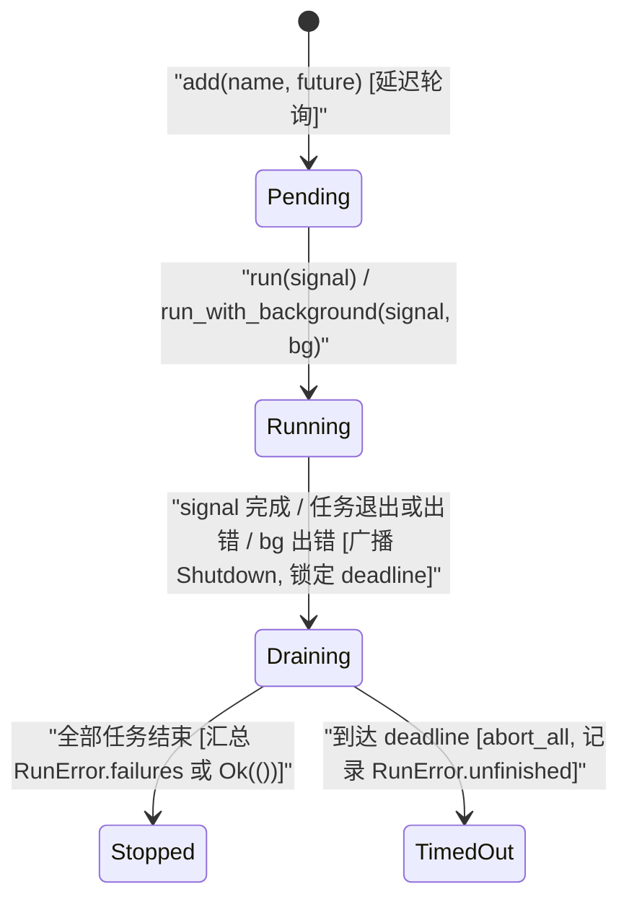
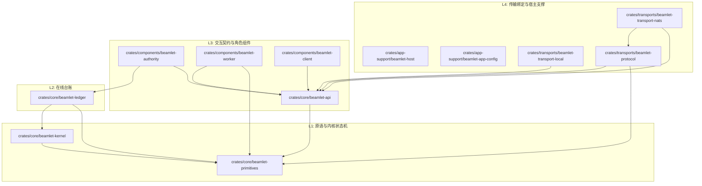

# L4-B: 宿主监督、进程内绑定与 Rust 映射

- **实现状态**：`Implemented`
- **下层依赖**：[00-conventions.md](00-conventions.md) 至 [05-binding-nats.md](05-binding-nats.md)
- **参考实现**：[beamlet-host](../crates/app-support/beamlet-host/src/lib.rs)、[beamlet-transport-local](../crates/transports/beamlet-transport-local/src/lib.rs)

## Host 任务组监督

启动并发长期任务组、广播单向停止信号并限时排空（见 [host.rs](../crates/app-support/beamlet-host/src/host.rs)）：

- **`SEM-HST-01`（意外退出与辅助流）**：受管任务在 `Shutdown` 前返回 `Ok(())` 视为 `Failure::UnexpectedExit` 并触发停机；`run_with_background` 辅助流正常 EOF 不停机，出错才触发停机，进入排空时立即释放。
- **`SEM-HST-02`（固定排空期限）**：排空截止时间自首次停止触发锁定，后续错误按序记入 `RunError.failures`，**不得**重置或延长 `shutdown_timeout`；超期任务强制中止并记入 `RunError.unfinished`。

## Local 进程内绑定

[beamlet-transport-local](../crates/transports/beamlet-transport-local/src/lib.rs) 提供单进程零序列化 L3 传输：

- **零拷贝隔离域**：`Local::<P, R>::new(capacity)` 创建独立内存路由域（`Clone` 共享），直接透传任意 `<P, R>`（无需 `serde`，`R` 无需 `Clone` / `Debug`）。
- **有界背压与注销**：重复绑定 `(pool, RoleInstance)` 立即拒绝；接收通道满返回明确未交付；`stop()` 停止新接入并保留队列排空，`Drop` 自动注销路由项。

## Rust Workspace 映射

核心库按 L1–L4 单向依赖组织（`apps/` 为装配入口，不在规范范围内）：

- **编译期 Typestate**：[beamlet-kernel](../crates/core/beamlet-kernel/src/operation.rs) 以移动语义与 Typestate 在编译期禁止非法转换，`Operation` 不实现 `Clone`；`accept_report` 失败时通过 [AcceptReportError::into_operation](../crates/core/beamlet-kernel/src/accept_report_error.rs) 归还原实例所有权。
- **最小依赖隔离**：`beamlet-worker`、`beamlet-client` 与 `beamlet-api` 不依赖 `beamlet-kernel`、`beamlet-ledger` 及具体传输或配置库。
