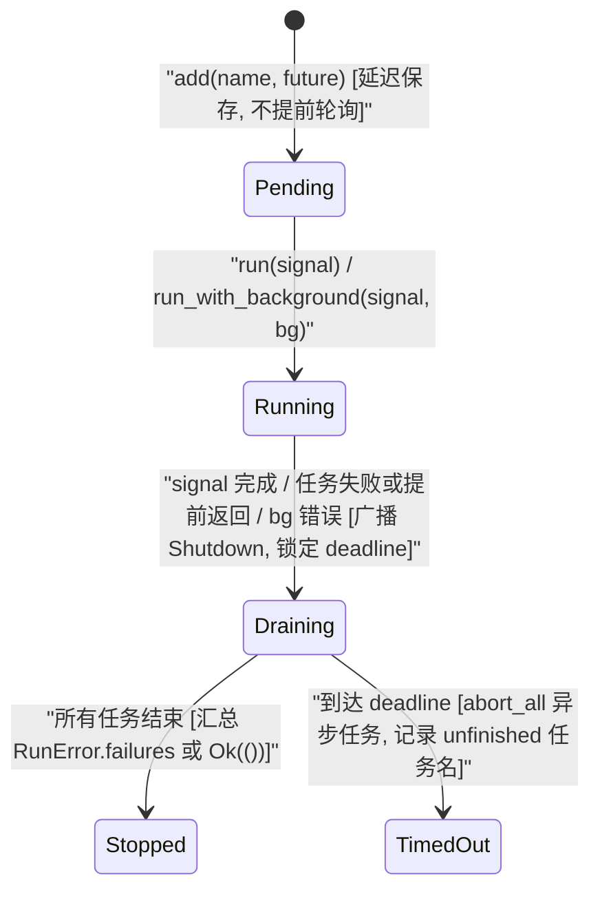
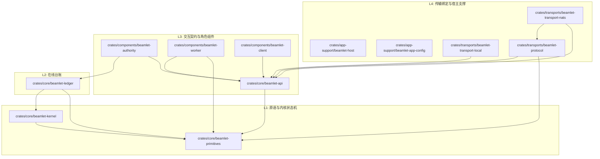

# L4-B: 宿主监督、进程内绑定与 Rust 参考实现映射

- **实现状态**：`Implemented`
- **下层依赖**：[00-glossary.md](00-glossary.md) 至 [05-binding-nats.md](05-binding-nats.md)
- **参考实现**：[beamlet-host](../crates/app-support/beamlet-host/src/lib.rs)、[beamlet-transport-local](../crates/transports/beamlet-transport-local/src/lib.rs)

## Host 异步任务组监督契约

`Host` 负责联合启动一组并发长期任务、广播一次性不可撤回的停止信号并协调有限排空，自身不耦合任何领域角色、配置格式或操作系统信号捕获（见 [host.rs](../crates/app-support/beamlet-host/src/host.rs)）：

- **`SEM-HST-01`（意外退出与后台输入边界）**：长期任务在停止广播前即便返回 `Ok(())` 亦视为 `Failure::UnexpectedExit` 并触发全组停机。通过 `run_with_background` 挂载的辅助输入流正常结束（EOF）**不**停止任务组，仅出错时触发停机，并在进入排空时立即释放。
- **`SEM-HST-02`（固定排空期限与错误聚合）**：排空倒计时从**首次**停止触发点起算，排空期间后续任务错误或 panic 按观测顺序追加至 `RunError.failures`，**不得**延长或重置 `shutdown_timeout`。超期未结束的任务被中止并按名称记录于 `RunError.unfinished`。

## Local 进程内传输绑定

[beamlet-transport-local](../crates/transports/beamlet-transport-local/src/lib.rs) 为单进程嵌入与契约测试提供零序列化开销的 L3 传输实现：

- **空间隔离与类型透传**：每次 `Local::<P, R>::new(capacity)` 创建彼此隔离的内存路由空间，`Clone` 共享同一路由表。支持直接传递任意 Rust 类型 `<P, R>`，无需 `serde`，亦不要求结果类型 `R` 实现 `Clone` 或 `Debug`。
- **有界拒收与生命周期**：重复绑定同一 `(pool, RoleInstance)` 立即拒绝；`Worker` 有界接收通道满时明确返回未交付（`NotDelivered`）；`stop()` 关闭新输入同时保留缓冲队列供排空，`Drop` 自动清理路由表注册项。

## Rust Workspace 参考实现映射

当前 Rust Workspace 的核心库按 L1–L4 严格分层组织（应用侧可执行入口 `apps/` 为基于这些库的装配示例，不纳入核心协议规范）：

- **编译期 Typestate 约束**：[beamlet-kernel](../crates/core/beamlet-kernel/src/operation.rs) 利用 Rust 所有权移动语义与私有 `state-machines` Typestate 在编译期阻止非法状态方法调用，且 `Operation` 不实现 `Clone`；当 `accept_report` 校验失败时，通过 [AcceptReportError::into_operation](../crates/core/beamlet-kernel/src/accept_report_error.rs) 无损归还原对象所有权。
- **最小依赖树隔离**：`beamlet-worker`、`beamlet-client` 与 `beamlet-api` 均不依赖 `beamlet-kernel`、`beamlet-ledger`、`state-machines` 或任何具体传输与配置库，确保嵌入方按需组合。
