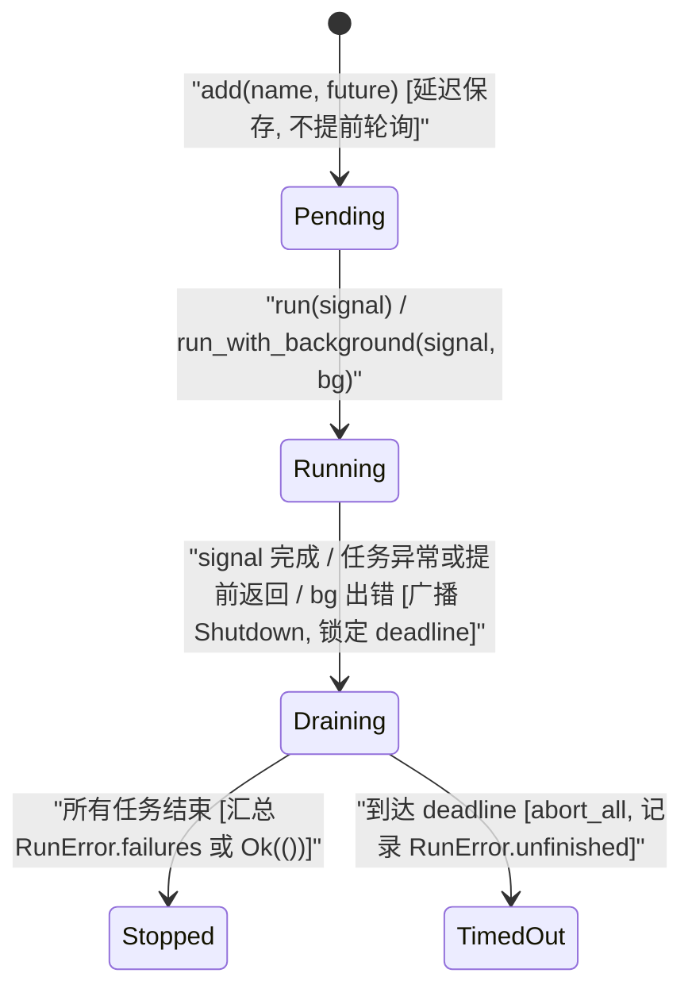
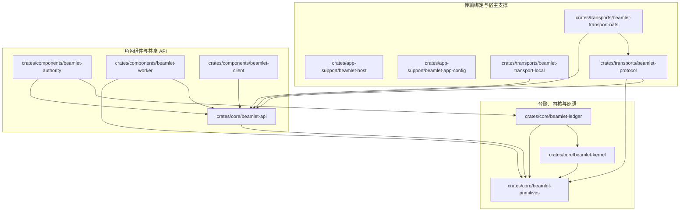

# Local 传输、Host 监督与工作区映射

- **下层依赖**：[04-routing.md](04-routing.md)、[05-wire-and-nats.md](05-wire-and-nats.md)
- **参考实现**：[beamlet-transport-local](../crates/transports/beamlet-transport-local/src/lib.rs)、[beamlet-host](../crates/app-support/beamlet-host/src/lib.rs)

## Local 进程内传输绑定（`beamlet-transport-local`）

- **隔离空间与泛型透传**：`Local::<P, R>::new(capacity)` 创建彼此隔离的内存路由空间（`Clone` 共享同一路由表），连接状态固定为 `(epoch = 1, connected = true)`。直接按值透传任意 Rust 类型 `<P, R>`，无需序列化或 `serde`，结果类型 `R` 不要求 `Clone` 或 `Debug`。
- **有界背压与注销**：重复绑定同一 `(pool, RoleInstance)` 立即拒绝；`Worker` 有界调用通道满时明确返回 `DeliveryError::NotDelivered`；发现与 `Presence` 公告广播允许有界丢弃。`stop()` 停止新接收同时保留已入队消息供排空，`Drop` 自动清理路由注册项。

## Host 长期任务监督（`beamlet-host`）

`Host` 联合启动一组并发长期任务、广播不可撤回的 `Shutdown` 信号并协调有限时间排空（见 [host.rs](../crates/app-support/beamlet-host/src/host.rs)）：

- **意外退出与后台输入边界**：受管长期任务在收到 `Shutdown` 前返回 `Ok(())` 记为 `Failure::UnexpectedExit` 并触发全组停止。通过 `run_with_background` 挂载的后台输入正常 EOF 不触发停机，仅出错时触发，并在进入排空时立即释放不占用排空期限。
- **固定排空期限**：排空倒计时自首次触发点锁定 `shutdown_timeout`；排空期间后续失败按观测顺序记入 `RunError.failures`，不得重置或延长截止时间，超期仍未结束的任务按名称记入 `RunError.unfinished`。`Host` 不解析任务诊断名称、领域身份或系统信号来源。

## Rust Workspace 库结构与依赖

核心库严格保持单向分层依赖（`apps/` 为基于核心库的装配示例入口）：

- **编译期 Typestate 保护**：[beamlet-kernel](../crates/core/beamlet-kernel/src/operation.rs) 使用移动语义与 `Ready` / `AwaitingReport` / `Closed` 类型状态在编译期禁止非法转换，`Operation` 不实现 `Clone`；`accept_report` 失配时通过 [AcceptReportError::into_operation](../crates/core/beamlet-kernel/src/accept_report_error.rs) 归还原对象所有权。
- **最小依赖隔离**：`beamlet-worker`、`beamlet-client` 与 `beamlet-api` 均不依赖 `beamlet-kernel`、`beamlet-ledger` 或任何具体传输与配置库。
