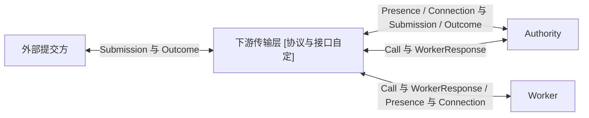

# 抽象传输保证

- **下层依赖**：[05-routing.md](05-routing.md)
- **非目标范围**：不规定具体消息中间件、网络协议、接口形态、序列化格式或身份认证机制；具体传输方案由下游自行实现。

## 跨边界消息流

## 下游传输必须满足的保证

1. **无状态透明边界**：传输层不得持有 `Operation` 或 `Worker` 租约状态，不得代做 `Selection` 选路，亦不得在失败或超时后自动重发 `Call` 或 `Submission`。
2. **定向单次投递与响应关联**：按 `Call` 锁定的 `Pool` 与目标 `Worker` 精确投递一次，允许在途调用并发执行与乱序回复，每次调用至多关联一份响应；任何未达、拒收、失败通知、超时、断线或关联失配，均不得伪造 `Report` 或自动重试。
3. **连接世代单调性与旧缓冲清空**：连接建立及每次断线、重连均须单调递增 `Connection` 的世代编号。在向 `Authority` 传递连接变更前，传输层**必须**丢弃本地接收缓冲中重连前积压的控制消息，防止旧世代 `Presence` 在重连后误续租约。
4. **控制隔离、排空保留与安全解耦**：`Presence` 与连接状态观测不得被业务处理背压阻塞；`Worker` 停止接入新调用时，传输层须允许已接收进局部队列的在途 `Call` 继续完成消费与回复。`Pool` 与 `RoleInstance` 仅作路由关联核对，身份认证与访问控制由下游传输基础设施保障。
