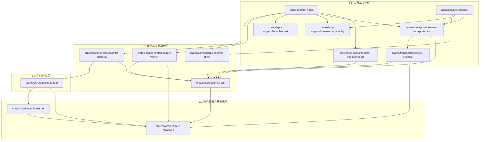

# L4-B: 宿主监督、应用装配与 Rust 参考实现映射

- **实现状态**：`Implemented`
- **下层依赖**：[00-glossary.md](00-glossary.md) 至 [06-binding-nats-v3.md](06-binding-nats-v3.md)
- **参考实现**：[beamlet-host](../crates/app-support/beamlet-host/src/lib.rs)、[beamlet-transport-local](../crates/transports/beamlet-transport-local/src/lib.rs)、[beamlet-app-config](../crates/app-support/beamlet-app-config/src/lib.rs)、[beamlet-node](../apps/beamlet-node/src/main.rs)、[beamlet-console](../apps/beamlet-console/src/main.rs)

## Host 异步任务监督与排空模型

`beamlet-host` 为多个并发长期任务提供统一启动、不可撤回的停止广播与有限排空监督，自身不耦合任何配置解析、OS 信号捕获或领域身份概念（见 [host.rs](../crates/app-support/beamlet-host/src/host.rs)）：

```mermaid
stateDiagram-v2
    [*] --> Pending: "Host::add(name, future) [仅保存, 不轮询]"
    Pending --> Running: "run(signal) / run_with_background(signal, bg)"
    Running --> Draining: "signal 完成 / 任务异常或提前退出 / bg 错误 [广播 Shutdown, 记录首个 deadline]"
    Draining --> Stopped: "所有任务结束 [汇总 RunError.failures 或 Ok(())]"
    Draining --> TimedOut: "到达 deadline [abort_all 异步任务, 记录 unfinished 任务名]"
```

- **意外提前退出判定（`SEM-HST-01`）**：已注册的长期任务在尚未发出 `Shutdown` 广播前即便返回 `Ok(())`，亦视为 `Failure::UnexpectedExit` 并立即触发全组停止。通过 `run_with_background` 驱动的辅助后台输入任务（如终端交互循环）正常结束（EOF）**不**停止长期任务组，仅在返回错误时触发停止，并在进入排空阶段时直接释放该背景任务。
- **固定排空期限与错误保留**：排空倒计时自**首次**停止触发点起算；排空期间发生的后续任务错误或 panic 按观测顺序追加至 `RunError.failures`，**不得**重置或延长 `shutdown_timeout`。超过期限仍未结束的任务触发 `abort_all` 并按名称记录至 `RunError.unfinished`（已启动的阻塞计算或远端调用不受异步中止强行打断）。丢弃尚未完成运行的 `Host` future 时自动广播一次性 `Shutdown` 通知，但不阻塞等待排空。

## Local 进程内传输绑定

[beamlet-transport-local](../crates/transports/beamlet-transport-local/src/lib.rs) 为单进程内嵌入和契约测试提供零序列化的 L3 传输实现：

- **空间隔离与共享**：每次调用 `Local::<P, R>::new(capacity)` 创建彼此隔离的内存路由表，`Clone` 句柄共享同一消息空间。任意 Rust 类型 `<P, R>` 均可通过本地通道传递，无需 `serde`、无需对 `R` 施加 `Clone` 或 `Debug` 约束。
- **有界背压与确定性未交付**：基于有界 Tokio `mpsc` 通道投递调用；重复绑定同一 `(pool, RoleInstance)` 立即拒绝；`Worker` 接收队列满时 `try_send` 明确返回 `DeliveryError::NotDelivered`；`WorkerEndpoint::stop` 关闭新输入同时保留缓冲调用供排空，`Drop` 时注销路由表键。`Discovery` 与 `Probe` 允许在队列满时尽力丢弃。

## Node 与 Console 应用装配规范

### 四层 UUID 身份与多传输桥接

| 身份字段 | 生命周期 | 配置持久化 | 作用范围与路由语义 |
| --- | --- | --- | --- |
| `node.node_id` | 跨重启持久 | 保存于 `node.ron` | 仅用于进程日志定位，**不**参与任何任务路由或角色选人 |
| `node_session_id` | 每次进程启动生成 | 仅内存 | 区分同一节点的多次重启运行 |
| `roles[].role_id` | 跨重启持久 | 保存于 `node.ron` | `Authority` / `Worker` 的固定逻辑身份，同节点内禁止重复 |
| `session_id` | 每个角色每次启动生成 | 仅内存 | 与 `role_id` 共同构成 `RoleInstance`，支撑同 `role_id` 多实例并发运行与无单活切换 |

单个 `Node` 进程按 `settings.transports` 名称表连接独立或共享的 `Local` / `Nats` 实例。一个 `Authority` 可在 `transports` 中同时引用多个命名传输（例如 `["local", "nats"]`），从而将外部通过 NATS 接入的请求无缝交付给同进程内的 `Local` `Worker` 执行，并在各自入口独立返回回复；一个 `Worker` 只能绑定恰好一个命名传输。

### RON 配置模式与只读不迁移原则

`beamlet-app-config` 通过 `confy` 在**可执行文件同级目录**加载 RON 配置（`node.ron` 默认文件名可经 `--config/-c` 指定，禁止含目录路径；`console.ron` 固定名称）：

- **首次生成与并发加锁**：当文件不存在时，首次生成带双语字段说明注释的默认配置（`node.ron` 通过同级 `.ron.lock` 文件锁串行化首次生成，防止并发冷启动覆盖身份）。
- **只读校验、绝不重写（`SEM-HST-02`）**：对于已存在的配置文件，应用**必须**严格只读解析并校验（包含正整数容量、非零单调时钟期限、非 nil 且不重复的 `role_id`、有效 `Pool` 与已注册能力），**不得**自动迁移字段、自动补全缺失 `UUID` 或写回文件。配置变更仅通过重启进程生效。
- **零并发与内置示范能力**：仅 `Authority` 与 `Worker` 的 `max_concurrent_tasks` 接受 `0` 并显式映射为 `Concurrency::Unlimited`；其余队列容量与期限均严禁零值。`beamlet-node` 内置两项示范能力并在阻塞线程池执行：`text.reverse/v1`（按 Unicode 标量值倒序，保留空白）与 `text.uppercase/v1`（Unicode 大写展开转换）。

当前 `node.ron` 实际配置布局（对齐 [apps/beamlet-node/src/settings.rs](../apps/beamlet-node/src/settings.rs)）：

```ron
(
    node: (
        node_id: "76da5097-794c-4306-bd45-caa6a501c200",
        label: Some("dev-node"),
        color: auto,
        shutdown_timeout_secs: 6,
    ),
    transports: {
        "local": local(capacity: 16),
        "nats": nats(
            url: "nats://127.0.0.1:4222",
            connect_timeout_secs: 10,
            subscription_capacity: 16,
        ),
    },
    roles: [
        authority(
            role_id: "3e8385b1-a50b-4cbd-a60f-8469e7e6ff3a",
            label: Some("authority"),
            transports: ["local", "nats"],
            pools: ["default"],
            timeouts: (
                worker_timeout_secs: 15,
                report_timeout_secs: 3,
            ),
            limits: (
                input_capacity: 16,
                max_concurrent_replies: 16,
                max_concurrent_tasks: 16,
            ),
        ),
        worker(
            role_id: "71d3e189-0478-4e8b-bfd2-93cdfd975dd7",
            label: Some("worker"),
            transports: ["local"],
            pool: "default",
            capabilities: ["text.reverse/v1", "text.uppercase/v1"],
            heartbeat_interval_secs: 5,
            max_concurrent_tasks: 1,
        ),
    ],
)
```

当前 `console.ron` 实际配置布局（对齐 [apps/beamlet-console/src/settings.rs](../apps/beamlet-console/src/settings.rs)）：

```ron
(
    color: auto,
    nats: (
        url: "nats://127.0.0.1:4222",
        connect_timeout_secs: 10,
        subscription_capacity: 65536,
    ),
    client: (
        pools: ["default"],
        request_timeout_secs: 10,
        discovery_window_ms: 1000,
        max_in_flight_requests: 16,
    ),
)
```

### Console 非阻塞交互语义

[beamlet-console](../apps/beamlet-console/src/session.rs) 允许在等待在途请求期间并发发起新的发现、查询或任务提交：

- 每次网络动作在创建时固定当时的目标快照并分配独立 `request_id` 与当前 UI 选择版本 `choice_revision`；旧查询或旧提交的迟到结果**不得**覆盖新近切换的目标选择（`/authority`、`/pool`、`/capability`、`/worker`）。
- 终端在途总数受 `max_in_flight_requests`（默认 `16`）限制，满载时明确拒绝新网络请求，同时保持本地选择切换与帮助命令可用。输入 `/quit` 或到达 EOF 后停止接收新提交并等待在途请求完成或超时；收到 `Ctrl+C` 则立即放弃本地等待。

## Rust Workspace 参考实现映射

当前 Rust Workspace 的 14 个成员包严格对应上述 L1–L4 分层边界：



- **编译期 Typestate 与无损错误归还**：在 [beamlet-kernel](../crates/core/beamlet-kernel/src/operation.rs) 中，`Operation<O, P, S>` 通过 Rust 所有权转移与私有 `state-machines` Typestate 在编译期阻止非法状态方法调用（如在 `AwaitingReport` 下直接调用 `create_attempt` 或 `close`），且不实现 `Clone`。当 `accept_report` 校验失败时，[AcceptReportError::into_operation](../crates/core/beamlet-kernel/src/accept_report_error.rs) 将未改变的原对象所有权无损归还给 `Ledger` 或调用方，避免任何数据克隆开销。
- **最小依赖树隔离**：`beamlet-worker`、`beamlet-client` 与 `beamlet-api` 均不依赖 `beamlet-kernel`、`beamlet-ledger`、`state-machines` 或任何配置/传输具体实现，确保第三方程序可独立嵌入任意单个组件。
