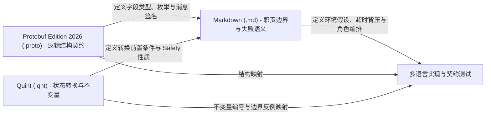
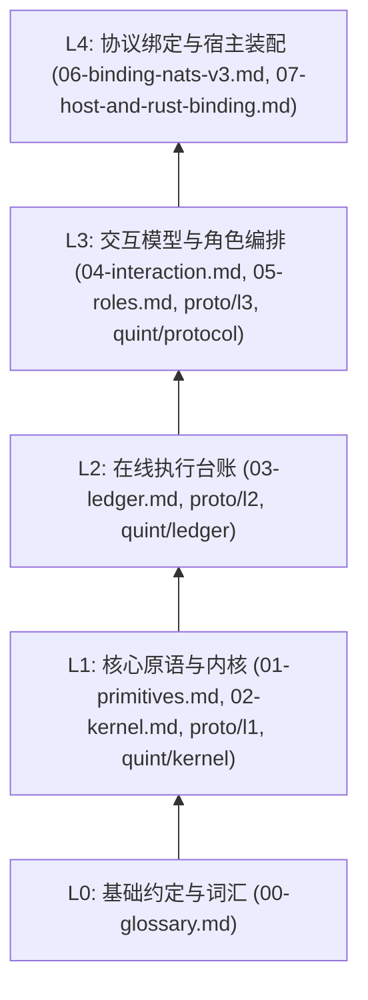

# Beamlet 跨语言架构与协议规范

本目录定义 **Beamlet** 的系统性架构设计、跨语言逻辑数据结构、行为契约与形式化安全性质。整套规范采用“自底向上、下层对上层完全透明、三种载体正交分工”的组织方式，使任意语言的实现都可以独立对照校验，而不必反向耦合到特定运行时或消息中间件。

## 三元规范栈与单一事实来源

为避免同一设计决策在不同文档间重复抄写与漂移，本规范通过三种互补载体各自承担唯一权威职责（Single Source of Truth）：



- **Markdown（`spec/*.md`）**：阐述分层架构、跨字段约束、环境假设（如本地单调时钟、队列背压与排空顺序）及 RFC 2119 规范性条款，**不重复抄写 `.proto` 字段定义表**。
- **Protobuf Edition 2026（`spec/proto/`）**：作为跨语言逻辑 IDL，定义消息封套、枚举与服务接口签名；仅表达**逻辑结构契约**，不强制要求具体传输绑定必须使用二进制 Protobuf 编码。
- **Quint（`spec/quint/`）**：对关键生命周期、授权防重用、租约世代隔离及定向交付协议构建可执行形式化模型，并通过随机模拟与 TLC 模型检验验证可追踪不变量（`INV-*`）。

## 分层依赖图谱（L0 到 L4）

规范严格按照从微观原语到宏观宿主装配的五个层级组织。阅读任一 `Ln` 层文件时，其概念与依赖绝不向上引用 `Ln+1` 层实体：



## 文档与模型索引

| 层级 | Markdown 规范 | Protobuf IDL (Edition 2026) | Quint 形式化模型 | 核心覆盖范围 |
| --- | --- | --- | --- | --- |
| L0 | [00-glossary.md](00-glossary.md) | — | — | RFC 2119 关键词、全局身份/时间约定、领域术语表 |
| L1 | [01-primitives.md](01-primitives.md) | [primitives.proto](proto/beamlet/l1/v1/primitives.proto) | [primitives.qnt](quint/kernel/primitives.qnt) | `Attempt`、`Report`、`OpaquePayload` 不可变证据模型 |
| L1 | [02-kernel.md](02-kernel.md) | [kernel.proto](proto/beamlet/l1/v1/kernel.proto) | [state_machine.qnt](quint/kernel/state_machine.qnt) / [kernel.qnt](quint/kernel/kernel.qnt) | 单 `Operation` 三态生命周期、已知状态重建与校验优先级 |
| L2 | [03-ledger.md](03-ledger.md) | [ledger.proto](proto/beamlet/l2/v1/ledger.proto) | [ledger.qnt](quint/ledger/ledger.qnt) | 多 `Operation` 在线管理与全局 `Attempt` 身份防重用 |
| L3 | [04-interaction.md](04-interaction.md) | [interaction.proto](proto/beamlet/l3/v1/interaction.proto) | — | `RoleInstance`、`Pool`、`CapabilityId`、五类抽象通道与失败分类 |
| L3 | [05-roles.md](05-roles.md) | — | [registry_lease.qnt](quint/protocol/registry_lease.qnt) / [delivery.qnt](quint/protocol/delivery.qnt) | `Registry` 租约与 `Epoch`、`Authority`/`Worker`/`Client` 编排与排空 |
| L4 | [06-binding-nats-v3.md](06-binding-nats-v3.md) | — | — | NATS Subject 路由、v3 JSON 线协议封装与缓冲语义 |
| L4 | [07-host-and-rust-binding.md](07-host-and-rust-binding.md) | — | — | `Local` 内存传输、`Host` 监督、`Node`/`Console` RON 装配及 Rust 映射 |

## 验证方式

进入仓库开发环境（例如 `nix develop`）后，可执行以下命令全量校验 IDL 与形式化模型：

```bash
# 校验 Protobuf Edition 2026 格式与 buf lint 规则
just check-proto

# 运行全部 Quint 类型检查、场景单元测试、随机轨迹见证与 TLC 模型检验
just check-models

# 一键运行完整规范校验
just check-spec
```
