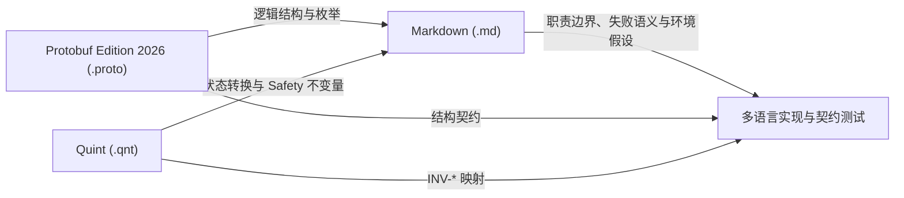
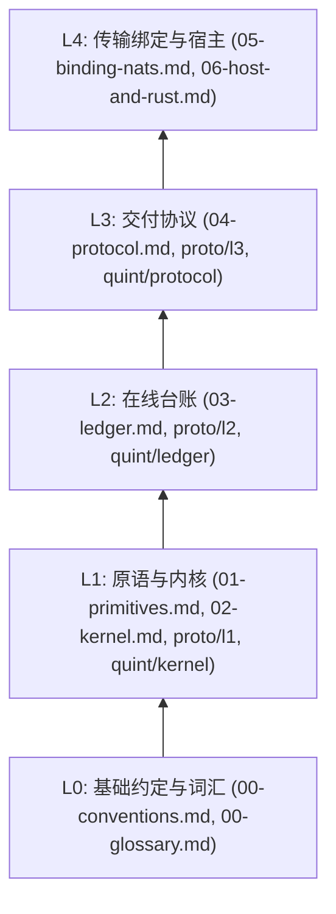

# Beamlet 架构与协议规范

Beamlet 规范自底向上分层，下层不耦合上层，由三种载体正交定义。

## 载体分工

- **Markdown（`spec/*.md`）**：分层边界、环境假设与 RFC 2119 条款；不重复抄写 `.proto` 字段表。
- **Protobuf Edition 2026（`spec/proto/`）**：跨语言逻辑数据结构契约（Logical IDL）；不限定线编码格式。
- **Quint（`spec/quint/`）**：可执行状态机与安全不变量（`INV-*`），经随机模拟与 TLC 模型检验验证。

## 分层依赖

`L0`–`L4` 单向演进，`Ln` 层不得引用 `Ln+1` 层概念：

## 索引

| 层级 | Markdown | Protobuf IDL | Quint 模型 | 范围 |
| --- | --- | --- | --- | --- |
| L0 | [00-conventions.md](00-conventions.md) / [00-glossary.md](00-glossary.md) | — | — | RFC 2119、基础约定、追踪编号与五维领域词典 |
| L1 | [01-primitives.md](01-primitives.md) | [primitives.proto](proto/beamlet/l1/v1/primitives.proto) | [primitives.qnt](quint/kernel/primitives.qnt) | `Attempt`、`Report`、`OpaquePayload` 不可变证据 |
| L1 | [02-kernel.md](02-kernel.md) | [kernel.proto](proto/beamlet/l1/v1/kernel.proto) | [state_machine.qnt](quint/kernel/state_machine.qnt) / [kernel.qnt](quint/kernel/kernel.qnt) | 单 `Operation` 三态状态机与外部重建 |
| L2 | [03-ledger.md](03-ledger.md) | [ledger.proto](proto/beamlet/l2/v1/ledger.proto) | [ledger.qnt](quint/ledger/ledger.qnt) | 多 `Operation` 在线索引与 `Attempt` 全局防重用 |
| L3 | [04-protocol.md](04-protocol.md) | [protocol.proto](proto/beamlet/l3/v1/protocol.proto) | [registry_lease.qnt](quint/protocol/registry_lease.qnt) / [delivery.qnt](quint/protocol/delivery.qnt) | 单调租约格、定向交付与优雅排空 |
| L4 | [05-binding-nats.md](05-binding-nats.md) | — | — | NATS Subject 路由、v3 JSON 线格式与连接世代 |
| L4 | [06-host-and-rust.md](06-host-and-rust.md) | — | — | `Host` 任务监督、`Local` 传输与 Rust 映射 |
