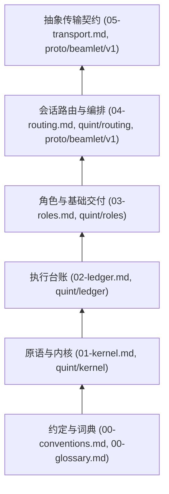

# Beamlet 架构与协议规范

Beamlet 规范自底向上组织，下层不依赖上层；层次越靠下，与业务及传输的耦合度越低。

## 载体分工

- **Markdown（`spec/*.md`）**：定义各层边界、职责分工、生命周期规则、失败语义与抽象传输契约。
- **Quint（`spec/quint/`）**：定义可执行的状态机与交互模型，并通过单元测试、随机模拟和 TLC 模型检验验证不变量。
- **Protobuf Edition 2026（`spec/proto/`）**：定义与传输后端无关的跨角色逻辑消息结构，任意业务载荷使用 `bytes` 表示，不规定线编码或具体传输中间件。

## 分层依赖图谱

## 文档索引

| 文件 | 形式化模型 / IDL | 核心范围 |
| --- | --- | --- |
| [00-conventions.md](00-conventions.md) | — | 规范性关键词、时钟与期限准则、术语书写规则 |
| [00-glossary.md](00-glossary.md) | — | 按依赖顺序与角色分类的领域词汇表 |
| [01-kernel.md](01-kernel.md) | [spec/quint/kernel/](quint/kernel/state_machine.qnt) | `Operation`、`Attempt`、`Report` 三种原语及内核状态机 |
| [02-ledger.md](02-ledger.md) | [spec/quint/ledger/](quint/ledger/ledger.qnt) | `Ledger` 多 `Operation` 管理与 `Attempt` 身份防重用 |
| [03-roles.md](03-roles.md) | [spec/quint/roles/](quint/roles/roles.qnt) | `Authority` 与 `Worker` 关系、基础交付与报告验收 |
| [04-routing.md](04-routing.md) | [spec/quint/routing/](quint/routing/routing.qnt)、[messages.proto](proto/beamlet/v1/messages.proto) | `RoleInstance`、`Pool`、`Presence` 租约、`Selection` 与 `Client` |
| [05-transport.md](05-transport.md) | [messages.proto](proto/beamlet/v1/messages.proto) | 下游须实现的五类抽象传输端点契约与连接世代隔离 |
