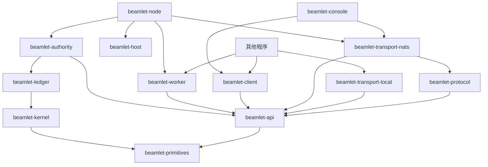

# 可复用 crate 拆分计划

状态: P0 基线通过; P1 已提取共享身份和一次性回复入口, 业务数据与运行参数解耦继续进行. Ledger 命名已采用. 本文制定目标结构、接口契约和迁移顺序, 不表示拟新增 crate 已经存在.

目标是让其他程序能够独立使用 Authority、Worker、调用客户端及运行监督, 自行选择消息后端、配置来源和交互方式. node / console 是这些库的组合应用. 本次以现有行为为基线, 不改变 [内核规范](kernel.md)、[交付契约](delivery.md) 和 [角色身份约定](node-composition.md).

## 1. 现有问题和拆分原则

目前适合保留的是从基础到编排的三层职责: `primitives`、`kernel`、`ledger`, 分别负责原语、单个 Operation 的合法转换、多个 Operation 的在线状态管理. Ledger 表示执行台账, 保存 Operation 当前状态及已使用的 Attempt 身份, 不承诺持久化或完整事件历史. 术语见 [领域词汇](../GLOSSARY.md).

拆分前的耦合集中在应用代码:

- `authority::run` 直接接收 node 的文件配置结构; `RunningRole` 同时处理角色、NATS、终端和退出.
- ingress / delivery 虽然有 trait, 但它们的 Reply 内部枚举直接包含 NATS、终端以及仅测试可用的 channel 分支. 外部项目不能添加自己的回复方式. 此项已由 `beamlet-api::Responder` 替换, 具体发送函数由适配器构造.
- `Delivery::select` 把 Worker 选择与消息交付放在一起; `Registry` 依赖 node 的连接状态和 Tokio watch.
- protocol 同时定义角色信息、提交数据、JSON 编码以及 NATS subject.
- Console 的发现和请求代码直接接收 `async_nats::Client`; Worker 的能力表和执行入口直接依赖文本示例.

拆分以独立使用场景和变化来源为依据. 公共接口只暴露调用者需要知道的身份、参数、结果和失败语义. 小型辅助类型保留为模块, 不逐个建立 crate; 只有消息后端、业务处理器等确实需要替换的位置提供可由外部实现的接口.

## 2. 目标 crate 结构

| crate | 职责 | 允许的主要 Beamlet 依赖 |
| --- | --- | --- |
| `beamlet-primitives` | Attempt、Report, 保持对身份和业务数据泛型 | 无 |
| `beamlet-kernel` | Operation 类型状态与转换 | primitives |
| `beamlet-ledger` | 在线 Operation 管理, 保留现有语义 | kernel、primitives |
| **`beamlet-api`** | 角色身份、pool、能力标识、交互数据及小型消息接口 | primitives |
| `beamlet-protocol` | 显式版本的线格式、编码解码、与交互数据之间的转换 | api、primitives |
| **`beamlet-authority`** | 创建与推进 Operation、Worker 登记及选择、并发准入、结果回复 | api、ledger、primitives |
| **`beamlet-worker`** | 能力注册与执行、并发控制、Report 创建、心跳与排空 | api、primitives |
| **`beamlet-client`** | Authority 发现、Worker 查询、任务提交及请求关联 | api |
| **`beamlet-transport-nats`** | NATS 连接、subject、订阅、收发、连接状态转换 | api、protocol |
| **`beamlet-transport-local`** | 进程内端点、通道、发现及回复, 同时用于嵌入和契约测试 | api |
| **`beamlet-host`** | 多个任务的共同启动监督、停止通知、退出期限、错误汇总 | api, 按实际需要 |

加粗项为拟新增 crate. 首轮拆出前六个新增 crate; host 放在最后一个独立阶段, 等角色接口通过复用验收后再抽取. registry、presence、capabilities、identity、shutdown 先作为所属 crate 的模块, 不再各建一个包.

依赖箭头表示“左方依赖右方”, 省略直接使用 primitives 的重复边:



关键约束:

- Worker 和 Client 的依赖树没有 authority、ledger、kernel 或 state-machines.
- Authority、Worker、Client 不依赖具体传输、protocol 编码、confy、clap 或终端库. 首轮允许它们明确依赖 Tokio, 不同时引入执行器抽象.
- NATS 和 local 适配器不依赖角色实现. 两者满足同一份交互契约, 通过同一套行为测试.
- api 不含连接、线程、定时器、文件读取、日志全局初始化或角色主循环. serde 支持如有实际需要, 使用可选 feature, 不要求配置来源必须支持 serde.
- host 不认识 NATS 配置和 Authority / Worker 类型枚举; 应用把已装配的角色任务交给它.
- 应用负责选择并连接适配器. 各库不反向引用 apps, 也不通过全局注册表寻找依赖.

## 3. 简洁接口与职责归属

### 3.1 运行参数和配置来源

应用中的 `NodeConfig`、`ConsoleConfig` 表示文件布局, 各库自己的 `AuthorityOptions`、`WorkerOptions`、`ClientOptions`、`NatsOptions`、`HostOptions` 表示运行参数:

```text
RON / 环境变量 / 数据库 / 远程配置 / 直接构造
                 ↓ 由使用方读取和转换
     具体库的 Options + 身份 + 已装配依赖
                 ↓ 统一校验
              创建并运行
```

Options 使用 `Duration` 等有单位的类型. 应用把秒、毫秒字段转换为 Duration, 把 `max_concurrent_tasks = 0` 转成明确的无限并发选项; 有限值在库构造时校验. 其他容量不自动获得“0 表示无限”的含义.

每个参数由实际实施它的模块拥有: 连接与订阅容量归传输, 任务并发归角色, 发现窗口归客户端, 总体退出期限归宿主. 构造库时执行语义校验, 避免直接调用库绕过配置校验. 应用负责基础设施引用、重复角色身份等跨实例约束, 并补充文件路径和字段名上下文.

不建立包含所有配置的 `beamlet-config`, 不要求用户实现 `ConfigProvider` 才能运行角色. 读取过程完成后交入普通值即可. 如将来需要复用 confy 的首次创建行为, 再提供独立可选的加载工具; 角色库不因此依赖 confy.

现有应用继续通过 confy 读取可执行文件旁的 RON, 保留 node 的配置文件名参数. 固定 UUID 仍仅在首次创建整个配置文件时生成; 已有文件新增角色由用户提供 UUID. 每次运行的 session UUID 由装配方显式创建并注入, 不序列化保存. 不迁移、不补全、不重写已有配置.

### 3.2 共享类型与线协议

api 拥有稳定的语义类型: `RoleInstance`、`Pool`、`CapabilityId`、角色描述、Presence、选择条件、提交与结果. 它只依赖必要的原语; uuid 等有意公开的依赖类型要有明确的兼容策略. 标识校验集中在类型构造处, 不在多个适配器复制.

库侧用 `Task<P>`、`Submission<P>`、`Call<P>`、`Outcome<R>` 表达业务输入和输出, Worker Report 继续使用已有泛型 Report. 首轮的操作身份格式保持不变, 不把所有身份策略都参数化. 泛型仅用于实际需要替换的业务数据和适配器, 不把一串内部泛型泄漏给使用方.

protocol 保留 v3 文本线格式和版本检查, 通过显式转换接入 `P = String, R = String`. 本次不改变线上消息结构. 本地适配器可直接传递其他 Rust 数据类型; NATS 首轮只承诺现有 v3 文本 profile. 将来支持其他 payload 时在 protocol 中增加明确的编码/profile, 需要改变线上结构时另行定版, 不能声称现有 v3 已支持任意数据.

subject 从 protocol 移到 NATS crate. 消息类型和报文编码可以被其他后端使用, NATS 路由约定不会成为所有后端必须接受的接口.

### 3.3 消息接口按交互语义划分

不要求所有后端伪装成一个具有字符串 topic 的通用消息总线. api 中以少量接口表达以下实际交互; 下表是方法职责, 具体 Rust 签名在 P1 以两个适配器验证后冻结.

| 接口 | 最小职责 | 行为要求 |
| --- | --- | --- |
| `Inbox<T, R>` | 接收带回复入口的请求, 停止接收 | 接收 future 可安全取消; 区分入口关闭和暂时没有消息; 停止后的排空行为明确 |
| `Responder<R>` | 消费自身并回复一次 | 不可 Clone, 不暴露 subject 或连接; 丢弃不等于远端取消 |
| `Delivery<P, R>` | 向指定 Worker 实例交付 Call 并等待 Report | 不选人、不重试; 校验 pool、目标会话与报告关联 |
| `PresenceSource` / `PresenceSink` | 接收完整快照及链路变化 / 发布快照 | 支持探测与重新同步信号; 明确观测失效时机 |
| `ClientTransport<P, R>` | 收集发现回复, 请求指定 Authority | 提供关联元数据和逐条发现结果; 不承诺请求取消或 exactly-once |

停止接收与处理积压由两层配合: 端点先关闭新输入, Authority 丢弃尚未签发 Attempt 的排队提交并等待已签发工作结束; Worker 继续排空已接收调用. 这些差异由角色明确选择, 不由消息后端暗中决定. 丢弃等待中的客户端 future 只停止本地等待, 不能推断远端任务已取消.

适配器暴露 `bind_authority`、`bind_worker` 和客户端端点. 端点是上述接口的具体组合, 负责持有订阅及清理资源; 它们不保存 Operation 或 Worker 登记策略. 绑定完成意味着接收入口已可用, Worker 在此后才发布 ready.

`Responder` 使用封装的一次性发送实现, 由适配器构造, 不再以枚举列举所有后端. 对外只保留构造适配器所需的入口和 `send(self, value)`. 外部实现无需修改 Beamlet 的源码.

静态装配优先通过泛型/关联类型推断. 异构回复及宿主任务集合确实需要统一存放时, 在封装内部做类型擦除. 不把 `Arc<Mutex<...>>`、`JoinHandle`、NATS 消息、Tokio Sender 或多层嵌套泛型作为正常使用路径. 异步接口明确所需的 Send 和生命周期约束; 不预设所有 trait 都能直接用作 trait object.

接口必须区分无接收者、明确未交付和结果未知. 超时、断线或缓冲溢出没有足够证据时只能返回未知. 适配器不能为了模拟其他后端自动重发; 将来接入可能重复投递的 broker 时, 必须单独定义其投递语义和执行幂等策略. 本次不添加持久队列确认、自动重试或 exactly-once 承诺.

### 3.4 Authority 与登记机制

`beamlet-authority` 拥有 Registry、Worker 选择和 Operation 编排. `Delivery::select` 移入 Authority: 选定一次具体实例后才创建 Operation / Attempt, 然后交付, Exact 失败仍不回退.

Registry 核心接收显式时间和观测事件, 不订阅 NATS、不持有 watch receiver. 传输层把连接变化转换成中立的观测世代失效事件; Authority 使旧视图失效, 并在重新同步后等待新的完整公告. 原有序号校验、pool 隔离、ready/draining/offline 和租约行为保持不变.

注册事件、发现和 Worker 查询属于控制处理; 任务提交进入有界业务队列. 即使业务并发已满, 控制处理仍有独立的推进机会. 这段分类、准入和回复逻辑由 Authority 统一实施, 不在 NATS 和 local 各复制一套. 适配器只做解码、路由与事件转换.

心跳频率、超时和过期清理由角色机制实施, 可配置项继续遵循现有归属. 消息后端不依靠服务器健康检查替代 Worker 存活语义. 登记表仍是每个 Authority 的本地视图, 不成为全局 Worker 所有权表.

### 3.5 Worker 与能力

Worker 接收能力集合和异步业务处理器. 它持有收到的 Attempt, 分配 Report 身份并组装 Report; 处理器接收业务输入及必要的只读执行上下文, 不负责报告路由或生成授权.

能力集合提供少量操作: 注册处理器、选择启用集合、取得描述、执行. 同一个启用集合同时驱动公告和执行许可. 注册处理器时拒绝重复标识, 配置启用列表保持现有的集合去重规则, 未知能力启动失败. `text.reverse/v1` 与 `text.uppercase/v1` 由应用或示例注册; Worker crate 不包含这些白名单和文本规则.

处理器可以等待异步 I/O, 阻塞计算由其明确移交阻塞执行机制. 多个能力需要不同数据结构时由应用选择统一的请求/结果枚举或编码 payload, 首轮不增加动态插件系统和类型反射.

本地泛型接口中的业务结果可以由应用定义为 `Result<T, E>` 并进入 Report; NATS v3 仍遵循现有文本结果格式. 无法执行、任务异常和报告发送失败继续与业务完成区分, 不用伪造报告消除不确定性. 保持当前任务并发计数、报告关联和停止后排空行为.

### 3.6 Client、宿主和输出

Client 提供 `discover`、`workers`、`submit` 三个主要操作, 集中实施发现去重、关联校验和请求期限. 传输端点只执行相应交互. Console 的命令解析、显示、当前选择、防止旧查询覆盖新选择的 UI revision, 以及终端动作的在途数量限制留在应用; 每次提交给 Client 的目标是不可变快照. Client 本身支持并发调用, 首轮不新增隐藏请求队列或额外的固定并发上限.

Host 接收已经装配好的任务、身份和停止句柄, 负责共同停止、排空期限和异常汇总. 它不读取文件、不创建 Tokio 执行器、不监听 Ctrl+C、不预置角色枚举. 操作系统退出信号由应用转换为停止请求; 其他程序也可以直接运行单个角色, 无需 Host.

角色的 `run` 返回受调用者管理的 future. 子任务、订阅和连接的所有权明确, 退出或 Drop 不遗留无人持有的后台任务; Drop 不阻塞, 正常停止通过显式异步入口完成. 超过退出期限不声称已经中断开始执行的阻塞计算或远端任务.

库可产生 tracing 事件, 不安装全局 subscriber、直接打印终端、决定颜色或调用 process::exit. 终端日志格式和颜色仍由应用配置. 公共错误使用可判别的具体错误类型并保留 source, anyhow 仅用于应用拼装上下文.

调用形式目标如下, 仅表示接口体验, 不是当前可编译代码:

```rust,ignore
let worker = Worker::builder(instance)
    .options(worker_options)
    .capability("text.reverse/v1", reverse)
    .build()?;
let endpoint = transport.bind_worker(worker.descriptor()).await?;
worker.run(endpoint, shutdown).await?;

let client = Client::new(transport.client_endpoint(), client_options)?;
let authorities = client.discover(&pools).await?;
let workers = client.workers(&target, None).await?;
let outcome = client.submit(&target, submission).await?;
```

更换 transport 或改为直接构造 options 不需要改 Worker / Client 的业务使用方式. 配置来源转换也不会进入以上接口.

## 4. 实施顺序与提交边界

每阶段以可编译、行为验证通过为结束条件, 分别提交; 不先创建一组空 crate 再长期修复编译.

| 阶段 | 交付内容 | 验收重点 |
| --- | --- | --- |
| P0 行为基线 | 梳理公共使用场景, 固定当前交付、并发、身份和退出行为测试 | 明确配置不重写、Exact 不回退、超时不重试、控制处理不被业务满载阻断 |
| P1 中立契约 | 新增 api; 提取共享语义类型、带单位的参数及可扩展回复入口; protocol 转为显式转换 | 原有 v3 wire 测试和应用构建通过; api 无消息客户端/配置/角色实现依赖 |
| P2 两个适配器 | 提取 NATS 实现和 subject; 把测试 channel 升为 local 端点实现; 迁移共用协议校验 | 两个后端使用同一契约测试; local 可用于外部程序; 连接恢复不复活旧租约 |
| P3 Worker 库 | 提取执行循环、能力注册和心跳驱动; 文本示例移到应用注册 | 单独启动 Worker; 非文本本地任务可运行; 依赖树无 kernel/ledger; 并发和排空语义不变 |
| P4 Authority 库 | 提取编排、Registry、选择和独立控制处理; 以 Options 替代文件配置 | NATS/local 共用登记和选择实现; 满载时仍可发现/查询; 失败仍保留等待中的 Attempt |
| P5 Client 库与薄应用 | 提取 SDK; node/console 只保留配置、装配、交互、输出初始化 | 自定义程序可发现/查询/提交; 不依赖 console; 旧 UI 结果不能覆盖新选择 |
| P6 宿主 | 提取监督和停止协调, 提供多角色嵌入示例 | 相同/不同角色多实例可运行; 共享/独立传输实例可装配; 单个错误能够停止同组任务 |

P2 完成时适配器已经依赖 api. 尚未提取的角色在 apps 内实现新契约; 随 P3/P4 迁入角色库, 最终清除应用中暂存的策略实现. 不把 Registry 移进 NATS 再依靠反向依赖调用 Authority. 某阶段如无法独立编译, 合并最小相邻迁移提交, 不引入反向依赖的临时架构.

P1 先验证接口能支持本地与 NATS 两种实现, 然后完成业务输入/输出泛型化. 每次公共接口变化都附可编译的外部使用示例, 不能只靠 crate 内单元测试证明可用.

## 5. 验收和测试

最小复用场景:

1. 一个普通 Rust 程序直接构造参数和 UUID, 嵌入 Worker 并连接 NATS, 不引用 node、不读取配置文件.
2. 一个普通 Rust 程序使用 local 适配器运行 Authority、Worker 和 Client, 以自定义 Rust 请求/结果完成调用, 无消息服务器.
3. 一个 HTTP 应用只使用 Client 和适配器提交任务, 不依赖 console、Authority 或内核状态机.
4. node 仍按现有 RON 组装多角色、多连接, 固定身份可复用、会话身份每次更新, 首次创建之外不写回配置.

共享契约测试覆盖定向角色/会话、pool 隔离、能力许可、发现去重、乱序报告关联、并发上限与 0 无限、背压分类、过期和重连、一次性回复、停止与排空. local 不能替代真实 NATS 的订阅缓冲、断线和取消语义验证; 后者保留真实服务集成测试. 不为替换实现重复保留只验证内部转发的小测试.

通过 `cargo tree` 及各 crate 的独立构建验证依赖方向, 特别检查 Worker/Client 没有间接引入 kernel、应用 crate 或 confy. 用精简的外部 consumer 测试避免 workspace 的依赖 feature 合并掩盖缺失声明. 每阶段运行相关测试; 完整迁移完成后运行 workspace fmt、clippy、test、doc 及真实 NATS 集成测试. Rust 构建和验证直接使用 Cargo, 不依赖 Nix.

## 6. 后续独立议题

Operation 历史保留和持久化不是移动 crate 可以解决的问题. 本轮保留 ledger 的现有行为; 后续按 [持久化方案](persistence.md) 单独设计归档与身份历史保证, 不为了限制内存直接删除 used_attempts 或仍等待报告的 Operation. 该文档涉及的 persistence crate 当前不在 workspace 中, 本次不把它作为已有实现或前置依赖.

新的消息后端、任意 payload 的网络编码、跨执行器运行、热更新配置、业务重试、执行幂等和持久队列确认分别定义语义后再扩展. 这些变化通过预留的实际接口进入, 不要求先建立统一插件框架、万能 Backend trait 或全局 service locator.
