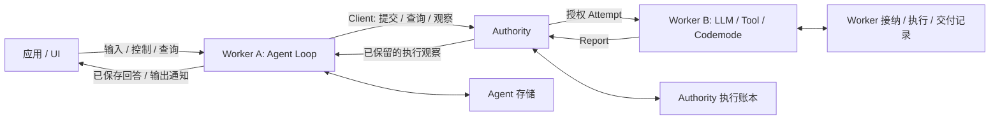

# Beamlet 设计入口

状态: 2026-11-10 确认的目标设计, 为后续实现提供依据. 本目录明确区分领域契约, 实现草案与已有原型; 文档中的目标能力不代表代码已具备该保证.

## 阅读顺序

| 文档 | 回答的问题 |
| --- | --- |
| 本页 | 原语, 分层, 角色, 部署与设计取舍 |
| [Agent 实体与状态](agent-model.md) | Agent 数据, preset, Loop 状态, 创建身份与 fork |
| [Operation 组合与 Agent Loop](operation-composition.md) | Loop, LLM Request, Tool, Codemode 如何关联与完成 |
| [执行 Client 与结果观察](execution-client.md) | Agent 如何提交, 查询和接收 Report, UI 如何查询和接收回答 |
| [持久化与恢复](persistence-recovery.md) | Diesel/SQLite, 异步提交, 故障窗口与恢复限制 |
| [实现顺序与验收](implementation-plan.md) | 当前差距, 前置决策与分阶段验收 |
| [实现任务与提交](implementation-tasks.md) | 最近的小任务, 每项验收与 commit 边界 |

[术语表](../../GLOSSARY.md)定义领域用语. [Node 与角色组合](node-composition.md), [三段回执](receipts.md), [Hello Console](hello-console.md)记录已有原型. [非 Durable 协议 v0](volatile-protocol.md)保留早期里程碑, 其中旧提交接口和旧实现状态不作为新实现依据.

## 核心模型

| 概念 | 职责 |
| --- | --- |
| Operation | 有独立身份的不可变执行请求; 原始输入确定后不因重传或补充输入改变 |
| Attempt | Authority 对某个 Operation 的一次执行授权; 不等于一次消息投递 |
| Report | 关联 Operation/Attempt 的结果与证据; 保留, 采用与业务成功是不同事实 |
| Agent | 独立持久化的实体, 保存配置, 输入, 历史引用与推进状态 |
| Capability / Tool | Capability 定义可执行行为; Tool 是面向 LLM 的调用接口, 两者与 Operation 不要求一一对应 |

Agent 通过自身的 Loop Operation 参与执行, 每次 LLM Request 是其中的独立 Operation, 不称为 Agent 的一次调用. Codemode 的一次代码执行和具体工具调用也可以是 Operation. 相同配置的不同创建请求和 fork 都产生不同 Agent, 不提供用第二个 Loop Operation 再次启动原 Agent 的入口. 不强制一条用户消息对应一个 Loop 或一个 Turn; 执行结束后仍可保存 Agent 数据供审阅和复制.

Agent 采用统一的正常完成规则: 其负责的子 Operation 全部结束, 工具结果已进入后续 LLM 处理, 且没有待提交调用或未处理输入/结果时结束 Loop. 异步工具仍会带来后续 LLM Operation, 期间 Agent 保持未完成. 不增加交互型/任务型分类或按此分类配置结束策略.

```text
Agent A
  -> Loop Operation O / Attempt O1
       -> LLM Request L1 / Report LR1
       -> Codemode C
            -> Tool T1 / Report TR1
            -> Tool T2 / Report TR2
            -> Codemode Report CR
       -> LLM Request L2 / Report LR2
       -> Loop Report OR
```

Report 的外部影响证据类型采用 `ImpactStatus`, 字段采用 `impact`, 不是独立计算原语, 也不表示编程语言的 Effect 系统. 确认无影响, 已观察影响与未知的语义继续保留. 当前代码仍使用 `Effect` 和 `effect`, T3 将统一调整 API 与原型 JSON 字段; 项目处于新建阶段, 不保留旧名称或旧编码兼容层. 执行失败不推导无影响, 执行成功不证明影响仅发生一次.

## 执行底座的状态

| 观察者 | 当前阶段 | 含义与限制 |
| --- | --- | --- |
| Authority | Accepted -> Dispatched -> Reported | 已接纳, 已记录派发, 已收录至少一份 Report; 有效 Report 先到时可直接进入 Reported |
| Worker | Queued -> Running -> Completed | 已接纳等待执行, 已进入执行, 已保存结果; 排队阶段拒绝也可直接 Completed |
| Report | Succeeded / Failed / Rejected | 执行返回输出, 执行失败或执行前拒绝; 与外部影响证据独立 |

这些是不同节点的局部事实, 不能合成一条同步全局状态机. `Dispatched` 不证明 Worker 已接纳, `Reported` 不证明业务成功. 当前 Kernel 的执行前 Rejected 必须带无外部影响结论, 不能把执行后错误伪装成执行前拒绝.

原型的 `WaitStatus::Waiting/TimedOut` 只记录本地等待观察, 不是新的领域生命周期, 也不是 Agent 的 Waiting. 超时后仍可收录 Report, 不自动取消, 改派或重新授权. Agent 的 Processing/Waiting/Suspended 与 Worker Running 可以同时成立: 父执行等待时仍未完成.

## 代码分层

```text
应用入口: Node / Console / UI
  -> 显式选择角色与基础设施, 通过公开接口组装和驱动

beamlet-agent -> beamlet -> beamlet-kernel
存储 / 消息 Adapter -> 对应库接口与领域类型
```

| 模块 | 目标职责 |
| --- | --- |
| Node / Console / UI 应用入口 | 参数与交互输入, 显式选择并组装角色/基础设施, 调用库接口, 展示输出与映射进程退出码 |
| beamlet-kernel | 身份, 执行领域对象, 纯状态规则与证据绑定校验; 不依赖 Agent, 数据库或消息编码 |
| beamlet | 通用执行账本与驱动, Authority/Worker, 提交和观察 Interface; 不理解 LLM Loop 策略 |
| beamlet-agent | Agent 实体, preset/override, Loop 策略, 输入构造, 结果采用与 fork |
| beamlet-agent-tool | 工具及执行环境的集成位置; 不另建授权账本 |
| beamlet-durable / 消息 Adapter | 执行持久化及消息交付的实现; Agent 存储映射由 Agent 层拥有 |

这是目标职责, 不是要求每个 Interface 立刻新增 crate. 独立 Authority/Worker 驱动及可选本地组合 `LocalExecution` 已位于 beamlet, 调用方直接依赖 beamlet, beamlet-agent 不再转导出通用执行入口. 新领域 Agent Loop 尚未实现. 底层不得为了执行 Agent capability 而反向依赖 Agent 模块; 由应用注册或传入执行逻辑.

当前本地组合通过 `LocalExecution::from_parts(authority, worker)` 接管应用创建的角色, 保留已有状态与各自配置; `into_parts` 可取回角色继续独立驱动. 组合动作不启动任务或基础设施, 不补发已有授权, 实例绑定仍在每次交付时校验. `new` 是按显式身份和相同内存上限创建角色的便捷入口, 两种方式使用同一实现.

`beamlet-node` 与 `beamlet-console` 都是库接口的调用者. 通用执行, 提交去重, 回执与重投, 查询与观察合并, Agent 推进, 持久化和协议处理尽量实现在对应库中. 角色构造, 连接绑定和生命周期驱动通过公开接口分别提供, 应用显式选择配置, 组装依赖并把系统信号转换为库的停止请求. Node 组合辅助是可选能力, 不能成为使用独立 Client, Authority 或 Worker 的必经入口.

库接受类型化配置和必要依赖, 完成可复用的配置校验, 返回结构化结果, 错误和观察; CLI 参数解析, 终端交互, 展示及退出码映射留在应用. 调用通用执行能力不要求依赖 Agent 库. 其他应用应能直接通过相同库接口完成相同行为, 无需导入 Node/Console 应用实现或复制其控制流程.

组装关系由应用明确给出: 角色使用哪个 Client/执行器, 本地交付还是消息 Adapter, 哪份存储, 哪个观测性出口. 通用角色逻辑依赖所需能力, 具体 Zenoh, Diesel/SQLite 和遥测实现留在对应 Adapter. 构造角色不隐式创建另一角色, 建立网络连接, 打开数据库或注册全局遥测; 基础设施连接与角色启动由显式调用触发. 缺失必需依赖或模式冲突时返回错误, 不自动换用另一后端.

应用可以传入已有基础设施句柄并决定共享关系. 接口须明确资源由谁持有及何时关闭; 停止一个角色不关闭其他角色仍在使用的连接或存储. 可选组装辅助可以执行应用声明的启动/关闭顺序, 使用者仍能分别使用相同角色与 Adapter 接口.

按实际职责抽取模块, 优先复用已有库, 不为下沉实现预建通用插件框架或机械增加 trait/crate. 库接口的验收覆盖完整行为, 应用测试聚焦装配与交互.

官方持久化以 Diesel + SQLite 为主. 用户可以提供符合契约的后端, 本阶段不设计或实现其他后端. Agent 存储与执行账本逻辑分离, 可以共用数据库与连接管理, 不要求两个数据库或全局事务.

## 角色与部署



Client 是提交和观察能力, 不要求独立服务. Worker 可以同时使用 Client 能力提交子 Operation. Authority 拥有 Operation 权威记录, 不拥有 Agent 的决策状态. Agent Loop 可以在任意获准且能访问其数据和能力的 Worker 上运行; AgentId 不由固定 Worker 位置决定. 新创建或 fork 的 Agent 可在另一 Worker 上执行, 这不表示第二个 Operation 继续原 Agent. 原执行的恢复遵守通用授权规则, 运行中迁移和自动故障接管不在首版承诺内.

Agent 保存已发布回答并提供查询与通知, UI 可以在 Loop 尚未结束时显示回答; 整个 Loop 的结束由最终 Report 表达. 输出查询和通知由 Agent 层提供, 执行 Report 仍由 Authority 保留, 具体约束见 [结果与 UI 输出观察](execution-client.md).

Node 是组装与生命周期容器, 不是另一种执行授权方. 用户分别选择稳定身份, 承载角色以及接入的基础设施. 稳定 NodeId/AuthorityId/WorkerId 可由用户提供或首次生成后保存; 运行实例 ID 每次启动更换. UUID 不是地址, 认证凭证或接管许可.

Zenoh 连接/Router, 数据库, 日志/指标/追踪出口分别配置, 不因为监听网络就自动充当 Router, 不因为连接数据库就成为 Authority. 不接入持久化时须显式标明易失模式. 当前默认 CLI 每次随机生成逻辑身份, 自动保存身份仍待实现.

UI, Agent 执行, Authority, Worker 与存储可以分节点. 远程 SQLite 需要存储服务处理消息并在本地通过 Diesel 完成事务, 不把 SQLite 文件当作可直接消息访问的对象. 首版优先本地组合与本地 SQLite, 不要求建设远程存储服务.

## 通信与调度

同进程使用类型化调用或通道, 保留相同授权和证据检查; 跨进程由 Adapter 编码, Zenoh 为当前主要传输. WIT/Protobuf 只借鉴描述类型和 Interface 的格式, 未决定接入生成器, 编码, gRPC 或 Wasm 工具链.

依赖顺序由事实决定: 请求可以并发接收, 独立 Operation 可以并发执行, 数据库提交可以异步等待. 只有依赖某次提交成功的动作需要等待它. 不把外部执行放入数据库事务, 不让同步数据库操作阻塞消息与 Loop 驱动线程.

不假设所有 Operation 共用一个并发名额池, 不新增组合执行池或容量原语. `await` 保持父 Operation 未完成, 允许接收消息和其他执行继续推进. 具体执行器可以限制 Shell 进程数或 LLM 请求数; 若配置了此类限制, 需避免父执行等待时耗尽子执行必需资源. 这不撤销现有原型的有界队列和记录限制, 也不要求无界创建任务.

本地组合, 长连接和订阅复用, 携带完整 Report 的通知, 独立调用并行以及事务批处理用于降低额外开销. 不要求每次调用依次进行提交, 订阅, 查询三个网络往返. 性能需基准实测, 没有延迟保证或吞吐目标数值.

## 明确的取舍

- 保留统一 Operation/Attempt/Report 表达 Loop 与 Codemode 的执行结果, 不另建 Task 生命周期或强制独立 Tool Reply 账本.
- Agent 独立持久化, 通过 ID 引用执行事实. 不要求 Event Sourcing, Event Bus, Actor 框架, Workflow DSL 或全局分布式事务.
- LLM 上下文是 Agent 选定事实的投影; 不删除原证据, 不让投影规则定义执行实体的生命周期.
- fork 是数据复制与新身份, 没有运行依赖型历史继承链, 不复制活动执行.
- Sub-Agent 与 MCP Sampling 的具体协议暂缓; 统一调用与观察 Interface 不以它们为前提. 不承担 systemd 式服务维持, 任意代码检查点或外部影响 exactly-once 保证.

旧讨论中的"Loop/Turn 一律在 Operation 外", "Codemode 必须使用另一套权威返回记录", `Advancing`, 公开 `AgentRuntime` 实体和强制双执行池均已撤回. 最终状态名采用 `Processing`; 不需要额外的 `WaitingContext` 或独立领域"等待观察状态机".
