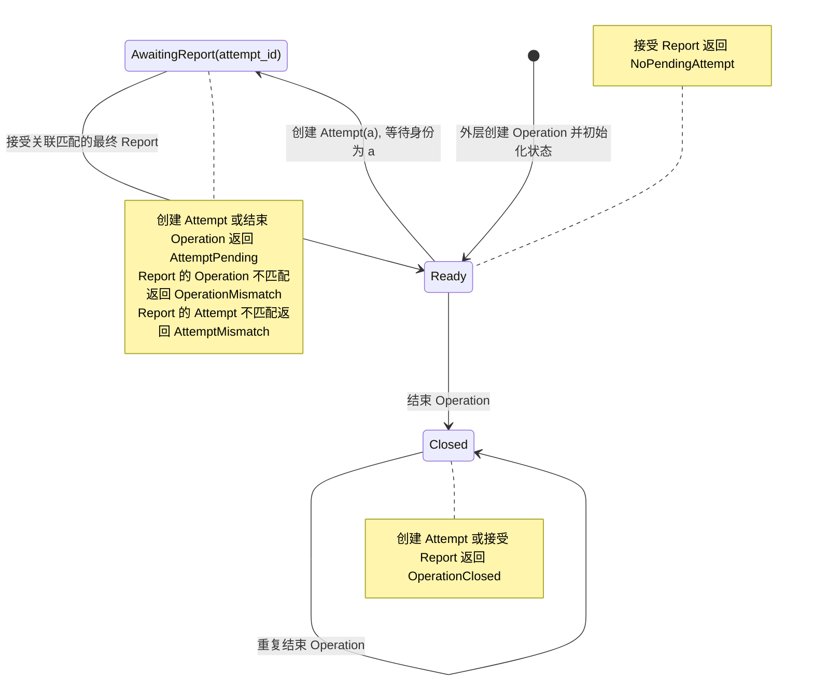
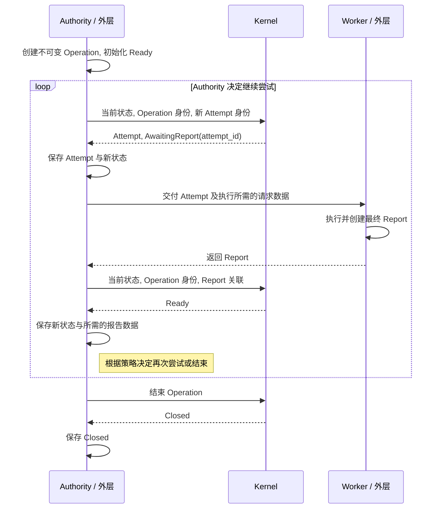

# Beamlet 最小内核规范

本文描述当前最小内核的语义与转换规则, 不限定实现语言.

## 原语

| 原语 | 含义 | 关联 |
| --- | --- | --- |
| Operation | 有独立身份的不可变执行请求, 内容相同不代表同一请求 | 自身身份 |
| Attempt | 针对一个 Operation 的一次执行授权 | 自身身份, Operation 身份 |
| Report | 一次授权执行的结果证据 | 自身身份, Operation 身份, Attempt 身份 |

创建 Attempt 就是创建一次执行授权, 没有独立的授权阶段. 重复交付同一个 Attempt 不会创建新授权.

Authority 与 Worker 的身份, 执行位置及 Attempt 的交付由外层管理.

## 状态

每个 Operation 对应一个由外层保存的生命周期状态. 状态变化不修改 Operation 的原始请求.

| 状态 | 含义 |
| --- | --- |
| Ready | Operation 尚未结束, 当前没有等待最终 Report 的 Attempt |
| AwaitingReport(attempt_id) | 正在等待指定 Attempt 的最终 Report |
| Closed | Operation 已结束 |

Ready 既可以表示尚未创建 Attempt, 也可以表示此前的最终 Report 已被接受. 同一 Operation 最多等待一个 Attempt 的最终 Report.



箭头表示成功转换. 注释框表示拒绝情况, 返回错误并保持原状态. 外层负责保存成功返回的新状态.

## 转换规则

所有转换读取外部提供的当前状态, 返回新状态或错误. 转换不修改输入, 不写入存储. 外层保存成功返回的数据与状态, 并将新状态用于后续转换.

### 创建 Attempt

输入为当前状态, Operation 身份和新的 Attempt 身份.

| 当前状态 | 结果 |
| --- | --- |
| Ready | 返回新的 Attempt 和 AwaitingReport(attempt_id) |
| AwaitingReport(_) | 拒绝, AttemptPending |
| Closed | 拒绝, OperationClosed |

返回的 Attempt 包含传入的自身身份与 Operation 身份. 失败时保留传入的身份, 供调用者取回.

外层保证 Operation 身份与当前状态对应, 并为每次新创建的 Attempt 提供新身份. 内核不保存身份历史, 不检查身份是否曾被使用.

### 接受最终 Report

输入为当前状态, Operation 身份和从最终 Report 提取的 Operation, Attempt 关联.

| 当前状态 | 结果 |
| --- | --- |
| Ready | 拒绝, NoPendingAttempt |
| AwaitingReport(attempt_id) | 校验关联, 匹配时返回 Ready |
| Closed | 拒绝, OperationClosed |

先校验当前状态, 再校验 Operation 关联, 最后校验 Attempt 关联. 返回首个错误.

| 关联不匹配 | 错误 |
| --- | --- |
| Report 的 Operation 身份与当前 Operation 不同 | OperationMismatch |
| Report 的 Attempt 身份与当前等待的 Attempt 不同 | AttemptMismatch |

旧 Attempt 的 Report 不能解除对当前 Attempt 的等待. 保存 Ready 后再次提交同一 Report, 将返回 NoPendingAttempt.

外层保证提交的是最终 Report, 且 Operation 身份与当前状态对应. 内核不检查报告结果内容, 接受报告不表示请求已经完成. 是否再次创建 Attempt 或结束 Operation, 由外层决定.

### 结束 Operation

输入为当前状态.

| 当前状态 | 结果 |
| --- | --- |
| Ready | 返回 Closed |
| AwaitingReport(_) | 拒绝, AttemptPending |
| Closed | 返回 Closed |

结束操作允许重复调用. Closed 状态拒绝创建 Attempt 和接受 Report.

## 执行流程

以下展示转换成功时的逻辑交互. Authority 与 Worker 表示职责, 不限定部署位置或传输方式.



Kernel 返回数据与新状态, 保存由外层完成. 接受最终 Report 后仍可再次创建 Attempt, 结束 Operation 由 Authority 显式决定.

## 内核与外层的职责

| 内核 | 外层 |
| --- | --- |
| 校验状态转换是否合法 | 定义身份类型, 保证唯一性 |
| 校验 Report 的身份关联 | 保存原语数据, 状态及其所属 Operation |
| 返回新状态与创建的 Attempt | 决定何时创建 Attempt, 采用结果或结束 Operation |
| 保持输入不变 | 管理执行位置, 调度, 执行, 传输, 超时与恢复 |

外层负责将状态校验与保存衔接起来. 本规范中的单个等待 Attempt 约束以当前输入状态为依据, 内核本身不提供存储或并发更新机制.

## 当前实现范围

当前内核提供 Attempt, OperationState 和 ReportAssociation, 以及上述三个转换.

ReportAssociation 只包含转换所需的两个关联身份, 不代表完整 Report. 完整的 Operation 请求, Report 身份与结果内容均由外层持有, 当前接口不定义其数据结构.

当前 Rust 实现中, 创建 Attempt 需要克隆 Attempt 身份, 以同时构造 Attempt 和新状态. 接受最终 Report 只需要身份相等比较, 结束 Operation 不要求身份支持克隆或比较. 其他语言可以使用适合自身的数据表示实现相同规则.

## Quint 模型

模型位于 `spec/kernel/`, 原语数据与生命周期状态分开定义.

| 文件 | 职责 |
| --- | --- |
| `operation.qnt` | Operation 身份与不透明请求内容 |
| `attempt.qnt` | Attempt 身份与 Operation 关联 |
| `report.qnt` | Report 身份, 关联与不透明结果内容 |
| `state_machine.qnt` | 三种状态, 三个转换与显式成功或拒绝结果 |
| `tests.qnt` | 场景测试, 有限状态枚举与不变量检查 |

原语构造函数只描述数据形状, 状态机判断动作是否合法. Report 身份与结果内容不参与当前转换判断. Rust 的 ReportAssociation 对应模型中 Report 的两个关联字段.

状态机使用纯函数返回转换结果. 测试中的状态变量模拟外层保存结果, `used` 只记录外层已使用的 Attempt 身份, 不代表内核持有历史.

### 运行检查

```bash
quint typecheck spec/kernel/tests.qnt
quint test spec/kernel/tests.qnt
quint run spec/kernel/tests.qnt --invariant=invariants --max-samples=1000 --max-steps=30 --seed=42 --verbosity=1
quint verify spec/kernel/tests.qnt --backend=tlc --invariant=invariants --max-steps=10 --verbosity=1
```

测试枚举三个生命周期状态形式, 两个 Operation 关联值和三个 Attempt 身份. 模拟器探索随机轨迹, TLC 检查有限模型. 检查性质为拒绝时状态不变, 关闭后不再打开, 创建输出与等待状态一致. 测试另外覆盖报告关联错误的优先级与完整生命周期.

当前检查环境为 Quint 0.33.1. 默认 Apalache 后端报告类型替换错误, 上述验证命令使用已通过检查的 TLC 后端.

规范与 Quint 模型独立于具体实现语言. 检查结果针对模型及其身份取值范围, 各语言实现维护自己的测试.

通过`just check-kernel-model`运行上述全部模型检查
