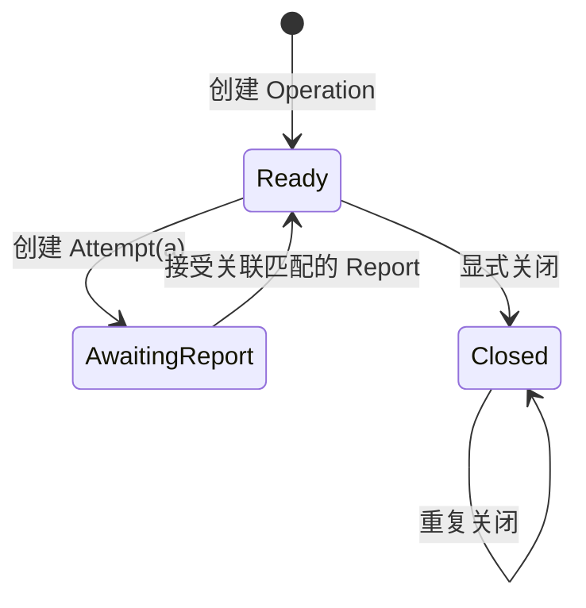
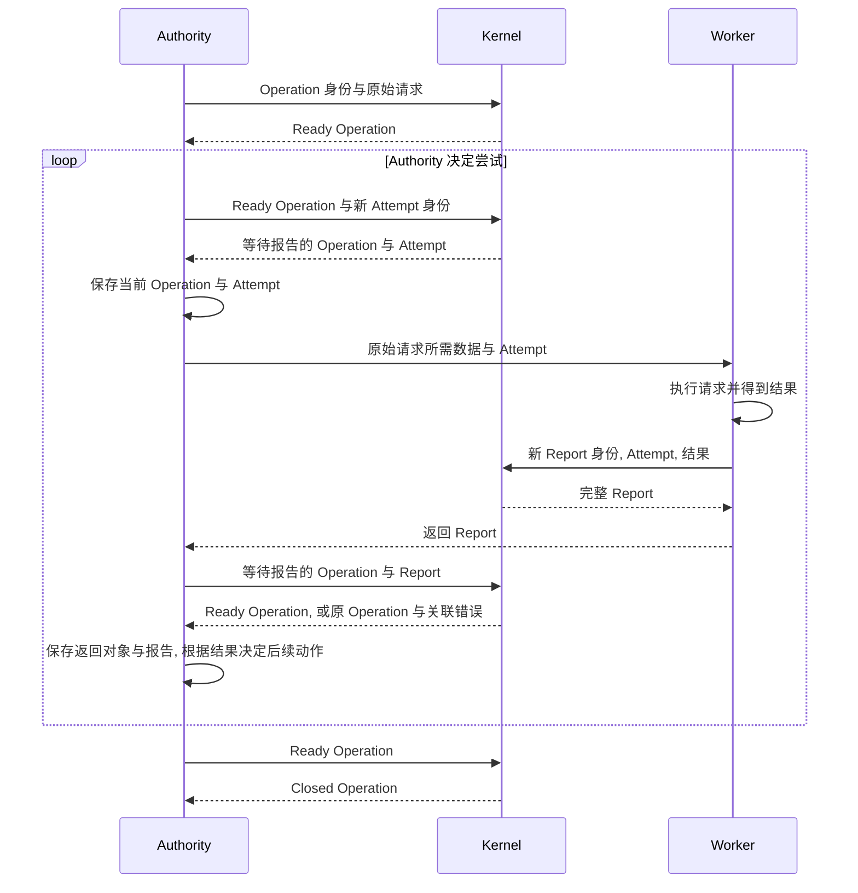

# Beamlet 内核规范

本文定义 Operation, Attempt, Report 的语义与生命周期, 不限定实现语言.

## 原语

| 原语 | 含义 | 数据 |
| --- | --- | --- |
| Operation | 有独立身份的执行请求及其当前生命周期 | 自身身份, 原始请求, 当前状态 |
| Attempt | 针对一个 Operation 的一次执行授权 | 自身身份, Operation 身份 |
| Report | 一次 Attempt 执行结束后的结果证据 | 自身身份, Operation 身份, Attempt 身份, 结果 |

Operation 的身份与原始请求不随生命周期变化. 内容相同而身份不同的 Operation 是不同请求. 请求与结果的业务结构均由调用者定义.

创建 Attempt 就是创建一次执行授权. 重复交付同一个 Attempt 不会创建新授权. 执行结束后使用该 Attempt 生成 Report, 报告保留它的两个引用身份.

## 生命周期

| 状态 | 含义 | 允许的动作 |
| --- | --- | --- |
| Ready | 尚未结束, 没有等待报告的 Attempt | 创建 Attempt, 关闭 |
| AwaitingReport(attempt_id) | 等待指定 Attempt 的报告 | 接受 Report |
| Closed | Operation 已结束 | 重复关闭 |

Ready 可以表示从未尝试, 也可以表示上一份 Report 已被接受. 一个 Operation 同时最多等待一个 Attempt 的 Report.

没有箭头的动作不允许发生. 实现可以在编译期阻止调用, 也可以在运行时拒绝并保留原 Operation.

## 转换规则

每个成功动作返回后续使用的 Operation. 动作不修改它的身份与原始请求, 不执行业务任务或写入存储. 调用者持有并继续使用返回值.

### 创建 Attempt

输入为 Ready Operation 与新的 Attempt 身份. 返回等待该 Attempt 的 Operation 以及 Attempt. Attempt 关联当前 Operation 身份.

调用者保证 Operation 身份唯一, 并为每次新 Attempt 提供未使用的身份. 内核不保存身份历史, 不检查历史重复.

等待报告和已关闭时都不允许创建新的 Attempt.

### 接受 Report

输入为等待报告的 Operation 与完整 Report. 依次校验以下字段, 返回首个不匹配原因:

| 条件 | 拒绝原因 |
| --- | --- |
| Report 的 Operation 身份不同 | OperationMismatch |
| Report 的 Attempt 身份不同于当前等待身份 | AttemptMismatch |

关联匹配时返回 Ready Operation. 不匹配时保留原 Operation, 允许调用者继续等待正确报告. 报告身份与结果内容不参与转换判断, 报告本身不因接受或拒绝而改变.

Ready 和 Closed 不允许接受 Report. 因此同一份报告被接受后, 不能再次解除已经结束的等待. 创建新 Attempt 后, 旧 Report 也不能解除新的等待.

调用者保证报告对应一次已结束的 Attempt. 业务失败的结果仍可被接受. 是否重试或关闭由外层策略决定.

### 关闭

Ready 返回 Closed. Closed 重复关闭仍返回 Closed. AwaitingReport 不允许关闭.

关闭表示显式结束 Operation, 不等同于接受 Report 或判断业务成功.

## Authority 与 Worker 流程

Authority 与 Worker 表示职责, 不限定执行位置, 部署方式或传输机制.

创建报告不自动解除 Authority 的等待. Authority 必须显式接受报告, 接受成功后才能再次创建 Attempt 或关闭.

## 内核与外层职责

| 内核 | 外层 |
| --- | --- |
| 定义三种原语及合法转换 | 定义身份, 请求与结果类型 |
| 关联 Attempt 与 Operation | 生成唯一身份并保存原语 |
| 校验 Report 的两个引用身份 | 保证报告对应已结束的 Attempt |
| 返回后续可用的 Operation | 决定执行, 重试与关闭策略 |

交付, 执行位置, 调度, 持久化, 超时, 恢复与并发更新协调均由外层负责. 内核不保存隐藏历史, 不提供 exactly-once 执行保证.

持久化记录与提交契约见 [持久化方案](persistence.md). 记录类型, 存储接口及以下恢复构造入口已实现; 适配器与应用层恢复编排尚未实现. kernel 不执行存储 IO.

## 当前 Rust 实现

Attempt 与 Report 由无外部依赖的 beamlet-primitives 提供. beamlet-kernel 提供 Operation 并重导出这两个共享原语, 保留原导入方式. Operation 的形式为 `Operation<O, P, S = Ready>`, O 为身份, P 为请求, S 为类型状态. 等待状态是 `AwaitingReport<A>`, A 为当前 Attempt 身份类型.

固定转换图由 state-machines 的同步 typestate 实现, 私有状态机不对外开放. 不合法状态没有对应动作方法.

| 调用 | 返回 |
| --- | --- |
| `Operation::new(operation_id, request)` | `Operation<O, P, Ready>` |
| `operation.create_attempt(attempt_id)` | 等待状态的 Operation 与 Attempt |
| `operation.accept_report(&report)` | Ready Operation; 失败时为持有原 Operation 的 AcceptReportError |
| `operation.close()` | Closed Operation, 支持重复关闭 |
| `Report::new(report_id, attempt, result)` | 保留 Attempt 关联的完整 Report |

转换消费旧 Operation, 调用者接收新对象. 报告不匹配时用 `error.into_operation()` 取回原对象. Operation 不实现 Clone, 状态对象不能由调用者自行构造.

创建 Attempt 要求两个身份支持 Clone, 各克隆一次以供 Operation 与 Attempt 独立持有. 接受报告仅要求身份支持 Eq, 不要求请求, 报告身份或结果支持克隆. 关闭不要求身份支持克隆或比较.

只读导出使用 id(), request(), status(); 等待状态额外读取 pending_attempt_id(). status 只是标签, 不是可任意设置的生命周期状态.

恢复 Ready 使用 Operation::new; 恢复 Closed 使用 Operation::restore_closed; 恢复等待使用 Operation::restore_awaiting_report(id, request, attempt). 等待恢复只校验授权所属 Operation, 不要求 Clone; 关联失败通过 error.into_parts() 归还全部输入.

这些入口不证明持久化历史正确. 日志连续性, 快照一致性和格式版本由外层加载/重放逻辑验证. 恢复不签发新授权或写入新事实.

Attempt::from_parts 用于还原已签发授权数据, 不代表新增授权, 也不证明来源真实性. Attempt 和 Report 均可通过 into_parts 取回字段供外层编码, 不绑定序列化库.

## Quint 模型

模型位于 `spec/kernel/`, 独立于 Rust 库与类型状态表示.

| 文件 | 职责 |
| --- | --- |
| `operation.qnt` | Operation 身份与不可变请求的投影 |
| `attempt.qnt` | Attempt 身份及 Operation 引用 |
| `report.qnt` | Report 身份, 两个引用与结果 |
| `state_machine.qnt` | 三态转换及非法动作的抽象拒绝结果 |
| `tests.qnt` | 有限枚举, 场景测试与不变量 |

模型将 Operation 的不可变数据与生命周期投影分开表示. 这不要求实现暴露独立状态枚举或记录类型. 模型用 Rejected 表示非法动作; Rust 可用方法不可调用来阻止同一动作. 模型的拒绝名称不要求在每种语言中存在对应的运行时错误类型.

核心性质是拒绝时状态不变, 关闭后不再打开, 创建输出与等待状态一致, 接受 Report 时两个引用均匹配且返回 Ready. 测试中的 used 与 reportInput 仅用于检查, 不代表内核持有历史.

运行 `nix develop --command just check-kernel-model` 执行类型检查, 5 个测试, 随机模拟与 TLC 检查. 当前环境使用 Quint 0.33.1, TLC 有限检查范围为两个 Operation 关联值与三个 Attempt 身份; 检查结果不等于所有具体实现自动正确.
